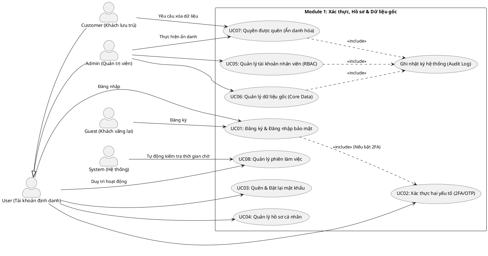

# ĐẶC TẢ USE CASE - MODULE 1: XÁC THỰC, HỒ SƠ & DỮ LIỆU GỐC

Tài liệu này đặc tả chi tiết các Use Case thuộc **Module 1: Xác thực, Hồ sơ & Dữ liệu gốc** của Hệ thống Quản lý Nghỉ dưỡng Tích hợp Kawai Retreat Resort & Hub.

---

## 1. Sơ đồ Use Case (PlantUML Use Case Diagram)

---

## 2. Đặc tả Chi tiết các Use Case (Use Case Specifications)

### UC01: Đăng ký & Đăng nhập bảo mật

| Mục | Nội dung chi tiết |
|---|---|
| **Mã Use Case** | **UC01** |
| **Tên Use Case** | Đăng ký & Đăng nhập bảo mật |
| **Tác nhân (Actors)** | Guest (Đăng ký), User (Đăng nhập) |
| **Mô tả tóm tắt** | Cho phép Khách vãng lai đăng ký tài khoản mới và cho phép người dùng định danh (khách hàng, nhân viên) đăng nhập an toàn vào hệ thống. Mật khẩu được mã hóa một chiều bằng thuật toán BCrypt trước khi lưu trữ. |
| **Điều kiện tiên quyết (Pre-conditions)** | - Khách vãng lai/Người dùng có thiết bị kết nối mạng Internet. - Đối với đăng nhập: Tài khoản đã được kích hoạt và không bị khóa. |
| **Điều kiện sau (Post-conditions)** | - Đăng ký: Tài khoản mới được tạo ở trạng thái "Chờ kích hoạt", email xác nhận được gửi đi. - Đăng nhập: Người dùng được cấp mã phiên làm việc (Session/JWT) tương ứng với vai trò và truy cập vào trang chức năng phù hợp. |
| **Luồng xử lý chính (Basic Flow)** | **A. Đăng ký tài khoản (Guest):** 1. Khách vãng lai nhấn nút "Đăng ký" trên Landing Page. 2. Hệ thống hiển thị biểu mẫu đăng ký (Họ tên, Email, Số điện thoại, Mật khẩu, Nhập lại mật khẩu). 3. Khách nhập thông tin và nhấn "Xác nhận". 4. Hệ thống kiểm tra định dạng và tính duy nhất của Email/Số điện thoại. 5. Hệ thống mã hóa mật khẩu bằng BCrypt, tạo bản ghi tài khoản mới. 6. Hệ thống gửi mã kích hoạt qua Email và thông báo cho Khách kiểm tra email.  **B. Đăng nhập hệ thống (User):** 1. Người dùng truy cập trang Đăng nhập. 2. Nhập Email/Tên tài khoản và Mật khẩu, sau đó nhấn "Đăng nhập". 3. Hệ thống so khớp thông tin mật khẩu sử dụng BCrypt Matcher. 4. Hệ thống kiểm tra cấu hình 2FA của tài khoản (Nếu bật 2FA, chuyển sang UC02). 5. Hệ thống khởi tạo phiên làm việc, lưu lịch sử đăng nhập thành công và điều hướng người dùng tới Dashboard tương ứng với Role (RBAC). |
| **Luồng thay thế (Alternative Flows)** | - **Alt 1 (Đăng nhập lần đầu của nhân viên):** Hệ thống yêu cầu đổi mật khẩu mặc định ngay sau khi đăng nhập thành công lần đầu tiên trước khi cho phép sử dụng hệ thống. |
| **Luồng ngoại lệ (Exception Flows)** | - **Exc 1 (Đăng ký trùng Email/SĐT):** Hệ thống báo lỗi "Email hoặc Số điện thoại đã được đăng ký" và yêu cầu nhập lại. - **Exc 2 (Đăng nhập sai thông tin):** Hệ thống tăng số lần đăng nhập sai của tài khoản lên 1. Nếu số lần đăng nhập sai liên tiếp < 5, hiển thị "Tài khoản hoặc mật khẩu không chính xác". - **Exc 3 (Khóa tài khoản do sai quá 5 lần - BR-SYS-02):** Nếu người dùng nhập sai mật khẩu 5 lần liên tiếp, hệ thống tự động khóa tài khoản trong 15 phút, gửi email thông báo và hiển thị thông tin khóa tài khoản trên màn hình. |
| **Quy tắc nghiệp vụ (Business Rules)** | - Mật khẩu bắt buộc mã hóa bằng BCrypt trước khi lưu database (BR-SYS-01). - Khóa tài khoản sau 5 lần nhập sai trong 15 phút (BR-SYS-02). |

---

### UC02: Xác thực hai yếu tố (2FA/OTP)

| Mục | Nội dung chi tiết |
|---|---|
| **Mã Use Case** | **UC02** |
| **Tên Use Case** | Xác thực hai yếu tố (2FA/OTP) |
| **Tác nhân (Actors)** | User, System (Bộ phận gửi mã OTP) |
| **Mô tả tóm tắt** | Lớp bảo mật bổ sung yêu cầu người dùng nhập mã OTP được gửi qua Email/SMS sau khi vượt qua bước nhập mật khẩu ở UC01. |
| **Điều kiện tiên quyết (Pre-conditions)** | Người dùng đã nhập đúng Email và Mật khẩu ở UC01 và tài khoản đã được kích hoạt chức năng 2FA. |
| **Điều kiện sau (Post-conditions)** | Hệ thống xác thực danh tính người dùng thành công, tạo phiên đăng nhập hợp lệ. |
| **Luồng xử lý chính (Basic Flow)** | 1. Sau bước 3 của UC01, hệ thống nhận diện tài khoản yêu cầu 2FA. 2. Hệ thống tự động tạo mã OTP ngẫu nhiên (6 chữ số). 3. Hệ thống gửi mã OTP tới Email/Số điện thoại của người dùng đã đăng ký (thông qua tích hợp SendGrid/Twilio) và chuyển người dùng đến giao diện nhập mã OTP. 4. Người dùng nhận mã, nhập vào hệ thống và nhấn "Xác nhận". 5. Hệ thống đối chiếu mã OTP người dùng nhập với mã lưu trữ trong bộ nhớ đệm (Cache/Redis) kèm theo thời gian hiệu lực. 6. Mã khớp và còn hiệu lực, hệ thống xác nhận đăng nhập thành công và chuyển đến Dashboard tương ứng. |
| **Luồng thay thế (Alternative Flows)** | - **Alt 1 (Gửi lại mã OTP):** Tại màn hình nhập OTP, sau 60 giây, nếu chưa nhận được mã, người dùng có thể bấm "Gửi lại mã". Hệ thống sẽ vô hiệu hóa mã cũ và gửi mã mới. |
| **Luồng ngoại lệ (Exception Flows)** | - **Exc 1 (Mã OTP hết hạn - BR-SYS-02):** Thời gian từ lúc gửi mã vượt quá 3 phút. Người dùng nhập mã, hệ thống báo lỗi "Mã xác thực đã hết hạn" và yêu cầu gửi mã mới. - **Exc 2 (Nhập sai OTP):** Người dùng nhập sai mã OTP. Hệ thống báo lỗi "Mã xác thực không đúng". Nếu nhập sai quá 3 lần, hệ thống hủy phiên đăng nhập hiện tại và yêu cầu người dùng đăng nhập lại từ đầu (UC01). |
| **Quy tắc nghiệp vụ (Business Rules)** | - Mã Code/OTP gửi qua email/SMS có thời gian hiệu lực tối đa là 3 phút (BR-SYS-02). |

---

### UC03: Quên & Đặt lại mật khẩu

| Mục | Nội dung chi tiết |
|---|---|
| **Mã Use Case** | **UC03** |
| **Tên Use Case** | Quên & Đặt lại mật khẩu |
| **Tác nhân (Actors)** | User, System |
| **Mô tả tóm tắt** | Cho phép người dùng lấy lại quyền truy cập tài khoản khi quên mật khẩu bằng cách gửi một Token đặt lại mật khẩu có giới hạn thời gian qua Email. |
| **Điều kiện tiên quyết (Pre-conditions)** | Người dùng có tài khoản đã đăng ký trên hệ thống và nhớ Email đăng ký. |
| **Điều kiện sau (Post-conditions)** | Mật khẩu mới được cập nhật và lưu trữ dưới dạng mã hóa BCrypt, token đặt lại mật khẩu bị hủy bỏ. |
| **Luồng xử lý chính (Basic Flow)** | 1. Người dùng nhấn liên kết "Quên mật khẩu" tại màn hình đăng nhập. 2. Hệ thống yêu cầu nhập Email đã đăng ký. 3. Người dùng nhập Email và nhấn "Gửi yêu cầu". 4. Hệ thống kiểm tra Email trong cơ sở dữ liệu. Nếu tồn tại, hệ thống tạo một Password Reset Token ngẫu nhiên và lưu trữ kèm thời gian hết hạn (ví dụ: 15 phút) vào database. 5. Hệ thống gửi Email chứa đường dẫn đặt lại mật khẩu kèm Token cho người dùng. 6. Người dùng click vào đường dẫn trong Email. 7. Giao diện Đặt lại mật khẩu mở ra, yêu cầu người dùng nhập Mật khẩu mới và Nhập lại mật khẩu mới. 8. Người dùng nhập thông tin và nhấn "Lưu". 9. Hệ thống kiểm tra tính hợp lệ của Token, mã hóa mật khẩu mới bằng BCrypt, cập nhật cơ sở dữ liệu và vô hiệu hóa Token. |
| **Luồng thay thế (Alternative Flows)** | Không có. |
| **Luồng ngoại lệ (Exception Flows)** | - **Exc 1 (Email không tồn tại):** Hệ thống không hiển thị chi tiết tài khoản lỗi để bảo mật, mà hiển thị thông báo chung: "Nếu email tồn tại trong hệ thống, hướng dẫn đặt lại mật khẩu đã được gửi". - **Exc 2 (Token hết hạn/Không hợp lệ):** Người dùng click vào đường dẫn khi Token đã hết hạn (>15 phút) hoặc bị thay đổi thông tin. Hệ thống hiển thị trang lỗi: "Liên kết đặt lại mật khẩu đã hết hạn hoặc không hợp lệ. Vui lòng gửi lại yêu cầu". |
| **Quy tắc nghiệp vụ (Business Rules)** | - Mật khẩu mới bắt buộc phải tuân thủ quy tắc độ phức tạp (tối thiểu 8 ký tự, có chữ hoa, chữ thường và số). |

---

### UC04: Quản lý hồ sơ cá nhân

| Mục | Nội dung chi tiết |
|---|---|
| **Mã Use Case** | **UC04** |
| **Tên Use Case** | Quản lý hồ sơ cá nhân |
| **Tác nhân (Actors)** | User |
| **Mô tả tóm tắt** | Cho phép người dùng xem, cập nhật thông tin cá nhân của mình. Đối với các thông tin nhạy cảm của khách lưu trú (như số CCCD/Hộ chiếu), hệ thống sẽ tự động mã hóa bằng thuật toán đối xứng AES-256 để bảo vệ quyền riêng tư. |
| **Điều kiện tiên quyết (Pre-conditions)** | Người dùng đã đăng nhập thành công vào hệ thống. |
| **Điều kiện sau (Post-conditions)** | Thông tin cá nhân được cập nhật chính xác trong cơ sở dữ liệu; thông tin CCCD/Hộ chiếu được mã hóa an toàn bằng AES-256. |
| **Luồng xử lý chính (Basic Flow)** | 1. Người dùng truy cập trang "Hồ sơ cá nhân". 2. Hệ thống tải dữ liệu hiện tại từ database. Đối với trường CCCD/Hộ chiếu, hệ thống sử dụng khóa giải mã AES-256 nội bộ để giải mã và hiển thị dạng che một phần (ví dụ: *******1234). 3. Người dùng chọn "Chỉnh sửa thông tin". 4. Nhập các thông tin cần thay đổi (Họ tên, Số điện thoại, Ảnh đại diện, Địa chỉ, Số CCCD/Hộ chiếu mới). 5. Người dùng kiểm tra thông tin và nhấn "Lưu thay đổi". 6. Hệ thống thực hiện kiểm tra định dạng dữ liệu đầu vào. Trường CCCD/Hộ chiếu sẽ được mã hóa bằng AES-256. 7. Hệ thống cập nhật thông tin vào Database và hiển thị thông báo "Cập nhật hồ sơ thành công". |
| **Luồng thay thế (Alternative Flows)** | Không có. |
| **Luồng ngoại lệ (Exception Flows)** | - **Exc 1 (Định dạng dữ liệu không hợp lệ):** Định dạng SĐT hoặc số CCCD không đúng chuẩn quốc gia. Hệ thống báo đỏ tại trường nhập liệu lỗi và ngăn chặn việc lưu dữ liệu. - **Exc 2 (Lỗi giải mã/mã hóa hệ thống):** Nếu phát sinh lỗi trong quá trình mã hóa/giải mã AES, hệ thống ghi log lỗi chi tiết bảo mật và báo lỗi chung cho người dùng: "Không thể xử lý thông tin định danh tại thời điểm này. Vui lòng thử lại sau". |
| **Quy tắc nghiệp vụ (Business Rules)** | - Tất cả thông tin định danh cá nhân nhạy cảm (CCCD, Hộ chiếu) phải được mã hóa đối xứng bằng AES-256 trước khi ghi xuống Database (BR-SYS-01, Nghị định 13/2023/NĐ-CP). |

---

### UC05: Quản lý tài khoản nhân viên (RBAC)

| Mục | Nội dung chi tiết |
|---|---|
| **Mã Use Case** | **UC05** |
| **Tên Use Case** | Quản lý tài khoản nhân viên (CRUD & RBAC) |
| **Tác nhân (Actors)** | Admin |
| **Mô tả tóm tắt** | Cho phép Quản trị viên khởi tạo tài khoản mới cho nhân viên resort, cập nhật thông tin, thay đổi trạng thái hoạt động (khóa/mở khóa) và phân quyền chi tiết dựa trên vai trò (Role-Based Access Control - RBAC). |
| **Điều kiện tiên quyết (Pre-conditions)** | Quản trị viên (Admin) đã đăng nhập thành công vào hệ thống. |
| **Điều kiện sau (Post-conditions)** | - Tài khoản nhân viên mới được tạo, chỉnh sửa thông tin hoặc thay đổi quyền thành công. - Thao tác nhạy cảm này được ghi nhận trực tiếp vào Audit Log. |
| **Luồng xử lý chính (Basic Flow)** | 1. Admin truy cập mục "Quản lý nhân viên". 2. Hệ thống hiển thị danh sách nhân sự hiện tại kèm thông tin Vai trò (Role) và Trạng thái (Hoạt động/Bị khóa). 3. Admin chọn thao tác: **Thêm mới**, **Sửa thông tin** hoặc **Khóa tài khoản**. 4. **Trường hợp thêm mới**: Admin nhập Họ tên, Email công việc, chọn Vai trò (Lễ tân, Buồng phòng, Kỹ thuật, Bếp, F&B Staff, Tour Guide, Manager). 5. Admin nhấn "Lưu". 6. Hệ thống kiểm tra dữ liệu, tự động tạo mật khẩu ngẫu nhiên tạm thời, phân vai trò tương ứng và gửi thông tin tài khoản qua email cho nhân viên mới. 7. Hệ thống tự động ghi nhận hành động này vào **Audit Log** (Người thực hiện: Admin ID, Hành động: Tạo tài khoản nhân viên mới, Thời gian). |
| **Luồng thay thế (Alternative Flows)** | - **Alt 1 (Thu hồi quyền/Khóa tài khoản):** Admin chọn một nhân viên trong danh sách, bấm "Khóa tài khoản". Hệ thống chuyển trạng thái tài khoản thành "Bị khóa" và lập tức chấm dứt mọi phiên hoạt động hiện tại (Session Revoke) của nhân viên đó. |
| **Luồng ngoại lệ (Exception Flows)** | - **Exc 1 (Admin tự khóa chính mình):** Admin chọn khóa tài khoản của chính mình đang đăng nhập. Hệ thống báo lỗi và chặn thao tác: "Không thể tự khóa tài khoản của chính bạn". |
| **Quy tắc nghiệp vụ (Business Rules)** | - Mọi hành động CRUD liên quan đến phân quyền và tài khoản nhân viên phải ghi lại Audit Log vĩnh viễn và không được phép xóa (BR-SYS-04). |

---

### UC06: Quản lý dữ liệu gốc (Core Data)

| Mục | Nội dung chi tiết |
|---|---|
| **Mã Use Case** | **UC06** |
| **Tên Use Case** | Quản lý dữ liệu gốc (Core Data) |
| **Tác nhân (Actors)** | Admin |
| **Mô tả tóm tắt** | Cho phép Quản trị viên cấu hình và quản lý các danh mục dữ liệu nền tảng phục vụ cho toàn hệ thống: Hạng phòng, Các thông số cấu hình resort, Danh mục tour, Thực đơn mẫu, Bảng giá gốc. |
| **Điều kiện tiên quyết (Pre-conditions)** | Quản trị viên (Admin) đã đăng nhập thành công. |
| **Điều kiện sau (Post-conditions)** | Các danh mục dữ liệu gốc được cập nhật chính xác, làm cơ sở dữ liệu để các bộ phận khác (Lễ tân, F&B, Tour) khai thác. |
| **Luồng xử lý chính (Basic Flow)** | 1. Admin truy cập module "Cấu hình hệ thống / Dữ liệu gốc". 2. Chọn danh mục cần quản lý (Hạng phòng, Khách sạn cấu hình, Danh mục món ăn, Dịch vụ đi kèm). 3. Hệ thống hiển thị bảng dữ liệu hiện tại. 4. Admin thực hiện các thao tác thêm mới, sửa đổi thông tin hoặc ngắt kích hoạt danh mục (Soft Delete). 5. Hệ thống kiểm tra ràng buộc dữ liệu (ví dụ: giá phòng không được âm, mã phòng không được trùng). 6. Admin xác nhận lưu dữ liệu. 7. Hệ thống cập nhật database, ghi lại lịch sử chỉnh sửa vào **Audit Log** và đồng bộ cache hệ thống. |
| **Luồng thay thế (Alternative Flows)** | Không có. |
| **Luồng ngoại lệ (Exception Flows)** | - **Exc 1 (Dữ liệu gốc đang được sử dụng ở các module khác):** Admin muốn xóa một Hạng phòng đang có Booking của khách trong tương lai. Hệ thống ngăn chặn việc xóa vật lý và chuyển sang trạng thái "Ngừng kinh doanh" (chỉ áp dụng cho các booking mới, giữ nguyên booking cũ). |
| **Quy tắc nghiệp vụ (Business Rules)** | - Thay đổi bảng giá phòng, giá dịch vụ gốc phải được ghi nhận vào Audit Log (BR-SYS-04). |

---

### UC07: Nghiệp vụ "Quyền được quên" (Ẩn danh hóa dữ liệu)

| Mục | Nội dung chi tiết |
|---|---|
| **Mã Use Case** | **UC07** |
| **Tên Use Case** | Quyền được quên (Ẩn danh hóa thông tin khách hàng) |
| **Tác nhân (Actors)** | Customer (Yêu cầu), Admin (Phê duyệt và Thực thi) |
| **Mô tả tóm tắt** | Đáp ứng tuân thủ Nghị định 13/2023/NĐ-CP về bảo vệ dữ liệu cá nhân. Khách hàng có quyền yêu cầu xóa thông tin cá nhân. Hệ thống thực hiện ẩn danh hóa thông tin định danh (CCCD, SĐT, Email, Tên) nhưng giữ lại số liệu hóa đơn, giao dịch tài chính phục vụ kế toán. |
| **Điều kiện tiên quyết (Pre-conditions)** | - Khách hàng đã thanh toán toàn bộ công nợ và không có booking nào đang hoạt động. - Admin đăng nhập hệ thống để xử lý phê duyệt. |
| **Điều kiện sau (Post-conditions)** | - Các trường định danh trong bảng `Customer` và `User` bị chuyển thành chuỗi vô danh (ví dụ: `ANONYMOUS_USER_1029`). - Hồ sơ giao dịch tài chính, hóa đơn cũ vẫn giữ nguyên tổng tiền nhưng người thanh toán chuyển thành tài khoản ẩn danh. |
| **Luồng xử lý chính (Basic Flow)** | 1. Khách hàng (Customer) gửi yêu cầu "Xóa tài khoản / Quyền được quên" từ trang cá nhân. 2. Hệ thống kiểm tra công nợ và các booking hoạt động. Nếu hợp lệ, chuyển yêu cầu vào trạng thái "Chờ xử lý" và báo cho Admin. 3. Admin kiểm tra danh sách yêu cầu xóa dữ liệu. 4. Admin nhấn nút "Phê duyệt ẩn danh hóa". 5. Hệ thống kích hoạt Database Script thực hiện cập nhật đè các trường thông tin nhạy cảm: Họ tên -> "ANONYMOUS", Email -> "deleted_email_XXX", SĐT -> "0000000000", CCCD -> NULL hoặc mã hóa rác. 6. Tài khoản bị vô hiệu hóa vĩnh viễn. 7. Ghi nhận hành động ẩn danh vào Audit Log (chỉ ghi nhận thời gian và ID tài khoản đã ẩn danh, không ghi lại thông tin gốc trước khi ẩn danh). |
| **Luồng thay thế (Alternative Flows)** | Không có. |
| **Luồng ngoại lệ (Exception Flows)** | - **Exc 1 (Khách hàng còn nợ hoặc booking chưa check-out):** Hệ thống lập tức từ chối yêu cầu tự động và thông báo: "Yêu cầu không thể thực hiện do tài khoản đang có dịch vụ chưa hoàn thành hoặc chưa thanh toán công nợ". |
| **Quy tắc nghiệp vụ (Business Rules)** | - Xóa tài khoản khách hàng bắt buộc phải dùng cơ chế Soft Deletion / Anonymization (Ẩn danh hóa) để bảo toàn lịch sử giao dịch kế toán (BR-SYS-05, Luật Kế toán và Nghị định 13/2023/NĐ-CP). |

---

### UC08: Quản lý phiên làm việc (Session Timeout)

| Mục | Nội dung chi tiết |
|---|---|
| **Mã Use Case** | **UC08** |
| **Tên Use Case** | Quản lý phiên làm việc (Session Timeout) |
| **Tác nhân (Actors)** | System (Tự động kiểm tra), User |
| **Mô tả tóm tắt** | Đảm bảo an toàn thông tin vận hành bằng cách tự động đăng xuất và hủy phiên làm việc của nhân viên resort nếu không phát sinh bất kỳ thao tác nào trên hệ thống sau một khoảng thời gian quy định (15 phút). |
| **Điều kiện tiên quyết (Pre-conditions)** | Nhân viên resort (Lễ tân, Buồng phòng, Quản lý...) đã đăng nhập thành công. |
| **Điều kiện sau (Post-conditions)** | Phiên làm việc bị xóa khỏi bộ nhớ hệ thống (Redis/Session Store), người dùng bị điều hướng về màn hình đăng nhập. |
| **Luồng xử lý chính (Basic Flow)** | 1. Hệ thống giám sát thời gian hoạt động cuối cùng (Last Active Time) của phiên đăng nhập nhân viên. 2. Mỗi khi nhân viên gửi một Request (click chuột, nhập liệu, chuyển trang), hệ thống cập nhật Last Active Time = Thời gian hiện tại. 3. Background Worker của hệ thống chạy ngầm liên tục kiểm tra: Nếu `Thời gian hiện tại - Last Active Time > 15 phút`. 4. Hệ thống thực hiện thu hồi Session / Hủy Token của tài khoản đó. 5. Hệ thống gửi tín hiệu về Frontend (WebSocket/Long polling) để thực hiện đăng xuất ngay lập tức tại trình duyệt và hiển thị thông báo: "Phiên làm việc của bạn đã hết hạn do không hoạt động trong 15 phút. Vui lòng đăng nhập lại". |
| **Luồng thay thế (Alternative Flows)** | - **Alt 1 (Hiển thị cảnh báo trước 1 phút):** Khi thời gian không hoạt động đạt 14 phút, hệ thống hiển thị một Modal đếm ngược: "Bạn đã không hoạt động gần 15 phút. Bạn có muốn duy trì đăng nhập?". Nếu người dùng click "Tiếp tục", Last Active Time được làm mới, phiên làm việc duy trì. |
| **Luồng ngoại lệ (Exception Flows)** | Không có. |
| **Quy tắc nghiệp vụ (Business Rules)** | - Các tài khoản nhân viên bắt buộc phải tự động đăng xuất sau 15 phút không hoạt động để tránh rò rỉ dữ liệu quầy lễ tân/POS (BR-SYS-03). |
