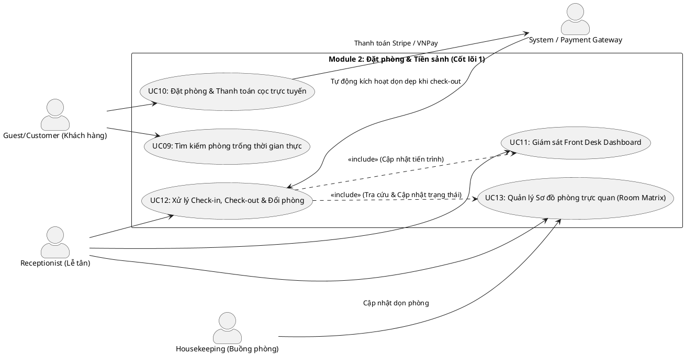

# ĐẶC TẢ USE CASE - MODULE 2: ĐẶT PHÒNG & TIỀN SẢNH

Tài liệu này đặc tả chi tiết các Use Case thuộc **Module 2: Đặt phòng & Tiền sảnh - CỐT LÕI 1** của Hệ thống Quản lý Nghỉ dưỡng Tích hợp Kawai Retreat Resort & Hub.

---

## 1. Sơ đồ Use Case (PlantUML Use Case Diagram)

---

## 2. Đặc tả Chi tiết các Use Case (Use Case Specifications)

### UC09: Tìm kiếm phòng trống thời gian thực

| Mục | Nội dung chi tiết |
|---|---|
| **Mã Use Case** | **UC09** |
| **Tên Use Case** | Tìm kiếm phòng trống thời gian thực |
| **Tác nhân (Actors)** | Guest/Customer, System |
| **Mô tả tóm tắt** | Cho phép khách hàng tìm kiếm các hạng phòng còn trống trong khoảng thời gian lưu trú dự kiến, hiển thị giá phòng động và thông tin phòng tương ứng. |
| **Điều kiện tiên quyết (Pre-conditions)** | Người dùng truy cập vào trang web resort. |
| **Điều kiện sau (Post-conditions)** | Hệ thống hiển thị danh sách các phòng khả dụng khớp với điều kiện tìm kiếm. |
| **Luồng xử lý chính (Basic Flow)** | 1. Người dùng nhập thông tin tìm kiếm phòng bao gồm: Ngày nhận phòng (Check-in date), Ngày trả phòng (Check-out date), Số lượng người lớn, Số lượng trẻ em. 2. Nhấn nút "Tìm kiếm phòng". 3. Hệ thống truy vấn bảng dữ liệu phòng (`Rooms`), hạng phòng (`Room_Types`), các booking đã xác nhận (`Bookings`) và giá phòng theo ngày (`Daily_Rates`). 4. Hệ thống sử dụng thuật toán kiểm tra tính khả dụng để lọc ra các phòng chưa có lịch đặt trùng. 5. Hệ thống tính toán tổng tiền tạm tính dựa trên giá phòng động theo từng ngày cụ thể (Daily Rates). 6. Hệ thống hiển thị danh sách hạng phòng còn trống, kèm hình ảnh, mô tả tiện ích, giá phòng chi tiết và nút "Đặt ngay". |
| **Luồng thay thế (Alternative Flows)** | - **Alt 1 (Áp dụng bộ lọc nâng cao):** Người dùng có thể lọc danh sách kết quả theo: Khoảng giá, Loại giường (King/Twin), Hướng phòng (Hướng biển, hướng vườn), hoặc các dịch vụ đi kèm. Hệ thống tự động cập nhật danh sách hiển thị mà không cần tải lại trang. |
| **Luồng ngoại lệ (Exception Flows)** | - **Exc 1 (Ngày đặt phòng không hợp lệ):** Người dùng chọn ngày check-in trong quá khứ hoặc ngày check-out nhỏ hơn hoặc bằng ngày check-in. Hệ thống báo lỗi và khóa nút tìm kiếm. - **Exc 2 (Không còn phòng trống):** Không có phòng nào đáp ứng yêu cầu. Hệ thống hiển thị thông điệp gợi ý khách hàng thay đổi thời gian hoặc chọn gói combo khác. |
| **Quy tắc nghiệp vụ (Business Rules)** | - Hệ thống bắt buộc dùng cơ chế khóa bi quan hoặc khóa lạc quan (Pessimistic/Optimistic Locking) khi truy vấn phòng trống để tránh ghi đè đồng thời tại bước thanh toán (chống Double-Booking - BR-FO-01). |

---

### UC10: Đặt phòng & Thanh toán cọc trực tuyến

| Mục | Nội dung chi tiết |
|---|---|
| **Mã Use Case** | **UC10** |
| **Tên Use Case** | Đặt phòng & Thanh toán đặt cọc trực tuyến |
| **Tác nhân (Actors)** | Customer, Cổng thanh toán (Stripe/VNPay Sandbox), System |
| **Mô tả tóm tắt** | Khách hàng thực hiện đặt các phòng đã chọn, áp dụng mã giảm giá (nếu có), nhập thông tin khách hàng đi kèm và tiến hành thanh toán cọc trực tuyến để hoàn tất giữ phòng. |
| **Điều kiện tiên quyết (Pre-conditions)** | - Khách hàng đã đăng nhập tài khoản (Customer). - Khách hàng đã chọn phòng trống ở UC09. |
| **Điều kiện sau (Post-conditions)** | - Giao dịch đặt phòng được tạo ở trạng thái "Đã cọc". - Room Matrix cập nhật trạng thái phòng tương ứng sang "Đã giữ chỗ". - Hệ thống gửi email xác nhận đặt phòng và hóa đơn cọc cho khách. |
| **Luồng xử lý chính (Basic Flow)** | 1. Khách hàng nhấn nút "Đặt ngay" tại hạng phòng đã chọn. 2. Hệ thống chuyển sang giao diện thông tin Booking. 3. Khách nhập thông tin liên hệ và danh sách người đi cùng (Dependents - người phụ thuộc). 4. Khách hàng nhập mã giảm giá (nếu có), hệ thống kiểm tra và áp dụng giảm trừ vào tổng tiền. 5. Khách hàng chọn phương thức thanh toán (Thẻ tín dụng qua Stripe hoặc VNPay) và nhấn "Thanh toán đặt cọc". 6. Hệ thống tạm giữ phòng trong 15 phút (Lock room inventory) và điều hướng khách sang trang thanh toán của bên thứ ba. 7. Khách hàng thực hiện thanh toán thành công. 8. Cổng thanh toán gửi Webhook/IPN xác nhận thành công về hệ thống. 9. Hệ thống chuyển trạng thái Booking thành "Confirmed", tạo bản ghi Folio ban đầu, ghi nhận giao dịch đặt cọc và gửi email xác nhận cho khách. |
| **Luồng thay thế (Alternative Flows)** | - **Alt 1 (Hủy đặt phòng trước 48h - BR-FIN-02):** Khách hàng thực hiện yêu cầu hủy phòng trên hệ thống trước giờ check-in 48 giờ. Hệ thống tự động hoàn 100% tiền cọc qua cổng thanh toán và giải phóng phòng. - **Alt 2 (Hủy phòng trong vòng 48h):** Khách hàng hủy phòng trong vòng 48 giờ trước check-in. Hệ thống hủy đặt phòng nhưng giữ lại 100% tiền cọc làm phí phạt hủy phòng muộn. |
| **Luồng ngoại lệ (Exception Flows)** | - **Exc 1 (Hết hạn 15 phút thanh toán - BR-FO-02):** Khách hàng không hoàn tất thanh toán cọc trong vòng 15 phút. Hệ thống tự động chạy cron job giải phóng phòng giữ chỗ và hủy giao dịch đặt phòng. - **Exc 2 (Thanh toán thất bại):** Lỗi giao dịch tại cổng thanh toán. Hệ thống nhận mã lỗi, điều hướng khách về trang booking, hiển thị báo lỗi "Thanh toán thất bại, vui lòng thử lại hoặc chọn phương thức khác" và duy trì thời gian giữ phòng còn lại. |
| **Quy tắc nghiệp vụ (Business Rules)** | - Giữ phòng trực tuyến tối đa 15 phút chờ thanh toán cọc (BR-FO-02). - Hủy phòng trước 48h hoàn cọc 100%; hủy sau 48h hoặc No-show tịch thu cọc (BR-FIN-02). |

---

### UC11: Giám sát Front Desk Dashboard

| Mục | Nội dung chi tiết |
|---|---|
| **Mã Use Case** | **UC11** |
| **Tên Use Case** | Giám sát Front Desk Dashboard |
| **Tác nhân (Actors)** | Receptionist, System |
| **Mô tả tóm tắt** | Cung cấp cho Lễ tân giao diện trung tâm trực quan để giám sát toàn bộ hoạt động tiền sảnh trong ngày vận hành: Danh sách khách sắp đến (Arrivals), khách sắp đi (Departures), danh sách phòng yêu cầu dọn dẹp khẩn cấp (Rush Room). |
| **Điều kiện tiên quyết (Pre-conditions)** | Lễ tân (Receptionist) đã đăng nhập thành công. |
| **Điều kiện sau (Post-conditions)** | Lễ tân nắm bắt toàn bộ dòng vận hành tiền sảnh thời gian thực và xử lý nhanh các tác vụ. |
| **Luồng xử lý chính (Basic Flow)** | 1. Lễ tân truy cập giao diện "Dashboard Tiền sảnh". 2. Hệ thống tải dữ liệu ngày vận hành hiện tại và hiển thị các khối thông tin trực quan:    - Tổng số phòng cần Check-in hôm nay (Arrivals) kèm trạng thái thanh toán.    - Tổng số phòng cần Check-out hôm nay (Departures) kèm trạng thái Folio.    - Số lượng phòng "Rush Room" (Phòng khách yêu cầu check-in sớm, cần dọn dẹp ưu tiên). 3. Lễ tân có thể tương tác trực tiếp: bấm nút xử lý Check-in nhanh từ danh sách Arrivals, hoặc gửi cảnh báo dọn dẹp khẩn cấp cho Housekeeping. 4. Dashboard cập nhật dữ liệu liên tục qua kết nối WebSocket mỗi khi có thay đổi trạng thái từ các bộ phận khác. |
| **Luồng thay thế (Alternative Flows)** | Không có. |
| **Luồng ngoại lệ (Exception Flows)** | - **Exc 1 (Mất kết nối thời gian thực):** Kết nối WebSocket bị gián đoạn. Hệ thống hiển thị cảnh báo nhỏ: "Đang kết nối lại..." và tự động kích hoạt cơ chế fallback (HTTP Polling) mỗi 30 giây để đảm bảo dữ liệu không bị sai lệch quá lâu. |
| **Quy tắc nghiệp vụ (Business Rules)** | Không có. |

---

### UC12: Xử lý Check-in, Check-out & Đổi phòng

| Mục | Nội dung chi tiết |
|---|---|
| **Mã Use Case** | **UC12** |
| **Tên Use Case** | Xử lý Check-in, Check-out & Đổi phòng |
| **Tác nhân (Actors)** | Receptionist, System |
| **Mô tả tóm tắt** | Nghiệp vụ cốt lõi tại quầy tiền sảnh của Lễ tân để thực hiện đăng ký lưu trú cho khách (Check-in), đổi phòng vật lý khi khách có yêu cầu và thực hiện tất toán hóa đơn, giải phóng phòng (Check-out). |
| **Điều kiện tiên quyết (Pre-conditions)** | Lễ tân đã đăng nhập vào hệ thống. |
| **Điều kiện sau (Post-conditions)** | - Check-in: Khách nhận phòng, trạng thái phòng chuyển sang `Occupied`. Giao thông tin đăng ký lưu trú sang cơ quan Công an. - Đổi phòng: Hóa đơn/Folio được chuyển sang phòng mới, cập nhật sơ đồ phòng. - Check-out: Folio được tất toán về 0, trạng thái phòng chuyển sang `Vacant_Dirty`, kích hoạt yêu cầu dọn phòng tự động. |
| **Luồng xử lý chính (Basic Flow)** | **A. Quy trình Check-in:** 1. Khách hàng xuất hiện tại quầy, lễ tân tìm kiếm Booking theo Tên/Mã đặt phòng. 2. Lễ tân yêu cầu xuất trình giấy tờ tùy thân. Sử dụng máy quét hoặc camera quét CCCD/Hộ chiếu của khách đại diện và các khách đi kèm. 3. Hệ thống giải trích thông tin từ giấy tờ, tự động điền vào hồ sơ lưu trú của Booking, mã hóa AES-256. 4. Hệ thống kiểm tra tuổi khách đại diện (phải >= 18 tuổi). 5. Lễ tân chọn số phòng vật lý còn trống có trạng thái `Vacant_Clean` trên Room Matrix và gán cho khách. 6. Lễ tân bàn giao chìa khóa phòng, xác nhận Check-in trên hệ thống.  **B. Quy trình Đổi phòng:** 1. Khách yêu cầu đổi phòng. Lễ tân tra cứu danh sách phòng trống cùng hạng trên Room Matrix. 2. Lễ tân thực hiện đổi phòng trên hệ thống: chọn phòng cũ, chọn phòng mới. 3. Hệ thống tự động chuyển toàn bộ Folio (hóa đơn tích hợp) đang ghi nhận nợ của phòng cũ sang phòng mới. 4. Cập nhật phòng cũ thành `Vacant_Dirty` và phòng mới thành `Occupied`.  **C. Quy trình Check-out:** 1. Khách hàng trả phòng. Lễ tân mở Folio của phòng trên hệ thống. 2. Hệ thống kiểm tra xem có đơn hàng dịch vụ nào từ nhà hàng (F&B), tour tuyến hoặc mini-bar chưa xử lý xong không. 3. Lễ tân xác nhận tất toán công nợ (Folio Balance = 0) sau khi khách thanh toán số tiền còn lại (nếu có) qua tiền mặt/thẻ. 4. Lễ tân nhấn "Xác nhận Check-out". Hệ thống kích hoạt hóa đơn điện tử gửi về email khách, đổi trạng thái phòng vật lý thành `Vacant_Dirty` và tự động tạo phiếu yêu cầu dọn phòng gửi đến bộ phận Housekeeping. |
| **Luồng thay thế (Alternative Flows)** | - **Alt 1 (Yêu cầu Rush Room - BR-FO-05):** Khi check-in sớm mà chưa có phòng `Vacant_Clean`, lễ tân chọn một phòng `Vacant_Dirty` trong danh sách và đánh dấu "Rush Room". Hệ thống sẽ đẩy phòng này lên vị trí ưu tiên số 1 trên màn hình thiết bị của nhân viên buồng phòng. |
| **Luồng ngoại lệ (Exception Flows)** | - **Exc 1 (Khách đại diện dưới 18 tuổi - BR-FO-03):** Thông tin quét CCCD cho thấy khách đại diện dưới 18 tuổi. Hệ thống hiển thị cảnh báo đỏ và ngăn chặn hoàn tất check-in cho đến khi bổ sung thông tin CCCD của người bảo hộ hợp pháp đi cùng. - **Exc 2 (Check-out khi công nợ chưa tất toán - BR-FIN-01):** Lễ tân bấm Check-out khi số dư Folio > 0 hoặc đang có đơn dịch vụ "Đang xử lý". Hệ thống sẽ khóa tính năng Check-out và yêu cầu Lễ tân thanh toán hết hóa đơn hoặc hủy đơn dịch vụ đang xử lý trước. |
| **Quy tắc nghiệp vụ (Business Rules)** | - Khách đại diện check-in phải >= 18 tuổi và có ID hợp lệ (BR-FO-03). - Chỉ check-in vào phòng có trạng thái `Vacant_Clean` (BR-FO-04). - Khóa tính năng Check-out nếu Folio vẫn còn dư nợ hoặc đơn hàng chưa hoàn thành (BR-FIN-01, Quy tắc kinh doanh). - Tự động sinh yêu cầu dọn phòng khi Check-out thành công (Quy tắc nghiệp vụ CSDL). |

---

### UC13: Quản lý Sơ đồ trạng thái phòng vật lý (Room Matrix)

| Mục | Nội dung chi tiết |
|---|---|
| **Mã Use Case** | **UC13** |
| **Tên Use Case** | Quản lý Sơ đồ trạng thái phòng vật lý (Room Matrix) |
| **Tác nhân (Actors)** | Receptionist, Housekeeping, Maintenance, System |
| **Mô tả tóm tắt** | Giao diện trực quan mô phỏng sơ đồ các tầng và số phòng vật lý của resort. Cho phép Lễ tân theo dõi thời gian thực trạng thái phòng, đồng thời cho phép Buồng phòng cập nhật sạch/bẩn và Kỹ thuật cập nhật trạng thái sửa chữa. |
| **Điều kiện tiên quyết (Pre-conditions)** | Tác nhân đã đăng nhập vào hệ thống và có quyền thao tác tương ứng (RBAC). |
| **Điều kiện sau (Post-conditions)** | Trạng thái phòng vật lý được cập nhật đồng bộ tức thời trên hệ thống, phục vụ chính xác cho việc gán phòng check-in. |
| **Luồng xử lý chính (Basic Flow)** | 1. Người dùng truy cập tính năng "Sơ đồ phòng (Room Matrix)". 2. Hệ thống hiển thị sơ đồ lưới biểu diễn các phòng phân theo tầng. Mỗi phòng được tô màu đại diện cho trạng thái hiện tại:    - Xanh lá: `Vacant_Clean` (Trống sạch).    - Đỏ: `Occupied` (Có khách).    - Vàng: `Vacant_Dirty` (Trống bẩn).    - Xám: `Out_of_Service` (Đang sửa chữa/Bảo trì). 3. **Nhân viên Buồng phòng** sau khi dọn xong phòng bẩn, click vào phòng trên sơ đồ và chọn "Cập nhật sạch". Hệ thống cập nhật trạng thái phòng thành `Vacant_Clean`. Sơ đồ của Lễ tân đổi màu xanh lá tức thì. 4. **Nhân viên kỹ thuật** khi tiếp nhận phiếu sửa chữa phòng, cập nhật trạng thái phòng thành `Out_of_Service`. Hệ thống khóa phòng này không cho phép Lễ tân gán check-in. 5. Sau khi sửa chữa xong, kỹ thuật viên cập nhật phòng thành `Vacant_Dirty` để buồng phòng vào dọn dẹp. |
| **Luồng thay thế (Alternative Flows)** | Không có. |
| **Luồng ngoại lệ (Exception Flows)** | - **Exc 1 (Xung đột cập nhật đồng thời):** Lễ tân đang gán phòng check-in cùng lúc Buồng phòng cập nhật trạng thái bẩn/sạch. Hệ thống áp dụng cơ chế khóa dữ liệu (Locking), hiển thị thông báo trạng thái phòng đã thay đổi và yêu cầu tải lại sơ đồ phòng để thao tác chính xác. |
| **Quy tắc nghiệp vụ (Business Rules)** | - Trạng thái phòng phải tuân thủ nghiêm ngặt vòng đời: Vacant_Clean → Occupied → Vacant_Dirty → Vacant_Clean (BR-FO-04). |
