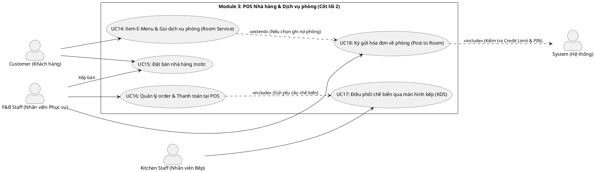

# ĐẶC TẢ USE CASE - MODULE 3: POS NHÀ HÀNG & DỊCH VỤ PHÒNG

Tài liệu này đặc tả chi tiết các Use Case thuộc **Module 3: POS Nhà hàng & Dịch vụ phòng - CỐT LÕI 2** của Hệ thống Quản lý Nghỉ dưỡng Tích hợp Kawai Retreat Resort & Hub.

---

## 1. Sơ đồ Use Case (PlantUML Use Case Diagram)

---

## 2. Đặc tả Chi tiết các Use Case (Use Case Specifications)

### UC14: Xem E-Menu & Gọi dịch vụ phòng (Room Service)

| Mục | Nội dung chi tiết |
|---|---|
| **Mã Use Case** | **UC14** |
| **Tên Use Case** | Xem E-Menu & Gọi dịch vụ phòng (Room Service) |
| **Tác nhân (Actors)** | Customer, System |
| **Mô tả tóm tắt** | Khách đang lưu trú tại phòng quét mã QR phòng hoặc sử dụng ứng dụng để xem thực đơn điện tử (E-Menu) thời gian thực của resort và đặt đồ ăn/đồ uống giao tận phòng. |
| **Điều kiện tiên quyết (Pre-conditions)** | Khách hàng đã nhận phòng thành công (trạng thái phòng là `Occupied`) và truy cập giao diện khách hàng. |
| **Điều kiện sau (Post-conditions)** | Đơn đặt Room Service được gửi thành công đến bộ phận F&B và KDS nhà bếp để chế biến. |
| **Luồng xử lý chính (Basic Flow)** | 1. Khách hàng truy cập mục "Dịch vụ phòng / E-Menu" trên thiết bị cá nhân. 2. Hệ thống tải thực đơn từ Database, lọc bỏ các món được Bếp báo hết (theo UC17). 3. Khách duyệt danh sách, chọn món ăn, số lượng và thêm ghi chú chế biến (ví dụ: không cay). 4. Khách hàng xác nhận số phòng và chọn phương thức thanh toán:    - Thanh toán trực tiếp qua Stripe/VNPay.    - Ký gửi hóa đơn vào tài khoản phòng (Post to Room - chuyển sang UC18). 5. Sau khi xác thực thanh toán thành công (hoặc ký gửi thành công), hệ thống sinh đơn hàng Room Service. 6. Hệ thống phân tách đơn hàng và đẩy danh sách món trực tiếp lên màn hình KDS của Bếp (UC17) đồng thời thông báo cho nhân viên phục vụ phòng chuẩn bị dụng cụ. |
| **Luồng thay thế (Alternative Flows)** | Không có. |
| **Luồng ngoại lệ (Exception Flows)** | - **Exc 1 (Phòng trống - không thể đặt Room Service):** Khách hàng cố tình nhập số phòng trống hoặc phòng đã check-out. Hệ thống báo lỗi: "Số phòng không hợp lệ hoặc không có khách lưu trú. Vui lòng liên hệ Lễ tân". - **Exc 2 (Món ăn hết đột ngột tại thời điểm đặt):** Khách hàng gửi đơn hàng nhưng trong lúc đó đầu bếp vừa cập nhật hết món. Hệ thống hiển thị thông báo: "Món [Tên Món] đã hết. Vui lòng chọn món khác". |
| **Quy tắc nghiệp vụ (Business Rules)** | - Thực đơn E-Menu phải đồng bộ tức thời trạng thái "Hết món" từ KDS nhà bếp để tránh khách đặt phải món không còn nguyên liệu (BR-FB-02). |

---

### UC15: Đặt bàn nhà hàng trước

| Mục | Nội dung chi tiết |
|---|---|
| **Mã Use Case** | **UC15** |
| **Tên Use Case** | Đặt bàn nhà hàng trước |
| **Tác nhân (Actors)** | Customer, F&B Staff (Nhân viên tiếp đón/xếp bàn), System |
| **Mô tả tóm tắt** | Cho phép khách hàng đặt chỗ trước tại nhà hàng của resort (chọn thời gian, số lượng người, vị trí bàn mong muốn). Nhân viên nhà hàng xác nhận và xếp bàn vật lý tương ứng. |
| **Điều kiện tiên quyết (Pre-conditions)** | Khách hàng có tài khoản hệ thống (hoặc nhân viên hỗ trợ đặt qua điện thoại). |
| **Điều kiện sau (Post-conditions)** | Trạng thái bàn ăn chuyển sang "Đã đặt trước" trong khung giờ yêu cầu. Hệ thống gửi mã đặt bàn cho khách. |
| **Luồng xử lý chính (Basic Flow)** | 1. Khách hàng chọn mục "Đặt bàn nhà hàng" trên ứng dụng. 2. Chọn Nhà hàng, ngày đặt bàn, khung giờ dự kiến và số lượng khách. 3. Hệ thống kiểm tra sơ đồ bàn trống khả dụng trong khung giờ đó. 4. Khách hàng lựa chọn khu vực mong muốn (trong nhà, ngoài trời, phòng VIP) và gửi yêu cầu. 5. Hệ thống ghi nhận trạng thái đặt bàn, gán mã đặt bàn (Reservation Code). 6. Tại nhà hàng, nhân viên F&B xem danh sách đặt bàn trên màn hình điều phối, chuẩn bị bàn vật lý và cập nhật trạng thái "Đã setup" khi khách chuẩn bị đến. |
| **Luồng thay thế (Alternative Flows)** | - **Alt 1 (Hủy giữ bàn tự động sau 30 phút - BR-FB-03):** Nếu khách hàng không đến đúng giờ hẹn quá 30 phút, hệ thống tự động chạy cron job giải phóng bàn đó về trạng thái trống (Vacant) để phục vụ khách vãng lai. |
| **Luồng ngoại lệ (Exception Flows)** | - **Exc 1 (Không còn bàn trống):** Vào khung giờ khách chọn, nhà hàng đã kín chỗ. Hệ thống hiển thị cảnh báo đỏ và gợi ý các khung giờ lân cận hoặc danh sách bàn chờ (Waiting List). |
| **Quy tắc nghiệp vụ (Business Rules)** | - Bàn đặt trước được giữ tối đa 30 phút sau giờ hẹn, quá thời gian tự động giải phóng bàn (BR-FB-03). |

---

### UC16: Tạo đơn & Thanh toán tại POS

| Mục | Nội dung chi tiết |
|---|---|
| **Mã Use Case** | **UC16** |
| **Tên Use Case** | Tạo đơn & Thanh toán tại POS |
| **Tác nhân (Actors)** | F&B Staff, System |
| **Mô tả tóm tắt** | Nhân viên phục vụ tại bàn sử dụng thiết bị POS cầm tay/máy POS cố định để mở bàn, nhập order của khách, gửi yêu cầu chế biến xuống bếp và thực hiện thanh toán trực tiếp tại chỗ. |
| **Điều kiện tiên quyết (Pre-conditions)** | Nhân viên phục vụ (F&B Staff) đã đăng nhập vào hệ thống POS. |
| **Điều kiện sau (Post-conditions)** | - Đơn hàng được lưu trữ, doanh thu ghi nhận vào nguồn thu F&B. - Trạng thái bàn ăn chuyển về trống (Clean/Vacant) sau khi hoàn tất thanh toán. |
| **Luồng xử lý chính (Basic Flow)** | 1. Nhân viên phục vụ chọn số bàn trên giao diện sơ đồ bàn POS. 2. Nhân viên nhấn "Mở bàn" và nhập món ăn khách yêu cầu trực tiếp từ danh mục món hiển thị trên POS. 3. Sau khi nhập xong, nhân viên bấm "Gửi Bếp". Hệ thống tự động in phiếu chế biến hoặc truyền tin điện tử xuống hệ thống KDS của Bếp (UC17) dưới dạng vé KOT (Kitchen Order Ticket). 4. Khi khách yêu cầu thanh toán, nhân viên bấm "Tất toán đơn" trên POS. 5. Hệ thống in hóa đơn tạm tính kèm VAT và phí dịch vụ. 6. Khách hàng thanh toán bằng tiền mặt hoặc thẻ ngân hàng. 7. Nhân viên cập nhật phương thức thanh toán và nhấn "Hoàn tất". Hệ thống in hóa đơn tài chính, ghi nhận doanh thu và chuyển trạng thái bàn ăn sang "Cần dọn dẹp". |
| **Luồng thay thế (Alternative Flows)** | - **Alt 1 (Gộp bàn / Chuyển bàn):** Khách yêu cầu chuyển sang bàn khác hoặc gộp hóa đơn với bàn bên cạnh. Nhân viên phục vụ chọn chức năng tương ứng trên POS, hệ thống cập nhật lại sơ đồ bàn và dồn các món ăn vào chung một hóa đơn. |
| **Luồng ngoại lệ (Exception Flows)** | - **Exc 1 (Lỗi kết nối máy in hóa đơn/máy POS):** Thiết bị POS mất kết nối mạng cục bộ. Hệ thống chuyển sang chế độ hoạt động ngoại tuyến (Offline mode), lưu đơn tạm vào bộ nhớ thiết bị và tự động đồng bộ lên máy chủ khi có mạng trở lại. |
| **Quy tắc nghiệp vụ (Business Rules)** | - Việc tách biệt xử lý dữ liệu giữa POS và bếp là bắt buộc để tránh xung đột dữ liệu khi nhân viên phục vụ sửa đơn hàng cùng lúc bếp đang chế biến. |

---

### UC17: Điều phối chế biến qua màn hình bếp (KDS)

| Mục | Nội dung chi tiết |
|---|---|
| **Mã Use Case** | **UC17** |
| **Tên Use Case** | Điều phối chế biến qua màn hình bếp (Kitchen Display System - KDS) |
| **Tác nhân (Actors)** | Kitchen Staff, System |
| **Mô tả tóm tắt** | Hiển thị danh sách các món ăn cần chế biến theo thời gian thực cho đầu bếp. Đầu bếp có thể cập nhật trạng thái chế biến cho từng món ăn cụ thể và báo cáo nhanh khi một món ăn hết nguyên liệu để khóa món trên POS. |
| **Điều kiện tiên quyết (Pre-conditions)** | Đầu bếp (Kitchen Staff) đã đăng nhập hệ thống KDS đặt tại khu vực bếp. |
| **Điều kiện sau (Post-conditions)** | - Trạng thái từng món ăn (`KOT Status`) được cập nhật trực tiếp trên hệ thống POS của phục vụ. - Món ăn hết nguyên liệu bị ẩn lập tức trên E-Menu và POS. |
| **Luồng xử lý chính (Basic Flow)** | 1. Hệ thống KDS nhận thông tin món ăn từ POS (UC16) hoặc Room Service (UC14). 2. Màn hình KDS hiển thị các thẻ món ăn (KOT) xếp theo thứ tự thời gian đặt hoặc độ ưu tiên (VIP/Room Service). 3. Khi bắt đầu chế biến một món, đầu bếp click vào món đó và chuyển trạng thái sang "Đang chế biến" (`Preparing`). Hệ thống đồng bộ thông tin này về POS để nhân viên phục vụ theo dõi. 4. Khi hoàn thành món ăn, đầu bếp click chuyển sang "Đã xong" (`Ready`). Hệ thống thông báo cho nhân viên chạy bàn đến lấy đồ. 5. Trong quá trình vận hành, nếu phát hiện nguyên liệu của một món ăn đã hết, đầu bếp click vào danh mục món trên KDS và chọn "Báo hết món". 6. Hệ thống thực hiện truyền phát thời gian thực (Real-time Broadcast) khóa món ăn đó trên tất cả các POS và giao diện đặt đồ của khách. |
| **Luồng thay thế (Alternative Flows)** | Không có. |
| **Luồng ngoại lệ (Exception Flows)** | Không có. |
| **Quy tắc nghiệp vụ (Business Rules)** | - Cho phép bếp báo hoàn thành từng món ăn riêng lẻ (tại bảng `Food_Order_Details`) thay vì phải đợi hoàn thành toàn bộ đơn hàng nhằm tối ưu hóa thời gian phục vụ (Quy tắc thiết kế KOT). |

---

### UC18: Ký gửi hóa đơn về phòng (Post to Room / Room Charge)

| Mục | Nội dung chi tiết |
|---|---|
| **Mã Use Case** | **UC18** |
| **Tên Use Case** | Ký gửi hóa đơn về phòng (Post to Room / Room Charge) |
| **Tác nhân (Actors)** | F&B Staff, Customer, System |
| **Mô tả tóm tắt** | Cho phép khách hàng không cần trả tiền mặt/thẻ ngay tại nhà hàng hoặc khi gọi dịch vụ phòng mà chọn ghi nhận chi phí vào Hóa đơn tổng hợp (Folio) của phòng mình và thanh toán một lần khi Check-out. |
| **Điều kiện tiên quyết (Pre-conditions)** | - Phòng của khách hàng đang ở trạng thái `Occupied` (đã check-in). - Khách hàng đã thiết lập mã PIN bảo mật Folio lúc check-in. |
| **Điều kiện sau (Post-conditions)** | Chi phí đơn hàng được cộng dồn trực tiếp vào số dư nợ của Folio phòng tương ứng. Trạng thái đơn hàng F&B chuyển thành "Đã ký gửi phòng". |
| **Luồng xử lý chính (Basic Flow)** | 1. Tại bước thanh toán của UC16 (hoặc xác nhận của UC14), khách hàng yêu cầu "Ký gửi về phòng" (Post to Room). 2. Nhân viên phục vụ nhập số phòng của khách trên POS. 3. Hệ thống kiểm tra trạng thái phòng vật lý trong Database:    - Xác nhận phòng đang `Occupied`.    - Lấy thông tin Tên khách đại diện đăng ký phòng đó hiển thị lên POS để đối chiếu. 4. Khách hàng xác nhận tên mình và nhập mã PIN xác thực giao dịch trên thiết bị POS của nhân viên (hoặc thiết bị cá nhân). 5. Hệ thống xác thực mã PIN khớp, đồng thời kiểm tra Hạn mức nợ (Credit Limit) của phòng. 6. Nếu hạn mức nợ còn đủ, hệ thống tự động ghi nhận mã Booking phòng vào hóa đơn F&B, cộng dồn số tiền đơn hàng vào tài khoản Folio của phòng. 7. Hệ thống in biên lai xác nhận ký gửi có chữ ký điện tử hoặc chữ ký vật lý của khách lưu trữ làm đối chứng. |
| **Luồng thay thế (Alternative Flows)** | Không có. |
| **Luồng ngoại lệ (Exception Flows)** | - **Exc 1 (Phòng chưa Check-in hoặc đã Check-out - BR-FB-01):** Số phòng nhập vào không có khách ở. Hệ thống báo lỗi "Phòng không ở trạng thái lưu trú" và từ chối ký gửi. - **Exc 2 (Vượt quá hạn mức nợ - Credit Limit - BR-SYS-06):** Số dư nợ hiện tại cộng thêm đơn hàng F&B vượt quá hạn mức nợ tối đa cho phép của phòng (ví dụ: 10,000,000 VND). Hệ thống từ chối ký gửi và thông báo: "Giao dịch bị từ chối do vượt hạn mức công nợ phòng. Vui lòng thanh toán trực tiếp hoặc liên hệ Lễ tân để nâng hạn mức". - **Exc 3 (Sai mã PIN):** Khách hàng nhập sai mã PIN xác thực. Hệ thống hiển thị: "Mã PIN không chính xác. Bạn còn 2 lần thử". Nếu sai quá 3 lần, tính năng ký gửi của phòng này tạm thời bị khóa. |
| **Quy tắc nghiệp vụ (Business Rules)** | - Chỉ được phép ký gửi hóa đơn ăn uống vào các phòng đang có khách lưu trú thực tế (Occupied) (BR-FB-01). - Bắt buộc kiểm tra mã PIN và hạn mức nợ (Credit Limit) trước khi cho phép ghi nợ Folio (BR-FB-01, Database Triggers). |
