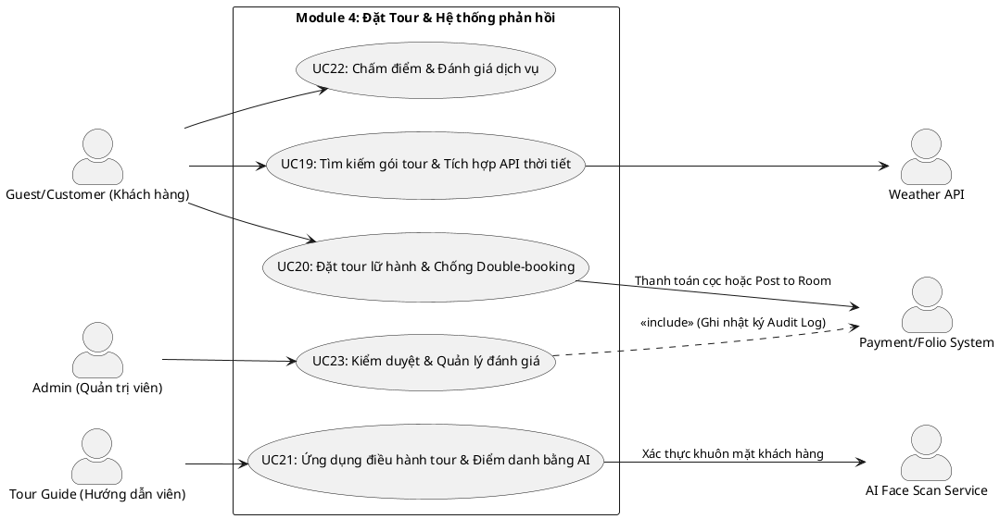

# ĐẶC TẢ USE CASE - MODULE 4: ĐẶT TOUR & HỆ THỐNG PHẢN HỒI

Tài liệu này đặc tả chi tiết các Use Case thuộc **Module 4: Đặt Tour & Hệ thống phản hồi** của Hệ thống Quản lý Nghỉ dưỡng Tích hợp Kawai Retreat Resort & Hub.

---

## 1. Sơ đồ Use Case (PlantUML Use Case Diagram)

---

## 2. Đặc tả Chi tiết các Use Case (Use Case Specifications)

### UC19: Tìm kiếm gói tour & Tích hợp API thời tiết

| Mục | Nội dung chi tiết |
|---|---|
| **Mã Use Case** | **UC19** |
| **Tên Use Case** | Tìm kiếm gói tour & Tích hợp API thời tiết |
| **Tác nhân (Actors)** | Guest/Customer, Weather API (OpenWeather), System |
| **Mô tả tóm tắt** | Cho phép khách hàng tìm kiếm các chương trình du lịch, trải nghiệm địa phương do resort tổ chức, đồng thời xem dự báo thời tiết thời gian thực tại điểm đến để lên lịch trình phù hợp. |
| **Điều kiện tiên quyết (Pre-conditions)** | Người dùng truy cập trang thông tin tour của resort. |
| **Điều kiện sau (Post-conditions)** | Danh sách gói tour phù hợp kèm theo tình trạng thời tiết tại địa phương được hiển thị trực quan. |
| **Luồng xử lý chính (Basic Flow)** | 1. Người dùng truy cập mục "Khám phá Tour lữ hành". 2. Hệ thống gọi API thời tiết (OpenWeather Map) lấy thông tin dự báo thời tiết 3-5 ngày tới tại khu vực resort và các điểm tham quan. 3. Hệ thống hiển thị widget thời tiết nổi bật (Nhiệt độ, Khả năng mưa, Cảnh báo thời tiết xấu nếu có). 4. Người dùng nhập từ khóa tìm kiếm hoặc lọc tour theo: Loại hình (Mạo hiểm, Văn hóa, Nghỉ dưỡng), Khoảng thời gian, Số lượng chỗ. 5. Hệ thống truy vấn cơ sở dữ liệu bảng `Tours` và `Tour_Schedules` đang hoạt động. 6. Hiển thị danh sách tour, lịch trình chi tiết, số chỗ còn trống, giá vé và khuyến cáo thời tiết tương thích với tour (ví dụ: tour lặn biển khuyến cáo không đi vào ngày có giông bão). |
| **Luồng thay thế (Alternative Flows)** | Không có. |
| **Luồng ngoại lệ (Exception Flows)** | - **Exc 1 (API Thời tiết bị lỗi/mất kết nối):** Hệ thống không thể tải dữ liệu thời tiết. Hệ thống bỏ qua widget thời tiết, hiển thị danh mục tour bình thường và ghi log lỗi hệ thống để tránh làm gián đoạn trải nghiệm của khách. |
| **Quy tắc nghiệp vụ (Business Rules)** | Không có. |

---

### UC20: Đặt tour lữ hành & Chống Double-booking

| Mục | Nội dung chi tiết |
|---|---|
| **Mã Use Case** | **UC20** |
| **Tên Use Case** | Đặt tour lữ hành & Chống Double-booking |
| **Tác nhân (Actors)** | Customer, Payment/Folio System, System |
| **Mô tả tóm tắt** | Khách hàng thực hiện đặt chỗ tham gia tour cho mình và người đi cùng, tiến hành thanh toán trực tuyến hoặc ký gửi chi phí vào hóa đơn phòng (Post to Room). Hệ thống áp dụng cơ chế khóa dữ liệu để ngăn chặn bán quá tải chỗ trống (Overbooking). |
| **Điều kiện tiên quyết (Pre-conditions)** | - Khách hàng đã đăng nhập tài khoản (Customer). - Tour còn trống chỗ đáp ứng đủ số lượng người đăng ký. |
| **Điều kiện sau (Post-conditions)** | - Trạng thái đặt tour là "Thành công". Số chỗ trống của lịch trình tour giảm đi tương ứng. - Danh sách người tham gia được cập nhật vào bảng `Tour_Attendees` để phục vụ điểm danh. - Nếu khách chọn Post to Room, Folio phòng được ghi nhận tăng số dư nợ tương ứng. |
| **Luồng xử lý chính (Basic Flow)** | 1. Khách hàng bấm nút "Đặt Tour" tại lịch trình đã chọn. 2. Nhập số lượng người tham gia, chọn danh sách khách đi kèm từ danh sách người phụ thuộc (`Dependents`) hoặc nhập thông tin khách mới (Họ tên, ảnh chân dung để điểm danh AI). 3. Khách hàng lựa chọn phương thức thanh toán:    - Thanh toán trực tuyến (cọc hoặc 100%) qua cổng thanh toán.    - Ghi nợ vào phòng (Post to Room) -> Hệ thống gọi quy trình xác thực mã PIN và hạn mức nợ của phòng (UC18). 4. Hệ thống áp dụng Database Lock (Pessimistic Lock - SELECT ... FOR UPDATE) trên bản ghi `Tour_Schedules` để khóa tạm thời số ghế trống trong lúc giao dịch diễn ra. 5. Xác nhận giao dịch thành công. 6. Hệ thống tạo hóa đơn đặt tour, cập nhật bảng `Tour_Attendees`, gửi vé điện tử (QR Code) và lịch trình tour qua email cho khách. |
| **Luồng thay thế (Alternative Flows)** | - **Alt 1 (Tự động hủy lịch trình do thiếu người - BR-FIN-05):** Trước 24h khởi hành, nếu số lượng khách đặt thực tế thấp hơn số lượng tối thiểu quy định (Min Participants) của tour, hệ thống tự động chạy tác vụ hủy tour, gửi email xin lỗi khách hàng và hoàn tiền 100% tiền cọc tự động qua cổng thanh toán (hoặc trừ nợ trên Folio phòng nếu trước đó ký gửi phòng). |
| **Luồng ngoại lệ (Exception Flows)** | - **Exc 1 (Vượt quá số chỗ còn lại - BR-TR-01):** Số khách đăng ký lớn hơn số chỗ trống thực tế. Hệ thống hiển thị cảnh báo đỏ và ngăn chặn tạo đặt chỗ: "Xin lỗi, tour chỉ còn lại X chỗ trống". |
| **Quy tắc nghiệp vụ (Business Rules)** | - Tổng số người đặt tour không được vượt quá số ghế thiết kế tối đa của phương tiện/lịch trình (BR-TR-01). - Tự động hủy lịch trình và hoàn tiền 100% nếu không đạt số lượng người tối thiểu trước 24h khởi hành (BR-FIN-05). |

---

### UC21: Ứng dụng điều hành tour & Điểm danh bằng AI

| Mục | Nội dung chi tiết |
|---|---|
| **Mã Use Case** | **UC21** |
| **Tên Use Case** | Ứng dụng điều hành tour & Điểm danh bằng AI |
| **Tác nhân (Actors)** | Tour Guide, AI Face Scan Service, System |
| **Mô tả tóm tắt** | Hướng dẫn viên sử dụng ứng dụng di động để quản lý lịch trình tour được phân công, xem danh sách hành khách (Manifest), thực hiện điểm danh tự động bằng cách quét khuôn mặt khách đối chiếu dữ liệu đăng ký bằng AI, và báo cáo sự cố phát sinh. |
| **Điều kiện tiên quyết (Pre-conditions)** | - Hướng dẫn viên (Tour Guide) đã đăng nhập vào ứng dụng dành cho nhân viên. - Lịch trình tour đã đến thời gian tập trung khởi hành. |
| **Điều kiện sau (Post-conditions)** | Trạng thái điểm danh của từng hành khách được cập nhật (Có mặt/Vắng mặt) trên cơ sở dữ liệu. |
| **Luồng xử lý chính (Basic Flow)** | 1. Hướng dẫn viên truy cập danh mục "Lịch trình của tôi", chọn tour hiện tại. 2. Hệ thống hiển thị bảng Manifest danh sách khách hàng tham gia (`Tour_Attendees`) kèm ảnh đăng ký gốc. 3. Tại điểm tập trung, Hướng dẫn viên nhấn nút "Điểm danh AI Face Scan" và hướng camera điện thoại về phía khách hàng. 4. Ứng dụng chụp ảnh khuôn mặt khách và gửi dữ liệu ảnh (Base64) đến Microservice FastAPI AI xử lý nhận diện khuôn mặt. 5. AI Service tính toán vectơ đặc trưng khuôn mặt, đối chiếu với ảnh gốc và trả về kết quả độ khớp (Similarity Score). 6. Nếu độ khớp >= 85%, hệ thống tự động chuyển trạng thái của hành khách đó thành "Present" (Đã điểm danh) và phát âm thanh xác nhận thành công. 7. Hệ thống tự động lưu trữ thời gian và tọa độ GPS của điểm tập trung điểm danh. 8. Hướng dẫn viên xác nhận hoàn tất danh sách và bắt đầu khởi hành. |
| **Luồng thay thế (Alternative Flows)** | - **Alt 1 (Báo cáo sự cố khẩn cấp):** Trong quá trình đi tour, nếu có sự cố xảy ra (xe hỏng, thời tiết xấu đột ngột), Hướng dẫn viên chọn nút "Báo cáo sự cố", nhập mô tả và chụp ảnh gửi về trung tâm. Hệ thống tự động gửi cảnh báo khẩn cấp đến màn hình của Manager và Lễ tân tiền sảnh. |
| **Luồng ngoại lệ (Exception Flows)** | - **Exc 1 (Độ tương đồng dưới 85% - BR-TR-02):** Khách hàng thay đổi kiểu tóc, đeo kính hoặc ánh sáng yếu làm độ tương đồng AI báo về < 85%. Hệ thống hiển thị cảnh báo: "Không thể nhận diện tự động". Ứng dụng tự động kích hoạt tính năng điểm danh thủ công (Manual Fallback), cho phép Hướng dẫn viên đối chiếu bằng mắt thường và bấm nút "Xác nhận có mặt" bằng quyền của mình. |
| **Quy tắc nghiệp vụ (Business Rules)** | - Điểm danh AI Face Scan yêu cầu độ khớp tối thiểu 85% mới chấp nhận hợp lệ; nếu dưới phải chuyển sang điểm danh thủ công (BR-TR-02). |

---

### UC22: Chấm điểm & Đánh giá dịch vụ (Feedback)

| Mục | Nội dung chi tiết |
|---|---|
| **Mã Use Case** | **UC22** |
| **Tên Use Case** | Chấm điểm & Đánh giá dịch vụ |
| **Tác nhân (Actors)** | Customer, System |
| **Mô tả tóm tắt** | Cho phép khách hàng chấm điểm (sao) và viết nhận xét về chất lượng dịch vụ phòng, tour tuyến hoặc nhà hàng sau khi đã sử dụng dịch vụ. |
| **Điều kiện tiên quyết (Pre-conditions)** | Khách hàng đã hoàn thành việc check-out phòng hoặc hoàn thành tour lữ hành. |
| **Điều kiện sau (Post-conditions)** | Đánh giá được lưu trữ ở trạng thái "Chờ kiểm duyệt" trong cơ sở dữ liệu. |
| **Luồng xử lý chính (Basic Flow)** | 1. Hệ thống gửi email hoặc thông báo đẩy (Push Notification) gợi ý đánh giá sau khi khách check-out phòng hoặc kết thúc tour. 2. Khách hàng click vào liên kết, giao diện Đánh giá mở ra. 3. Khách chọn số sao (1 đến 5 sao) và nhập nội dung nhận xét chi tiết, có thể tải lên hình ảnh thực tế (tối đa 3 ảnh). 4. Khách hàng nhấn "Gửi đánh giá". 5. Hệ thống kiểm tra thời hạn gửi đánh giá (trong vòng 7 ngày). Nếu hợp lệ, lưu đánh giá vào cơ sở dữ liệu ở trạng thái `Pending_Approval` và hiển thị thông báo cảm ơn khách hàng. |
| **Luồng thay thế (Alternative Flows)** | Không có. |
| **Luồng ngoại lệ (Exception Flows)** | - **Exc 1 (Quá hạn đánh giá - BR-TR-03):** Khách hàng cố tình gửi đánh giá sau 8 ngày kể từ lúc kết thúc dịch vụ. Hệ thống từ chối lưu trữ và thông báo lỗi: "Rất tiếc, thời hạn gửi đánh giá cho dịch vụ này đã hết (tối đa 7 ngày sau khi kết thúc)". |
| **Quy tắc nghiệp vụ (Business Rules)** | - Khách hàng chỉ có thể gửi đánh giá dịch vụ trong vòng tối đa 7 ngày kể từ khi check-out phòng hoặc hoàn thành lịch trình tour (BR-TR-03). |

---

### UC23: Kiểm duyệt & Quản lý đánh giá

| Mục | Nội dung chi tiết |
|---|---|
| **Mã Use Case** | **UC23** |
| **Tên Use Case** | Kiểm duyệt & Quản lý đánh giá |
| **Tác nhân (Actors)** | Admin, System |
| **Mô tả tóm tắt** | Cho phép Quản trị viên kiểm tra nội dung các đánh giá do khách hàng gửi lên, thực hiện phê duyệt để hiển thị công khai trên Landing Page hoặc ẩn các đánh giá có nội dung thô tục, spam. |
| **Điều kiện tiên quyết (Pre-conditions)** | Quản trị viên (Admin) đã đăng nhập vào hệ thống quản trị. |
| **Điều kiện sau (Post-conditions)** | - Trạng thái đánh giá cập nhật thành "Đã duyệt" (Hiển thị) hoặc "Đã ẩn" (Không hiển thị). - Thao tác ẩn đánh giá được ghi nhận chi tiết lý do vào Audit Log. |
| **Luồng xử lý chính (Basic Flow)** | 1. Admin truy cập trang "Quản lý đánh giá / Kiểm duyệt". 2. Hệ thống hiển thị danh sách đánh giá mới ở trạng thái `Pending_Approval`. 3. Admin đọc nội dung và chọn thao tác:    - **Phê duyệt**: Đánh giá được công khai trên Landing Page, điểm sao trung bình của resort/tour tự động được tính toán lại.    - **Từ chối / Ẩn**: Admin chọn lý do ẩn (ví dụ: Chứa ngôn từ không phù hợp, Spam quảng cáo) và nhấn "Xác nhận ẩn". 4. Hệ thống cập nhật trạng thái của đánh giá. 5. Nếu Admin thực hiện ẩn đánh giá, hệ thống yêu cầu nhập lý do kiểm duyệt và tự động ghi chép vào **Audit Log** kèm theo tài khoản Admin thực hiện. |
| **Luồng thay thế (Alternative Flows)** | Không có. |
| **Luồng ngoại lệ (Exception Flows)** | - **Exc 1 (Cố tình sửa đổi nội dung đánh giá của khách - BR-TR-04):** Hệ thống được thiết kế hoàn toàn không có nút "Sửa nội dung nhận xét" cho Admin. Admin chỉ có quyền Ẩn hoặc Hiện. Nếu cố tình can thiệp bằng database trực tiếp, cơ chế toàn vẹn dữ liệu (hashing chữ ký bản ghi đánh giá) sẽ báo động lỗi bảo mật. |
| **Quy tắc nghiệp vụ (Business Rules)** | - Admin được phép ẩn/hiện nhận xét nhưng tuyệt đối không được phép sửa nội dung đánh giá của khách hàng. Mọi thao tác ẩn/hiện phải ghi lại lý do kiểm duyệt vào Audit Log (BR-TR-04). |
