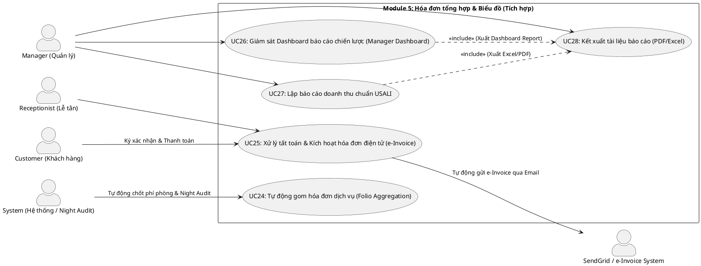

# ĐẶC TẢ USE CASE - MODULE 5: HÓA ĐƠN TỔNG HỢP & BIỂU ĐỒ

Tài liệu này đặc tả chi tiết các Use Case thuộc **Module 5: Hóa đơn tổng hợp & Biểu đồ - Tích hợp hệ thống** của Hệ thống Quản lý Nghỉ dưỡng Tích hợp Kawai Retreat Resort & Hub.

---

## 1. Sơ đồ Use Case (PlantUML Use Case Diagram)

---

## 2. Đặc tả Chi tiết các Use Case (Use Case Specifications)

### UC24: Tự động gom hóa đơn dịch vụ (Folio Aggregation)

| Mục | Nội dung chi tiết |
|---|---|
| **Mã Use Case** | **UC24** |
| **Tên Use Case** | Tự động gom hóa đơn dịch vụ (Folio Aggregation) |
| **Tác nhân (Actors)** | System (Hệ thống chạy ngầm / Night Audit), Receptionist |
| **Mô tả tóm tắt** | Hệ thống tự động liên kết và gom tất cả các khoản chi phí phát sinh từ các bộ phận (Room Charge từ POS nhà hàng, tiền đặt tour, chi phí đồ dùng mini-bar, đền bù hỏng tài sản) về một hóa đơn tổng hợp (Folio) duy nhất theo số phòng của khách. Chạy ngầm quy trình Kiểm toán đêm (Night Audit) lúc 02:00 AM để tính giá phòng hàng đêm. |
| **Điều kiện tiên quyết (Pre-conditions)** | Khách hàng đang lưu trú tại resort (phòng trạng thái `Occupied`) và phát sinh giao dịch ký gửi. |
| **Điều kiện sau (Post-conditions)** | Các giao dịch chi tiết được cập nhật vào Folio tương ứng, phản ánh chính xác số dư nợ của phòng thời gian thực. |
| **Luồng xử lý chính (Basic Flow)** | 1. Mỗi khi có giao dịch thành công từ UC18 (F&B Post to Room), UC20 (Tour Post to Room) hoặc ghi nhận tiêu dùng mini-bar từ Housekeeping, hệ thống tự động đẩy dữ liệu sang Database liên kết với ID của Folio phòng. 2. Hệ thống cộng dồn chi tiết hóa đơn (Transaction code, ngày giao dịch, mô tả dịch vụ, số tiền nợ, trạng thái thanh toán = `Unpaid`). 3. **Quy trình Kiểm toán đêm (Night Audit - BR-FIN-03):** Hằng ngày vào lúc 02:00 AM, hệ thống tự động chạy tác vụ ngầm:    - Quét qua danh sách tất cả các phòng đang có trạng thái `Occupied` trong ngày vận hành.    - Tự động sinh giao dịch tính tiền phòng (Room Charge) của đêm đó dựa trên bảng giá động của phòng (`Daily_Rates`), cộng vào Folio phòng.    - Chốt doanh thu ngày cũ và tự động chuyển ngày vận hành hệ thống sang ngày tiếp theo. |
| **Luồng thay thế (Alternative Flows)** | - **Alt 1 (Lễ tân kiểm tra Folio thủ công):** Lễ tân có thể tra cứu Folio bất kỳ lúc nào để giải đáp thắc mắc về chi tiêu của khách. Hệ thống hiển thị bảng kê chi tiết từng giao dịch kèm bộ phận phát sinh (F&B, Tour, Room, Mini-bar). |
| **Luồng ngoại lệ (Exception Flows)** | - **Exc 1 (Lỗi chạy Night Audit):** Vào lúc 02:00 AM, hệ thống bị gián đoạn (mất điện, lỗi máy chủ). Ngay khi hệ thống hoạt động trở lại, scheduler sẽ kiểm tra trạng thái chốt ngày vận hành. Nếu chưa chốt, hệ thống tự động khóa giao dịch check-in/check-out mới và thực thi Night Audit bù trước khi cho phép hoạt động bình thường trở lại. |
| **Quy tắc nghiệp vụ (Business Rules)** | - Quy trình kiểm toán đêm (Night Audit) chạy ngầm tự động lúc 02:00 AM hàng ngày để chốt ngày kế toán và chuyển ngày vận hành (BR-FIN-03). |

---

### UC25: Xử lý tất toán & Kích hoạt hóa đơn điện tử (e-Invoice)

| Mục | Nội dung chi tiết |
|---|---|
| **Mã Use Case** | **UC25** |
| **Tên Use Case** | Xử lý tất toán & Kích hoạt hóa đơn điện tử (e-Invoice) |
| **Tác nhân (Actors)** | Receptionist, Customer, SendGrid/e-Invoice API, System |
| **Mô tả tóm tắt** | Thực hiện vào ngày trả phòng của khách. Lễ tân hiển thị Folio tổng hợp, khách hàng kiểm tra và xác nhận thanh toán phần nợ còn lại. Sau khi hoàn thành, hệ thống tất toán công nợ và kích hoạt xuất hóa đơn điện tử gửi tự động qua email khách. |
| **Điều kiện tiên quyết (Pre-conditions)** | - Khách hàng yêu cầu check-out (UC12). - Lễ tân đã đăng nhập vào hệ thống quản lý tiền sảnh. |
| **Điều kiện sau (Post-conditions)** | - Số dư nợ Folio = 0. - Hóa đơn điện tử e-Invoice định dạng PDF được gửi thành công đến email khách hàng đăng ký. |
| **Luồng xử lý chính (Basic Flow)** | 1. Lễ tân chọn phòng cần check-out trên Dashboard tiền sảnh. 2. Hệ thống tải Folio tổng hợp hiển thị toàn bộ lịch sử sử dụng dịch vụ và các khoản đã thanh toán trước (như tiền cọc phòng ở UC10, cọc tour ở UC20). 3. Lễ tân in bảng kê chi tiết (Guest Ledger Ledger) hoặc hiển thị trên máy tính bảng cho khách đối chiếu. 4. Khách hàng đồng ý với bảng kê. Lễ tân nhấn "Thanh toán tất toán". 5. Khách hàng lựa chọn phương thức thanh toán số tiền còn lại (Tiền mặt, thẻ ngân hàng qua thiết bị POS tại quầy, hoặc chuyển khoản). 6. Lễ tân xác nhận thanh toán thành công trên hệ thống. Số dư nợ Folio chuyển về 0. 7. Hệ thống chuyển trạng thái Booking thành "Checked Out". 8. Hệ thống gọi API SendGrid tự động đóng gói hóa đơn, tạo file e-Invoice định dạng PDF có chữ ký số của resort gửi trực tiếp đến Email khách hàng. |
| **Luồng thay thế (Alternative Flows)** | Không có. |
| **Luồng ngoại lệ (Exception Flows)** | - **Exc 1 (Lỗi gửi email e-Invoice):** Hệ thống không thể gửi email do lỗi mạng hoặc địa chỉ email sai. Hệ thống hiển thị thông báo lỗi trên màn hình lễ tân và cho phép Lễ tân nhập email mới để nhấn nút "Gửi lại hóa đơn" thủ công. |
| **Quy tắc nghiệp vụ (Business Rules)** | - Không được phép hoàn tất Check-out nếu số dư nợ Folio khác 0 (BR-FIN-01, Database Triggers). |

---

### UC26: Giám sát Dashboard báo cáo chiến lược (Manager Dashboard)

| Mục | Nội dung chi tiết |
|---|---|
| **Mã Use Case** | **UC26** |
| **Tên Use Case** | Giám sát Dashboard báo cáo chiến lược (Manager Dashboard) |
| **Tác nhân (Actors)** | Manager, System |
| **Mô tả tóm tắt** | Cung cấp cho Quản lý cấp cao các biểu đồ phân tích trực quan, số liệu thống kê thời gian thực về sức khỏe tài chính và hiệu suất vận hành của resort (Tỷ lệ lấp đầy phòng - Occupancy Rate, Doanh thu trung bình mỗi phòng khả dụng - RevPAR, Tỷ lệ hủy phòng, Xu hướng dịch vụ). |
| **Điều kiện tiên quyết (Pre-conditions)** | Người dùng có tài khoản vai trò Quản lý (Manager) đã đăng nhập thành công. |
| **Điều kiện sau (Post-conditions)** | Các chỉ số hiệu suất kinh doanh (KPI) được trực quan hóa bằng các biểu đồ đường, cột, tròn trực quan theo mốc thời gian tùy chọn. |
| **Luồng xử lý chính (Basic Flow)** | 1. Quản lý truy cập menu "Báo cáo chiến lược / Dashboard". 2. Hệ thống tải dữ liệu tổng hợp từ Database phục vụ hiển thị biểu đồ:    - **Chỉ số lưu trú**: Tỷ lệ lấp đầy phòng (Occupancy Rate), ADR (Average Daily Rate), Thời gian lưu trú trung bình (LOS - Length of Stay).    - **Xu hướng dịch vụ**: Top các món ăn bán chạy nhất tại nhà hàng, top các tour thu hút nhiều khách nhất.    - **Luồng tài chính**: Tổng doanh thu tích lũy trong ngày/tuần/tháng/năm. 3. Quản lý lựa chọn mốc thời gian lọc (hôm nay, tuần này, tháng trước, quý hiện tại, khoảng ngày tùy chọn). 4. Hệ thống thực hiện tính toán lại và làm mới các biểu đồ hiển thị thời gian thực. |
| **Luồng thay thế (Alternative Flows)** | Không có. |
| **Luồng ngoại lệ (Exception Flows)** | - **Exc 1 (Truy vấn dữ liệu quá lớn gây quá tải):** Quản lý chọn mốc thời gian lọc quá dài (ví dụ: lịch sử 10 năm). Hệ thống giới hạn khoảng thời gian truy vấn tối đa là 2 năm trên giao diện hoặc tự động điều hướng sang cơ chế chạy báo cáo ngầm (Background job) để tránh đơ trình duyệt. |
| **Quy tắc nghiệp vụ (Business Rules)** | Không có. |

---

### UC27: Lập báo cáo doanh thu chuẩn USALI

| Mục | Nội dung chi tiết |
|---|---|
| **Mã Use Case** | **UC27** |
| **Tên Use Case** | Lập báo cáo doanh thu chuẩn USALI |
| **Tác nhân (Actors)** | Manager, System |
| **Mô tả tóm tắt** | Hệ thống tự động phân loại, tính toán và trình bày báo cáo doanh thu kế toán theo chuẩn USALI (Uniform System of Accounts for the Lodging Industry), tách biệt doanh thu và chi phí hoạt động theo từng bộ phận (Phòng, F&B, Tour lữ hành). |
| **Điều kiện tiên quyết (Pre-conditions)** | Người dùng có tài khoản vai trò Quản lý (Manager) đã đăng nhập thành công. |
| **Điều kiện sau (Post-conditions)** | Báo cáo tài chính chuẩn USALI được lập chi tiết dưới dạng bảng biểu theo cấu trúc doanh thu bộ phận, doanh thu dịch vụ và tỷ suất lợi nhuận gộp. |
| **Luồng xử lý chính (Basic Flow)** | 1. Quản lý chọn chức năng "Báo cáo tài chính chuẩn USALI". 2. Chọn kỳ báo cáo (Tháng, Quý, Năm). 3. Hệ thống truy vấn từ cơ sở dữ liệu các giao dịch tài chính đã được phân loại mã bộ phận (`Department Code`):    - **Doanh thu Phòng (Room Revenue)**: Tiền phòng thực tế khách đã ở.    - **Doanh thu Nhà hàng (F&B Revenue)**: Tiền ăn uống tại nhà hàng, quầy bar và room service.    - **Doanh thu Tour (Tour Revenue)**: Tiền khách đặt tour và các chi phí lữ hành đi kèm. 4. Hệ thống tự động đối chiếu doanh thu với chi phí vận hành trực tiếp của từng bộ phận (nếu có nhập) để tính toán Lợi nhuận vận hành gộp (GOP - Gross Operating Profit). 5. Hiển thị báo cáo dưới dạng bảng biểu cấu trúc phân tầng đúng định dạng chuẩn kế toán khách sạn quốc tế. |
| **Luồng thay thế (Alternative Flows)** | Không có. |
| **Luồng ngoại lệ (Exception Flows)** | Không có. |
| **Quy tắc nghiệp vụ (Business Rules)** | - Báo cáo doanh thu bắt buộc phân loại nguồn thu thành ba danh mục rõ rệt: Doanh thu phòng, Doanh thu F&B và Doanh thu lữ hành theo tiêu chuẩn USALI (BR-FIN-04). |

---

### UC28: Kết xuất tài liệu báo cáo (PDF/Excel)

| Mục | Nội dung chi tiết |
|---|---|
| **Mã Use Case** | **UC28** |
| **Tên Use Case** | Kết xuất tài liệu báo cáo (PDF/Excel) |
| **Tác nhân (Actors)** | Manager, System |
| **Mô tả tóm tắt** | Cho phép Quản lý tải xuống các báo cáo tài chính USALI, báo cáo KPI vận hành dưới dạng tệp tin Excel (.xlsx) để xử lý số liệu hoặc PDF để ký duyệt, lưu trữ bản cứng. |
| **Điều kiện tiên quyết (Pre-conditions)** | - Quản lý đã đăng nhập. - Giao diện đang hiển thị một báo cáo cụ thể (từ UC26 hoặc UC27). |
| **Điều kiện sau (Post-conditions)** | Tệp tin Excel hoặc PDF được tạo thành công và tự động tải xuống thiết bị của Quản lý. |
| **Luồng xử lý chính (Basic Flow)** | 1. Tại giao diện xem báo cáo, Quản lý nhấn nút "Xuất báo cáo". 2. Hệ thống hiển thị lựa chọn định dạng tệp: **Tải file Excel (.xlsx)** hoặc **Tải file PDF (.pdf)**. 3. **Trường hợp chọn Excel:** Hệ thống sử dụng thư viện xử lý bảng tính (như Apache POI), ánh xạ dữ liệu báo cáo vào tiêu đề và các cột tương ứng, thiết lập công thức tính toán tự động và trả về file Excel tải xuống. 4. **Trường hợp chọn PDF:** Hệ thống sử dụng thư viện sinh tài liệu (như OpenPDF/iText), chuyển đổi giao diện bảng biểu thành trang văn bản chuẩn hóa khổ giấy A4, chèn logo resort, tiêu đề trang, đánh số trang và trả về file PDF tải xuống. 5. Màn hình hiển thị thông báo "Kết xuất tài liệu thành công". |
| **Luồng thay thế (Alternative Flows)** | Không có. |
| **Luồng ngoại lệ (Exception Flows)** | - **Exc 1 (Lỗi tràn bộ nhớ máy chủ khi xuất file lớn):** Lượng dòng dữ liệu xuất ra quá lớn làm lỗi hệ thống. Hệ thống tự động chuyển sang chế độ tải bất đồng bộ: hiển thị thanh tiến trình và gửi liên kết tải file về email của Quản lý khi hoàn thành. |
| **Quy tắc nghiệp vụ (Business Rules)** | Không có. |
