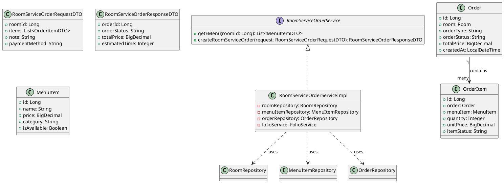
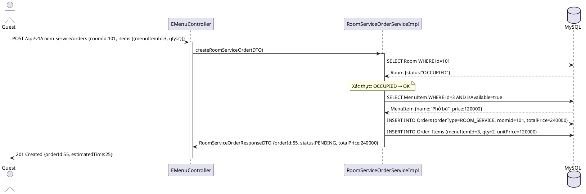
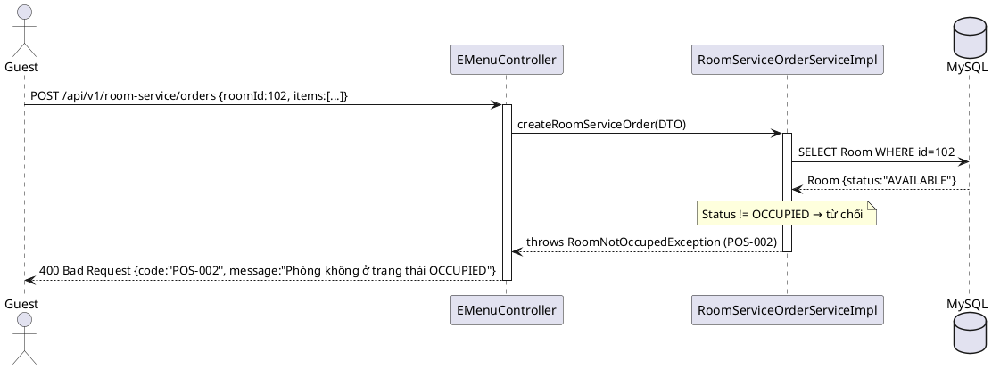
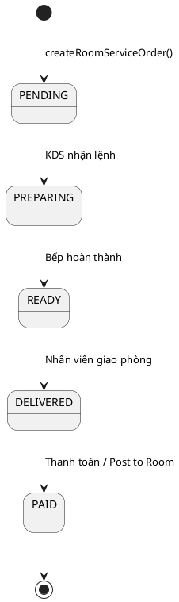

# ENGINEERING DOCUMENTATION STANDARD (EDS) v2.0

## UC14 — Room Service & E-Menu (PosService / RoomServiceOrderService)

| Field | Value |
|-------|-------|
| **Document ID** | `HOANIEN-EDS-MOD3-UC14-001` |
| **Version** | 1.0 |
| **Date** | 2026-06-14 |
| **Status** | Approved |
| **Document Owner** | Trịnh Minh Đức |
| **Author** | Trịnh Minh Đức — Developer |
| **Reviewed by** | Nguyễn Xuân Lưu — Tech Lead |
| **DPO Sign-off** | `[x] Approved – 2026-06-14 – Nguyễn Xuân Lưu` |
| **Approved by** | `[x] Nguyễn Xuân Lưu – 2026-06-14` |
| **Last Review** | 2026-06-14 |
| **Based on EDS** | v2.0 |

---

### CHANGELOG
| Ngày | Người thực hiện | Nội dung thay đổi |
|------|-----------------|-------------------|
| 2026-06-14 | Trịnh Minh Đức | Tạo tài liệu lần đầu |

---

### MỤC LỤC
1. [Tổng quan Module](#1)
2. [Ma trận Truy vết](#2)
3. [ADR](#3)
4. [Non-Functional & SLA](#4)
5. [Static Modeling](#5)
6. [Dynamic Modeling](#6)
7. [Domain Event Catalog](#7)
8. [Interface Specification](#8)
9. [API Specification](#9)
10. [Bảng mã lỗi](#10)
11. [Quy trình Triển khai](#11)
12. [Rollback & Incident Runbook](#12)
13. [Kịch bản Kiểm thử](#13)
14. [Phương pháp Xác minh](#14)
15. [Mẫu thử thực tế](#15)
16. [Authorization Matrix](#16)
17. [Phụ lục](#17)

---

### 1. Tổng quan Module

| Field | Value |
|-------|-------|
| **Module Name** | Room Service & E-Menu (UC14) |
| **Bounded Context** | POS & F&B Context |
| **Use Case** | UC14: Khách quét QR → xem E-Menu → đặt Room Service; hệ thống xác thực phòng OCCUPIED |
| **Data Classification** | Internal |
| **Compliance Scope** | Luật Kế toán; Quy định nội bộ Resort |
| **Upstream Dependencies** | Module 1 — Auth (JWT), Module 2 — Booking (Room OCCUPIED) |
| **Downstream Consumers** | UC17 (KDS — bếp nhận lệnh), UC18 (Post to Room ghi Folio) |

---

### 2. Ma trận Truy vết

| Requirement ID | Loại | Mô tả | Thành phần Code | Compliance | ADR |
|----------------|------|-------|-----------------|------------|-----|
| UC14.1 | US | Khách quét QR → xem E-Menu (danh sách món ăn theo phòng) | `RoomServiceOrderService.getEMenu()` | — | — |
| UC14.2 | US | Khách đặt món Room Service | `RoomServiceOrderService.createRoomServiceOrder()` | — | — |
| BR-POS-04 | BR | Chỉ phòng có trạng thái OCCUPIED mới được đặt Room Service | `RoomServiceOrderService.createRoomServiceOrder()` | Quy định Resort | — |

---

### 3. Architecture Decision Records (ADR)

#### ADR-002 — QR Code per Room gắn với RoomId

| Field | Value |
|-------|-------|
| **Status** | Accepted |
| **Deciders** | Nguyễn Xuân Lưu, Trịnh Minh Đức |
| **Date** | 2026-06-12 |

**Bối cảnh:** Khách cần truy cập E-Menu không cần đăng nhập, chỉ cần quét QR gắn trong phòng. QR phải liên kết chính xác đến phòng để tự động điền roomId khi đặt món.

**Quyết định:** Mỗi phòng có một QR code encode URL `/api/v1/emenu?roomId={roomId}`. Khi quét, hệ thống load E-Menu theo phòng và nhúng `roomId` vào session đặt hàng.

**Hệ quả:** Không cần xác thực đặc biệt khi xem E-Menu; roomId được xác minh khi submit order (phải OCCUPIED).

---

### 4. Non-Functional Requirements & SLA

#### 4.1. Performance & Availability

| Category | Requirement | Target SLA | Measurement |
|----------|-------------|------------|-------------|
| **Latency** | E-Menu load response (p99) | < 300ms | k6 load test |
| **Latency** | Room Service order response | < 200ms | k6 load test |
| **Availability** | Uptime | 99.9% | Uptime monitor |

#### 4.2. Security

| Category | Requirement | Target | Verification |
|----------|-------------|--------|--------------|
| **Room validation** | Phòng phải OCCUPIED | Server-side check | Unit test |
| **Rate limit** | Đặt hàng | 20 req/min per room | API Gateway |

---

### 5. Static Modeling

#### 5.1. Class Diagram



#### 5.2. Data Structure

```sql
CREATE TABLE Orders (
    id BIGINT AUTO_INCREMENT PRIMARY KEY,
    room_id BIGINT NULL,
    table_id BIGINT NULL,
    order_type VARCHAR(50) NOT NULL COMMENT 'ROOM_SERVICE, DINE_IN',
    order_status VARCHAR(50) DEFAULT 'PENDING',
    total_price DECIMAL(18,2) NOT NULL,
    note TEXT,
    payment_method VARCHAR(50),
    created_at TIMESTAMP DEFAULT CURRENT_TIMESTAMP
);

CREATE TABLE Order_Items (
    id BIGINT AUTO_INCREMENT PRIMARY KEY,
    order_id BIGINT NOT NULL,
    menu_item_id BIGINT NOT NULL,
    quantity INT NOT NULL,
    unit_price DECIMAL(18,2) NOT NULL,
    item_status VARCHAR(50) DEFAULT 'PENDING',
    FOREIGN KEY (order_id) REFERENCES Orders(id)
);
```

---

### 6. Dynamic Modeling

#### 6.1. Sequence Diagram — Happy Path: Đặt Room Service



#### 6.2. Sequence Diagram — Phòng không OCCUPIED → từ chối



#### 6.3. State Machine — Order



---

### 7. Domain Event Catalog

| Event Name | Trigger | Publisher | Subscriber(s) | Async? |
|------------|---------|-----------|---------------|--------|
| `RoomServiceOrderCreated` | Đặt món thành công | `RoomServiceOrderService` | `KdsService` (hiển thị bếp) | Yes |
| `RoomServiceOrderCompleted` | Giao món xong | `RoomServiceOrderService` | `FolioService` (Post to Room) | Yes |

---

### 8. Interface Specification

```java
// RoomServiceOrderService.java
// @version 1.0

public interface RoomServiceOrderService {
    /**
     * Lấy danh sách E-Menu cho phòng (các món khả dụng).
     *
     * @param roomId ID phòng (từ QR code)
     * @return List<MenuItemDTO>
     * @throws RoomNotFoundException nếu roomId không tồn tại (POS-001)
     */
    List<MenuItemDTO> getEMenu(Long roomId);

    /**
     * Tạo đơn hàng Room Service.
     * Yêu cầu phòng phải có status = OCCUPIED.
     *
     * @param request DTO chứa roomId, danh sách món, note
     * @return RoomServiceOrderResponseDTO
     * @throws RoomNotOccupedException  nếu phòng không OCCUPIED (POS-002)
     * @throws MenuItemNotAvailableException nếu món hết (POS-005)
     */
    RoomServiceOrderResponseDTO createRoomServiceOrder(RoomServiceOrderRequestDTO request)
        throws RoomNotOccupedException, MenuItemNotAvailableException;
}
```

---

### 9. API Specification

| Method | Path | Auth | Roles | Rate Limit | Idempotent? |
|--------|------|------|-------|------------|-------------|
| GET | `/api/v1/emenu` | None | All (QR scan) | 100/min | Yes |
| POST | `/api/v1/room-service/orders` | None (roomId từ QR) | All | 20/min | No |

**GET `/api/v1/emenu?roomId=101`**
*Response 200:*
```json
[
  {"menuItemId": 1, "name": "Phở bò", "price": 120000, "category": "Món chính", "isAvailable": true},
  {"menuItemId": 2, "name": "Cà phê sữa đá", "price": 45000, "category": "Đồ uống", "isAvailable": true}
]
```

**POST `/api/v1/room-service/orders`**
*Request:*
```json
{
  "roomId": 101,
  "items": [{"menuItemId": 1, "quantity": 2}],
  "note": "Ít đường",
  "paymentMethod": "POST_TO_ROOM"
}
```
*Response 201:*
```json
{"orderId": 55, "orderStatus": "PENDING", "totalPrice": 240000, "estimatedTime": 25}
```
*Response 400:* `{"error": {"code": "POS-002", "message": "Phòng không ở trạng thái OCCUPIED"}}`

---

### 10. Bảng mã lỗi

| Code | HTTP | Message (EN) | Message (VI) | Trigger |
|------|------|--------------|--------------|---------|
| `POS-001` | 404 | Room not found | Phòng không tồn tại | roomId không hợp lệ |
| `POS-002` | 400 | Room not occupied | Phòng không ở trạng thái OCCUPIED | Room.status != OCCUPIED |
| `POS-005` | 400 | Menu item not available | Món ăn hiện không khả dụng | MenuItem.isAvailable = false |

---

### 11. Quy trình Triển khai

#### 11.1. Prerequisites
- [x] Database đã có bảng Orders, Order_Items, Menu_Items
- [x] QR code đã được in và gắn vào các phòng

#### 11.2. Deployment
```bash
mvn clean package -DskipTests
java -jar target/hoanien-backend-1.0.jar --spring.profiles.active=staging
```

#### 11.3. Verification
```bash
curl -X GET "http://localhost:8080/api/v1/emenu?roomId=101"
curl -X POST http://localhost:8080/api/v1/room-service/orders \
  -H "Content-Type: application/json" \
  -d '{"roomId":101,"items":[{"menuItemId":1,"quantity":2}],"paymentMethod":"POST_TO_ROOM"}'
```

---

### 12. Rollback & Incident Runbook

| Điều kiện | Ngưỡng | Người quyết định |
|-----------|--------|-------------------|
| Room Service order fail rate | > 5% trong 5 phút | On-call Engineer |
| KDS không nhận lệnh | > 2 phút delay | On-call Engineer |

**Rollback:** `git checkout tags/v1.0.0 && mvn clean package`

---

### 13. Kịch bản Kiểm thử

**[Policy]** Test Data: SYNTHETIC. ❌ KHÔNG dùng Production data.

#### 13.1. Unit Tests
- TC-UNIT-UC14-001: Quét QR phòng 101 → trả E-Menu đúng danh sách món available
- TC-UNIT-UC14-002: Đặt Room Service phòng OCCUPIED → Order PENDING, OrderItems được tạo
- TC-UNIT-UC14-003: Đặt Room Service phòng AVAILABLE → POS-002
- TC-UNIT-UC14-004: Đặt món hết hàng (isAvailable=false) → POS-005
- TC-UNIT-UC14-005: RoomId không tồn tại → POS-001

#### 13.2. E2E Tests
- TC-E2E-UC14-001: QR scan → E-Menu → Đặt món → KDS nhận lệnh

---

### 14. Phương pháp Xác minh

```sql
-- Kiểm tra order được tạo đúng
SELECT o.id, o.room_id, o.order_type, o.order_status, o.total_price
FROM Orders o WHERE o.room_id = 101 ORDER BY o.created_at DESC LIMIT 1;

-- Kiểm tra OrderItems
SELECT oi.menu_item_id, oi.quantity, oi.unit_price, oi.item_status
FROM Order_Items oi WHERE oi.order_id = :orderId;

-- Xác minh phòng đang OCCUPIED
SELECT id, room_number, status FROM Rooms WHERE id = 101;
```

---

### 15. Mẫu thử thực tế

```bash
# Xem E-Menu theo phòng
curl -X GET "https://api.hoanienretreat.com/api/v1/emenu?roomId=101"

# Đặt Room Service
curl -X POST https://api.hoanienretreat.com/api/v1/room-service/orders \
  -H "Content-Type: application/json" \
  -d '{"roomId":101,"items":[{"menuItemId":1,"quantity":2},{"menuItemId":2,"quantity":1}],"note":"Không đá","paymentMethod":"POST_TO_ROOM"}'
```

---

### 16. Authorization Matrix

| Endpoint | GUEST (QR) | CUSTOMER | F&B STAFF | RECEPTIONIST | ADMIN |
|----------|:----------:|:--------:|:---------:|:------------:|:-----:|
| `GET /api/v1/emenu` | ✔️ | ✔️ | ✔️ | ✔️ | ✔️ |
| `POST /api/v1/room-service/orders` | ✔️ (via QR) | ✔️ | ✔️ | ✔️ | ✔️ |

---

### PHỤ LỤC

#### A. Glossary
| Thuật ngữ | Định nghĩa |
|-----------|------------|
| **E-Menu** | Menu điện tử khách truy cập qua QR code trong phòng |
| **Room Service** | Dịch vụ giao đồ ăn/uống tới tận phòng khách |
| **KDS** | Kitchen Display System — màn hình bếp hiển thị lệnh nấu |
| **OCCUPIED** | Trạng thái phòng đang có khách lưu trú |

#### B. Tài liệu tham chiếu
| Document | Path |
|----------|------|
| TDD UC14 | `06-Testing/mod3_pos/uc14/TDD_UC14_SPEC.md` |
| EDS MOD3 | `06-Testing/mod3_pos/EDS_MOD3_SPEC.md` |

---

*EDS v2.0*