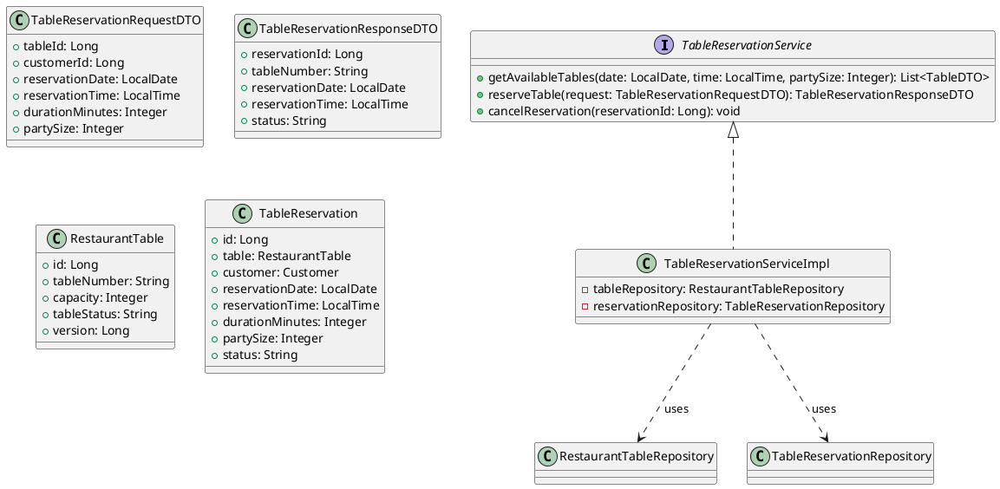
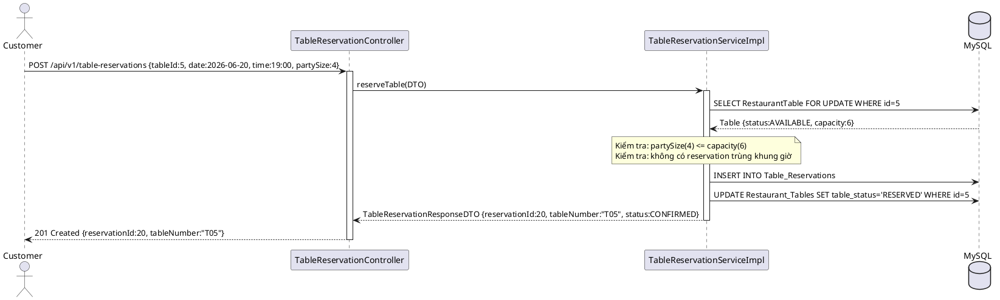
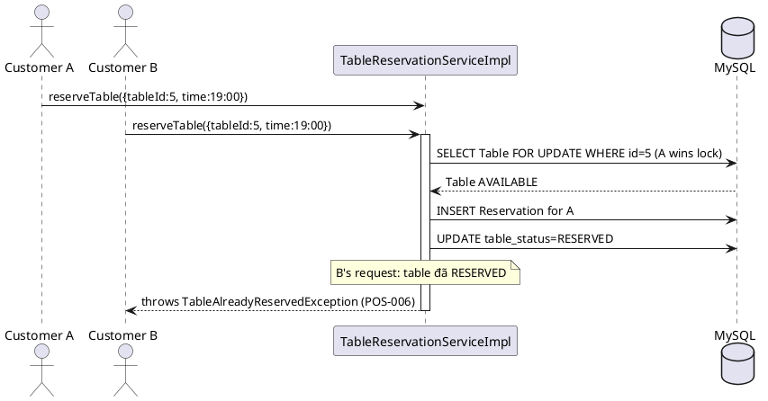
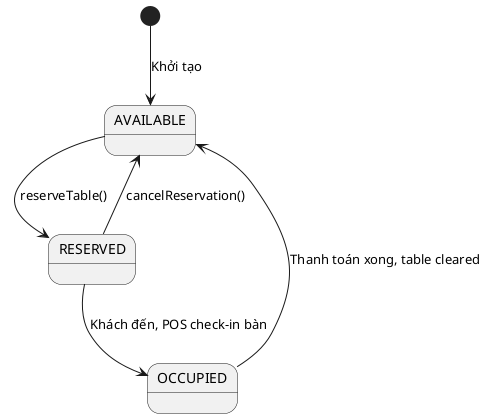

# ENGINEERING DOCUMENTATION STANDARD (EDS) v2.0

## UC15 — Đặt bàn nhà hàng (TableReservationService)

| Field | Value |
|-------|-------|
| **Document ID** | `HOANIEN-EDS-MOD3-UC15-001` |
| **Version** | 1.0 |
| **Date** | 2026-06-14 |
| **Status** | Approved |
| **Document Owner** | Trịnh Minh Đức |
| **Author** | Trịnh Minh Đức — Developer |
| **Reviewed by** | Nguyễn Xuân Lưu — Tech Lead |
| **DPO Sign-off** | `[x] Approved – 2026-06-14 – Nguyễn Xuân Lưu` |
| **Approved by** | `[x] Nguyễn Xuân Lưu – 2026-06-14` |
| **Last Review** | 2026-06-14 |
| **Based on EDS** | v2.0 |

---

### CHANGELOG
| Ngày | Người thực hiện | Nội dung thay đổi |
|------|-----------------|-------------------|
| 2026-06-14 | Trịnh Minh Đức | Tạo tài liệu lần đầu |

---

### MỤC LỤC
1. [Tổng quan Module](#1)
2. [Ma trận Truy vết](#2)
3. [ADR](#3)
4. [Non-Functional & SLA](#4)
5. [Static Modeling](#5)
6. [Dynamic Modeling](#6)
7. [Domain Event Catalog](#7)
8. [Interface Specification](#8)
9. [API Specification](#9)
10. [Bảng mã lỗi](#10)
11. [Quy trình Triển khai](#11)
12. [Rollback & Incident Runbook](#12)
13. [Kịch bản Kiểm thử](#13)
14. [Phương pháp Xác minh](#14)
15. [Mẫu thử thực tế](#15)
16. [Authorization Matrix](#16)
17. [Phụ lục](#17)

---

### 1. Tổng quan Module

| Field | Value |
|-------|-------|
| **Module Name** | Đặt bàn nhà hàng (UC15) |
| **Bounded Context** | POS & F&B Context |
| **Use Case** | UC15: Khách/Lễ tân đặt bàn theo ngày giờ; hệ thống kiểm tra bàn còn AVAILABLE; chống conflict đồng thời |
| **Data Classification** | Internal |
| **Compliance Scope** | Quy định nội bộ Resort |
| **Upstream Dependencies** | Module 1 — Auth (JWT) |
| **Downstream Consumers** | UC16 (POS Dine-In gắn với bàn đã đặt) |

---

### 2. Ma trận Truy vết

| Requirement ID | Loại | Mô tả | Thành phần Code | Compliance | ADR |
|----------------|------|-------|-----------------|------------|-----|
| UC15.1 | US | Đặt bàn theo ngày giờ, số lượng khách | `TableReservationService.reserveTable()` | — | ADR-003 |
| UC15.2 | US | Xem danh sách bàn còn trống theo thời điểm | `TableReservationService.getAvailableTables()` | — | — |
| UC15.3 | US | Hủy đặt bàn | `TableReservationService.cancelReservation()` | — | — |
| BR-POS-05 | BR | Chống 2 khách đặt cùng bàn cùng thời điểm (concurrency) | `TableReservationService.reserveTable()` | — | ADR-003 |

---

### 3. Architecture Decision Records (ADR)

#### ADR-003 — Optimistic Locking cho Đặt bàn Concurrency-Safe

| Field | Value |
|-------|-------|
| **Status** | Accepted |
| **Deciders** | Nguyễn Xuân Lưu, Trịnh Minh Đức |
| **Date** | 2026-06-12 |

**Bối cảnh:** Nhiều khách có thể đặt cùng một bàn trong cùng khung giờ. Cần đảm bảo chỉ 1 booking thành công.

**Quyết định:** Dùng `SELECT ... FOR UPDATE` (Pessimistic Locking) hoặc Optimistic Locking (`@Version`) trên `RestaurantTable`. Khi bàn đã có reservation trong khung giờ `[reservationTime, reservationTime + duration]`, throw `TableAlreadyReservedException` (POS-006).

**Hệ quả:** Tránh double-booking; performance đủ tốt vì đặt bàn không phải high-concurrency operation.

---

### 4. Non-Functional Requirements & SLA

#### 4.1. Performance & Availability

| Category | Requirement | Target SLA | Measurement |
|----------|-------------|------------|-------------|
| **Latency** | Reserve table response (p99) | < 200ms | k6 load test |
| **Concurrency** | Không double-booking | 0 conflict | Concurrent test |
| **Availability** | Uptime | 99.9% | Uptime monitor |

#### 4.2. Security

| Category | Requirement | Target | Verification |
|----------|-------------|--------|--------------|
| **Auth** | JWT required | CUSTOMER, RECEPTIONIST, ADMIN | Integration test |

---

### 5. Static Modeling

#### 5.1. Class Diagram



#### 5.2. Data Structure

```sql
CREATE TABLE Restaurant_Tables (
    id BIGINT AUTO_INCREMENT PRIMARY KEY,
    table_number VARCHAR(20) NOT NULL,
    capacity INT NOT NULL,
    table_status VARCHAR(50) DEFAULT 'AVAILABLE',
    version BIGINT DEFAULT 0,
    location VARCHAR(100)
);

CREATE TABLE Table_Reservations (
    id BIGINT AUTO_INCREMENT PRIMARY KEY,
    table_id BIGINT NOT NULL,
    customer_id BIGINT NOT NULL,
    reservation_date DATE NOT NULL,
    reservation_time TIME NOT NULL,
    duration_minutes INT DEFAULT 90,
    party_size INT NOT NULL,
    status VARCHAR(50) DEFAULT 'CONFIRMED',
    created_at TIMESTAMP DEFAULT CURRENT_TIMESTAMP,
    FOREIGN KEY (table_id) REFERENCES Restaurant_Tables(id)
);
```

---

### 6. Dynamic Modeling

#### 6.1. Sequence Diagram — Happy Path: Đặt bàn thành công



#### 6.2. Sequence Diagram — Double booking đồng thời



#### 6.3. State Machine — RestaurantTable



---

### 7. Domain Event Catalog

| Event Name | Trigger | Publisher | Subscriber(s) | Async? |
|------------|---------|-----------|---------------|--------|
| `TableReservedEvent` | Đặt bàn thành công | `TableReservationService` | `NotificationService` | Yes |
| `TableReservationCancelledEvent` | Hủy đặt bàn | `TableReservationService` | `NotificationService` | Yes |

---

### 8. Interface Specification

```java
// TableReservationService.java
// @version 1.0

public interface TableReservationService {
    /**
     * Lấy danh sách bàn còn trống theo ngày giờ và số khách.
     *
     * @param date      Ngày đặt bàn
     * @param time      Giờ đặt bàn
     * @param partySize Số lượng khách
     * @return List<TableDTO>
     */
    List<TableDTO> getAvailableTables(LocalDate date, LocalTime time, Integer partySize);

    /**
     * Đặt bàn (concurrency-safe).
     * Throw nếu bàn đã được đặt trong khung giờ tương ứng.
     *
     * @param request DTO chứa tableId, date, time, partySize
     * @return TableReservationResponseDTO
     * @throws TableAlreadyReservedException nếu bàn đã có booking (POS-006)
     * @throws TableCapacityExceededException nếu số khách > sức chứa (POS-007)
     */
    TableReservationResponseDTO reserveTable(TableReservationRequestDTO request)
        throws TableAlreadyReservedException, TableCapacityExceededException;

    /**
     * Hủy đặt bàn.
     *
     * @param reservationId ID reservation cần hủy
     */
    void cancelReservation(Long reservationId);
}
```

---

### 9. API Specification

| Method | Path | Auth | Roles | Rate Limit | Idempotent? |
|--------|------|------|-------|------------|-------------|
| GET | `/api/v1/tables/available` | JWT | All | 60/min | Yes |
| POST | `/api/v1/table-reservations` | JWT | CUSTOMER, RECEPTIONIST, ADMIN | 20/min | No |
| DELETE | `/api/v1/table-reservations/{id}` | JWT | CUSTOMER (own), RECEPTIONIST, ADMIN | 10/min | Yes |

**POST `/api/v1/table-reservations`**
*Request:*
```json
{
  "tableId": 5,
  "customerId": 2,
  "reservationDate": "2026-06-20",
  "reservationTime": "19:00",
  "durationMinutes": 90,
  "partySize": 4
}
```
*Response 201:*
```json
{
  "reservationId": 20,
  "tableNumber": "T05",
  "reservationDate": "2026-06-20",
  "reservationTime": "19:00",
  "status": "CONFIRMED"
}
```
*Response 409:* `{"error": {"code": "POS-006", "message": "Bàn đã được đặt trong khung giờ này"}}`

---

### 10. Bảng mã lỗi

| Code | HTTP | Message (EN) | Message (VI) | Trigger |
|------|------|--------------|--------------|---------|
| `POS-006` | 409 | Table already reserved | Bàn đã được đặt trong khung giờ này | Conflict reservation time |
| `POS-007` | 400 | Party size exceeds capacity | Số khách vượt quá sức chứa của bàn | partySize > table.capacity |
| `POS-008` | 404 | Reservation not found | Không tìm thấy đặt bàn | reservationId không tồn tại |

---

### 11. Quy trình Triển khai

#### 11.1. Prerequisites
- [x] Database đã có bảng Restaurant_Tables, Table_Reservations với dữ liệu bàn

#### 11.2. Deployment
```bash
mvn clean package -DskipTests
java -jar target/hoanien-backend-1.0.jar --spring.profiles.active=staging
```

#### 11.3. Verification
```bash
curl -X GET "http://localhost:8080/api/v1/tables/available?date=2026-06-20&time=19:00&partySize=4" \
  -H "Authorization: Bearer [JWT]"

curl -X POST http://localhost:8080/api/v1/table-reservations \
  -H "Authorization: Bearer [JWT]" \
  -H "Content-Type: application/json" \
  -d '{"tableId":5,"customerId":2,"reservationDate":"2026-06-20","reservationTime":"19:00","partySize":4}'
```

---

### 12. Rollback & Incident Runbook

| Điều kiện | Ngưỡng | Người quyết định |
|-----------|--------|-------------------|
| Double-booking phát hiện | Bất kỳ | Tech Lead |
| Reservation fail rate | > 5% trong 5 phút | On-call Engineer |

**Rollback:** `git checkout tags/v1.0.0 && mvn clean package`

---

### 13. Kịch bản Kiểm thử

**[Policy]** Test Data: SYNTHETIC. ❌ KHÔNG dùng Production data.

#### 13.1. Unit Tests
- TC-UNIT-UC15-001: Lấy bàn trống theo ngày giờ → trả đúng danh sách
- TC-UNIT-UC15-002: Đặt bàn thành công → TableReservation CONFIRMED, bàn RESERVED
- TC-UNIT-UC15-003: Đặt bàn đã có booking → POS-006
- TC-UNIT-UC15-004: Số khách > sức chứa → POS-007
- TC-UNIT-UC15-005: Hủy đặt bàn → status CANCELLED, bàn AVAILABLE

#### 13.2. Concurrency Tests
- TC-CONCURR-UC15-001: 2 request đồng thời đặt cùng bàn T05 lúc 19:00 → chỉ 1 thành công, 1 nhận POS-006

---

### 14. Phương pháp Xác minh

```sql
-- Kiểm tra reservation được tạo
SELECT id, table_id, customer_id, reservation_date, reservation_time, status
FROM Table_Reservations WHERE table_id = 5 AND reservation_date = '2026-06-20';

-- Kiểm tra trạng thái bàn
SELECT id, table_number, table_status FROM Restaurant_Tables WHERE id = 5;
```

---

### 15. Mẫu thử thực tế

```bash
# Xem bàn trống
curl -X GET "https://api.hoanienretreat.com/api/v1/tables/available?date=2026-06-20&time=19:00&partySize=4" \
  -H "Authorization: Bearer [JWT]"

# Đặt bàn
curl -X POST https://api.hoanienretreat.com/api/v1/table-reservations \
  -H "Authorization: Bearer [JWT]" \
  -H "Content-Type: application/json" \
  -d '{"tableId":5,"customerId":2,"reservationDate":"2026-06-20","reservationTime":"19:00","durationMinutes":90,"partySize":4}'

# Hủy đặt bàn
curl -X DELETE https://api.hoanienretreat.com/api/v1/table-reservations/20 \
  -H "Authorization: Bearer [JWT]"
```

---

### 16. Authorization Matrix

| Endpoint | GUEST | CUSTOMER | F&B STAFF | RECEPTIONIST | ADMIN |
|----------|:-----:|:--------:|:---------:|:------------:|:-----:|
| `GET /api/v1/tables/available` | ✔️ | ✔️ | ✔️ | ✔️ | ✔️ |
| `POST /api/v1/table-reservations` | ❌ | ✔️ | ✔️ | ✔️ | ✔️ |
| `DELETE /api/v1/table-reservations/{id}` | ❌ | Own | ✔️ | ✔️ | ✔️ |

---

### PHỤ LỤC

#### A. Glossary
| Thuật ngữ | Định nghĩa |
|-----------|------------|
| **Double-booking** | Hiện tượng 2 booking trùng cùng bàn cùng khung giờ |
| **Pessimistic Locking** | Kỹ thuật khóa record DB để tránh concurrent writes |
| **Party Size** | Số lượng khách trong cùng một lần đặt bàn |

#### B. Tài liệu tham chiếu
| Document | Path |
|----------|------|
| TDD UC15 | `06-Testing/mod3_pos/uc15/TDD_UC15_SPEC.md` |
| EDS MOD3 | `06-Testing/mod3_pos/EDS_MOD3_SPEC.md` |

---

*EDS v2.0*