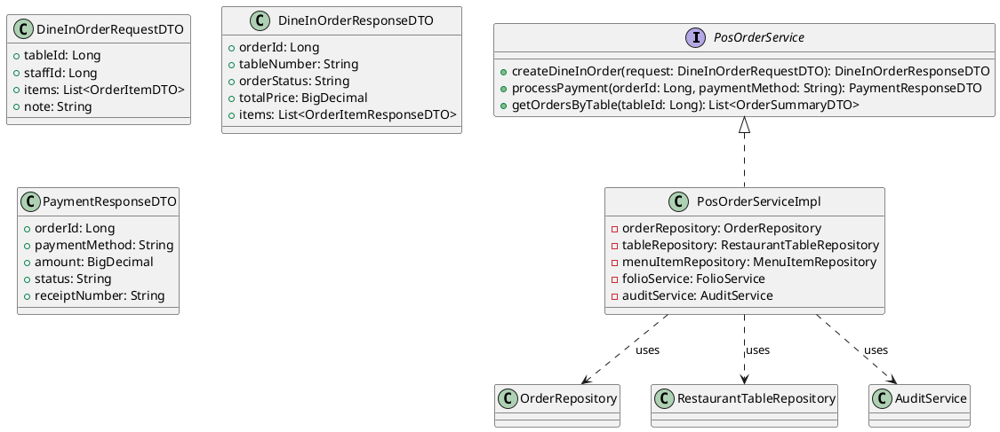
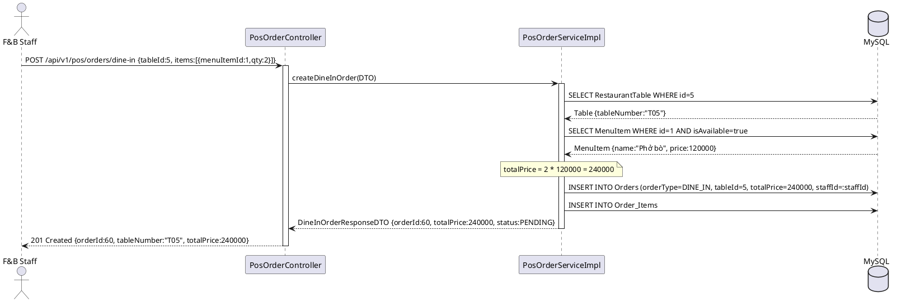
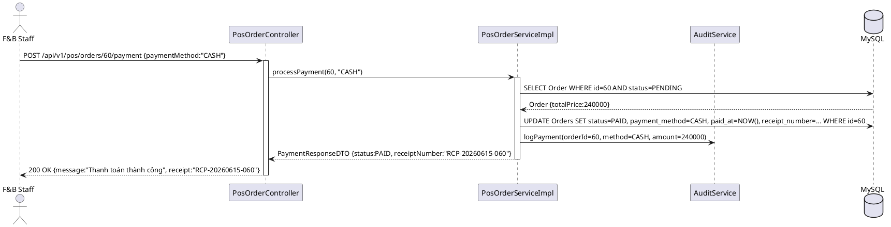
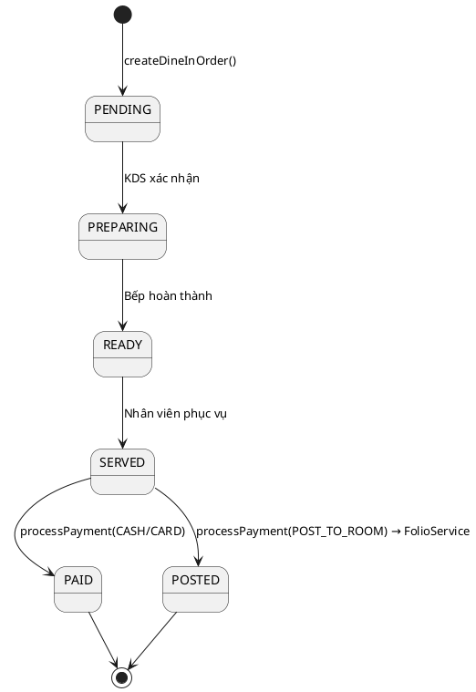

# ENGINEERING DOCUMENTATION STANDARD (EDS) v2.0

## UC16 — POS Dine-In: Tạo Order & Thanh toán (PosOrderService)

| Field | Value |
|-------|-------|
| **Document ID** | `HOANIEN-EDS-MOD3-UC16-001` |
| **Version** | 1.0 |
| **Date** | 2026-06-14 |
| **Status** | Approved |
| **Document Owner** | Trịnh Minh Đức |
| **Author** | Trịnh Minh Đức — Developer |
| **Reviewed by** | Nguyễn Xuân Lưu — Tech Lead |
| **DPO Sign-off** | `[x] Approved – 2026-06-14 – Nguyễn Xuân Lưu` |
| **Approved by** | `[x] Nguyễn Xuân Lưu – 2026-06-14` |
| **Last Review** | 2026-06-14 |
| **Based on EDS** | v2.0 |

---

### CHANGELOG
| Ngày | Người thực hiện | Nội dung thay đổi |
|------|-----------------|-------------------|
| 2026-06-14 | Trịnh Minh Đức | Tạo tài liệu lần đầu |

---

### MỤC LỤC
1. [Tổng quan Module](#1)
2. [Ma trận Truy vết](#2)
3. [ADR](#3)
4. [Non-Functional & SLA](#4)
5. [Static Modeling](#5)
6. [Dynamic Modeling](#6)
7. [Domain Event Catalog](#7)
8. [Interface Specification](#8)
9. [API Specification](#9)
10. [Bảng mã lỗi](#10)
11. [Quy trình Triển khai](#11)
12. [Rollback & Incident Runbook](#12)
13. [Kịch bản Kiểm thử](#13)
14. [Phương pháp Xác minh](#14)
15. [Mẫu thử thực tế](#15)
16. [Authorization Matrix](#16)
17. [Phụ lục](#17)

---

### 1. Tổng quan Module

| Field | Value |
|-------|-------|
| **Module Name** | POS Dine-In: Tạo Order & Thanh toán (UC16) |
| **Bounded Context** | POS & F&B Context |
| **Use Case** | UC16: Nhân viên F&B tạo order Dine-In, ghi đúng bàn + món + giá; thanh toán tiền mặt/thẻ/Post to Room |
| **Data Classification** | Internal / Financial |
| **Compliance Scope** | Luật Kế toán Việt Nam; Quy định Resort |
| **Upstream Dependencies** | UC15 (TableReservation), Module 1 — Auth (JWT) |
| **Downstream Consumers** | UC17 (KDS bếp nhận lệnh), UC18 (Post to Room ghi Folio) |

---

### 2. Ma trận Truy vết

| Requirement ID | Loại | Mô tả | Thành phần Code | Compliance | ADR |
|----------------|------|-------|-----------------|------------|-----|
| UC16.1 | US | Nhân viên tạo Dine-In order gắn với bàn + danh sách món | `PosOrderService.createDineInOrder()` | Luật Kế toán | — |
| UC16.2 | US | Thanh toán tiền mặt → order chuyển PAID | `PosOrderService.processPayment()` | Luật Kế toán | — |
| UC16.3 | US | Thanh toán thẻ → order PAID | `PosOrderService.processPayment()` | — | — |
| UC16.4 | US | Post to Room → ghi nợ Folio | `PosOrderService.processPayment()` | — | ADR-001 |
| BR-POS-01 | BR | Tổng tiền phải tính đúng: SUM(qty * unitPrice) | `PosOrderService.createDineInOrder()` | — | — |

---

### 3. Architecture Decision Records (ADR)

#### ADR-001 — Event-driven Post to Room

| Field | Value |
|-------|-------|
| **Status** | Accepted |
| **Deciders** | Nguyễn Xuân Lưu, Trịnh Minh Đức |
| **Date** | 2026-06-12 |

**Bối cảnh:** Khi khách chọn "Post to Room", POS cần ghi nợ vào Folio (hóa đơn lưu trú). Folio thuộc Module 2, POS không nên gọi trực tiếp.

**Quyết định:** POS publish event `PosOrderPostedToRoom`. FolioService lắng nghe và tự ghi nợ. Cần validate Credit Limit trước khi publish.

**Hệ quả:** Module loosely coupled; nếu Folio lỗi, POS vẫn hoạt động (retry mechanism).

---

### 4. Non-Functional Requirements & SLA

#### 4.1. Performance & Availability

| Category | Requirement | Target SLA | Measurement |
|----------|-------------|------------|-------------|
| **Latency** | Create Dine-In order (p99) | < 200ms | k6 load test |
| **Latency** | Payment processing | < 300ms | k6 load test |
| **Availability** | Uptime | 99.9% | Uptime monitor |

#### 4.2. Security

| Category | Requirement | Target | Verification |
|----------|-------------|--------|--------------|
| **Auth** | Chỉ F&B Staff, Receptionist, Admin | JWT + Role | Integration test |
| **Audit** | Mọi giao dịch thanh toán được ghi | AuditLog | Unit test |

---

### 5. Static Modeling

#### 5.1. Class Diagram



#### 5.2. Data Structure

```sql
-- Sử dụng lại bảng Orders và Order_Items từ UC14
-- orderType = 'DINE_IN'
-- Bổ sung cột payment_method và receipt_number
ALTER TABLE Orders ADD COLUMN receipt_number VARCHAR(50) NULL;
ALTER TABLE Orders ADD COLUMN paid_at TIMESTAMP NULL;
ALTER TABLE Orders ADD COLUMN staff_id BIGINT NULL;
```

---

### 6. Dynamic Modeling

#### 6.1. Sequence Diagram — Happy Path: Tạo Dine-In Order



#### 6.2. Sequence Diagram — Thanh toán tiền mặt



#### 6.3. State Machine — Order Status



---

### 7. Domain Event Catalog

| Event Name | Trigger | Publisher | Subscriber(s) | Async? |
|------------|---------|-----------|---------------|--------|
| `DineInOrderCreated` | Tạo order thành công | `PosOrderService` | `KdsService` | Yes |
| `PosOrderPaid` | Thanh toán thành công | `PosOrderService` | `AuditService` | Yes |
| `PosOrderPostedToRoom` | Post to Room | `PosOrderService` | `FolioService` | Yes |

---

### 8. Interface Specification

```java
// PosOrderService.java
// @version 1.0

public interface PosOrderService {
    /**
     * Tạo Dine-In Order gắn với bàn.
     * Ghi đúng bàn + danh sách món + tính đúng tổng tiền.
     *
     * @param request DTO chứa tableId, staffId, items
     * @return DineInOrderResponseDTO
     * @throws TableNotFoundException nếu tableId không tồn tại (POS-001)
     * @throws MenuItemNotAvailableException nếu có món hết hàng (POS-005)
     */
    DineInOrderResponseDTO createDineInOrder(DineInOrderRequestDTO request);

    /**
     * Xử lý thanh toán: CASH, CARD, hoặc POST_TO_ROOM.
     * POST_TO_ROOM: validate Credit Limit, publish PosOrderPostedToRoom event.
     *
     * @param orderId       ID order cần thanh toán
     * @param paymentMethod "CASH" | "CARD" | "POST_TO_ROOM"
     * @return PaymentResponseDTO
     * @throws OrderNotFoundException nếu orderId không tồn tại
     * @throws CreditLimitExceededException nếu POST_TO_ROOM vượt Credit Limit (POS-003)
     */
    PaymentResponseDTO processPayment(Long orderId, String paymentMethod);

    /**
     * Lấy danh sách orders theo bàn.
     *
     * @param tableId ID bàn
     * @return List<OrderSummaryDTO>
     */
    List<OrderSummaryDTO> getOrdersByTable(Long tableId);
}
```

---

### 9. API Specification

| Method | Path | Auth | Roles | Rate Limit | Idempotent? |
|--------|------|------|-------|------------|-------------|
| POST | `/api/v1/pos/orders/dine-in` | JWT | F&B STAFF, RECEPTIONIST, ADMIN | 100/min | No |
| POST | `/api/v1/pos/orders/{id}/payment` | JWT | F&B STAFF, RECEPTIONIST, ADMIN | 50/min | No |
| GET | `/api/v1/pos/orders?tableId={id}` | JWT | F&B STAFF, RECEPTIONIST, ADMIN | 200/min | Yes |

**POST `/api/v1/pos/orders/dine-in`**
*Request:*
```json
{
  "tableId": 5,
  "staffId": 3,
  "items": [{"menuItemId": 1, "quantity": 2}, {"menuItemId": 2, "quantity": 1}],
  "note": "Ít đường"
}
```
*Response 201:*
```json
{
  "orderId": 60,
  "tableNumber": "T05",
  "orderStatus": "PENDING",
  "totalPrice": 285000,
  "items": [
    {"menuItemId": 1, "name": "Phở bò", "quantity": 2, "unitPrice": 120000, "subtotal": 240000},
    {"menuItemId": 2, "name": "Cà phê sữa đá", "quantity": 1, "unitPrice": 45000, "subtotal": 45000}
  ]
}
```

**POST `/api/v1/pos/orders/60/payment`**
*Request:* `{"paymentMethod": "CASH"}`
*Response 200:*
```json
{"orderId": 60, "paymentMethod": "CASH", "amount": 285000, "status": "PAID", "receiptNumber": "RCP-20260615-060"}
```

---

### 10. Bảng mã lỗi

| Code | HTTP | Message (EN) | Message (VI) | Trigger |
|------|------|--------------|--------------|---------|
| `POS-001` | 404 | Table not found | Bàn không tồn tại | tableId không hợp lệ |
| `POS-003` | 400 | Credit limit exceeded | Vượt hạn mức tín dụng | POST_TO_ROOM vượt Credit Limit |
| `POS-005` | 400 | Menu item not available | Món ăn hiện không khả dụng | MenuItem.isAvailable = false |
| `POS-009` | 404 | Order not found | Không tìm thấy order | orderId không tồn tại |
| `POS-010` | 400 | Order already paid | Order đã được thanh toán | processPayment trên PAID order |

---

### 11. Quy trình Triển khai

#### 11.1. Prerequisites
- [x] Database đã có Orders, Order_Items, Restaurant_Tables, Menu_Items
- [x] AuditService đã deploy

#### 11.2. Deployment
```bash
mvn clean package -DskipTests
java -jar target/hoanien-backend-1.0.jar --spring.profiles.active=staging
```

---

### 12. Rollback & Incident Runbook

| Điều kiện | Ngưỡng | Người quyết định |
|-----------|--------|-------------------|
| Thanh toán fail | > 2% trong 10 phút | On-call Engineer |
| Tính tiền sai | Bất kỳ | Tech Lead + Finance |

**Rollback:** `git checkout tags/v1.0.0 && mvn clean package`

---

### 13. Kịch bản Kiểm thử

**[Policy]** Test Data: SYNTHETIC. ❌ KHÔNG dùng Production data.

#### 13.1. Unit Tests
- TC-UNIT-UC16-001: Tạo Dine-In order → ghi đúng bàn, đúng món, tính đúng giá
- TC-UNIT-UC16-002: Thanh toán tiền mặt → order PAID, receipt được tạo
- TC-UNIT-UC16-003: Thanh toán thẻ → order PAID
- TC-UNIT-UC16-004: Order không tồn tại → POS-009
- TC-UNIT-UC16-005: Thanh toán order đã PAID → POS-010

---

### 14. Phương pháp Xác minh

```sql
-- Kiểm tra order Dine-In được tạo đúng
SELECT id, table_id, order_type, order_status, total_price, staff_id
FROM Orders WHERE id = :orderId AND order_type = 'DINE_IN';

-- Kiểm tra OrderItems
SELECT oi.menu_item_id, oi.quantity, oi.unit_price, (oi.quantity * oi.unit_price) as subtotal
FROM Order_Items oi WHERE oi.order_id = :orderId;

-- Xác minh tổng tiền
SELECT SUM(quantity * unit_price) FROM Order_Items WHERE order_id = :orderId;

-- Kiểm tra order sau thanh toán
SELECT id, order_status, payment_method, paid_at, receipt_number
FROM Orders WHERE id = :orderId;
```

---

### 15. Mẫu thử thực tế

```bash
# Tạo Dine-In order
curl -X POST https://api.hoanienretreat.com/api/v1/pos/orders/dine-in \
  -H "Authorization: Bearer [JWT]" \
  -H "Content-Type: application/json" \
  -d '{"tableId":5,"staffId":3,"items":[{"menuItemId":1,"quantity":2}]}'

# Thanh toán tiền mặt
curl -X POST https://api.hoanienretreat.com/api/v1/pos/orders/60/payment \
  -H "Authorization: Bearer [JWT]" \
  -H "Content-Type: application/json" \
  -d '{"paymentMethod":"CASH"}'
```

---

### 16. Authorization Matrix

| Endpoint | GUEST | CUSTOMER | F&B STAFF | RECEPTIONIST | ADMIN |
|----------|:-----:|:--------:|:---------:|:------------:|:-----:|
| `POST /api/v1/pos/orders/dine-in` | ❌ | ❌ | ✔️ | ✔️ | ✔️ |
| `POST /api/v1/pos/orders/{id}/payment` | ❌ | ❌ | ✔️ | ✔️ | ✔️ |
| `GET /api/v1/pos/orders?tableId={id}` | ❌ | ❌ | ✔️ | ✔️ | ✔️ |

---

### PHỤ LỤC

#### A. Glossary
| Thuật ngữ | Định nghĩa |
|-----------|------------|
| **Dine-In** | Khách ăn tại nhà hàng, không phải giao phòng |
| **KOT** | Kitchen Order Ticket — phiếu lệnh nấu gửi cho bếp |
| **Receipt** | Biên lai thanh toán |
| **POST_TO_ROOM** | Ghi nợ tiền ăn vào hóa đơn phòng thay vì thanh toán ngay |

#### B. Tài liệu tham chiếu
| Document | Path |
|----------|------|
| TDD UC16 | `06-Testing/mod3_pos/uc16/TDD_UC16_SPEC.md` |
| EDS MOD3 | `06-Testing/mod3_pos/EDS_MOD3_SPEC.md` |

---

*EDS v2.0*