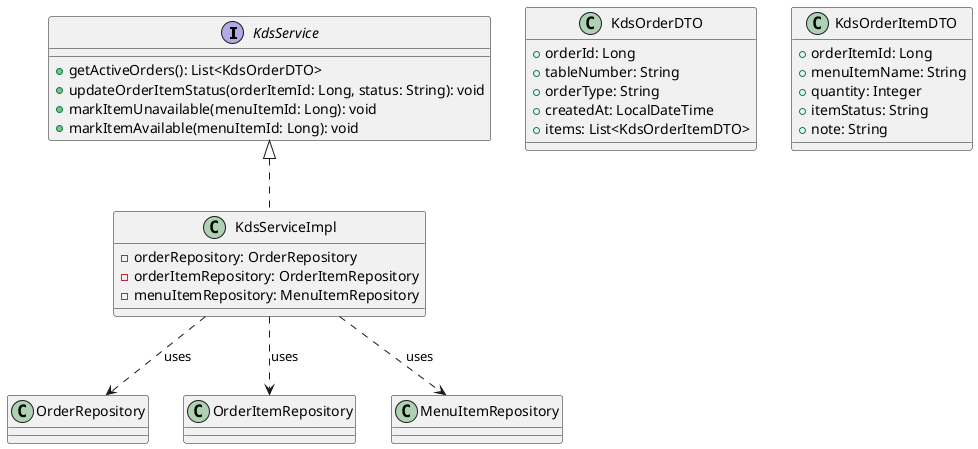
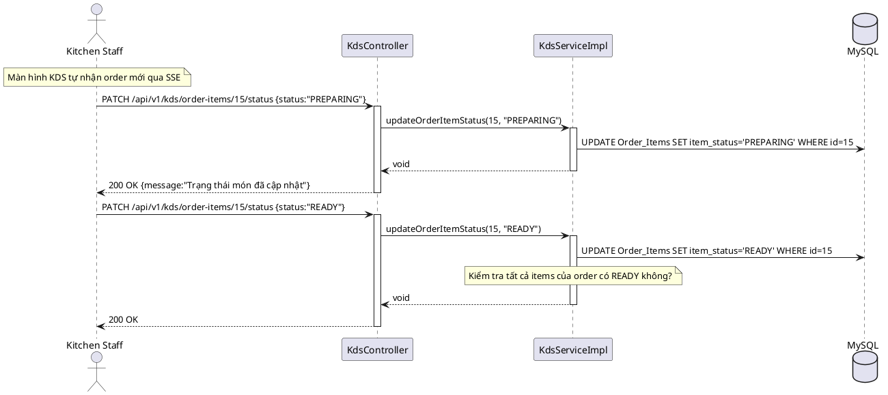
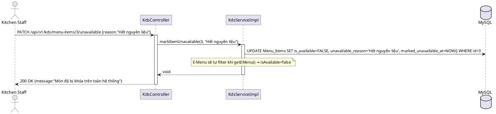
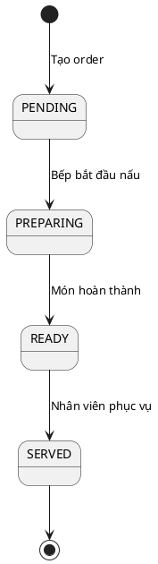

# ENGINEERING DOCUMENTATION STANDARD (EDS) v2.0

## UC17 — KDS (Kitchen Display System) & Quản lý Hết món (KdsService)

| Field | Value |
|-------|-------|
| **Document ID** | `HOANIEN-EDS-MOD3-UC17-001` |
| **Version** | 1.0 |
| **Date** | 2026-06-14 |
| **Status** | Approved |
| **Document Owner** | Trịnh Minh Đức |
| **Author** | Trịnh Minh Đức — Developer |
| **Reviewed by** | Nguyễn Xuân Lưu — Tech Lead |
| **DPO Sign-off** | `[x] Approved – 2026-06-14 – Nguyễn Xuân Lưu` |
| **Approved by** | `[x] Nguyễn Xuân Lưu – 2026-06-14` |
| **Last Review** | 2026-06-14 |
| **Based on EDS** | v2.0 |

---

### CHANGELOG
| Ngày | Người thực hiện | Nội dung thay đổi |
|------|-----------------|-------------------|
| 2026-06-14 | Trịnh Minh Đức | Tạo tài liệu lần đầu |

---

### MỤC LỤC
1. [Tổng quan Module](#1)
2. [Ma trận Truy vết](#2)
3. [ADR](#3)
4. [Non-Functional & SLA](#4)
5. [Static Modeling](#5)
6. [Dynamic Modeling](#6)
7. [Domain Event Catalog](#7)
8. [Interface Specification](#8)
9. [API Specification](#9)
10. [Bảng mã lỗi](#10)
11. [Quy trình Triển khai](#11)
12. [Rollback & Incident Runbook](#12)
13. [Kịch bản Kiểm thử](#13)
14. [Phương pháp Xác minh](#14)
15. [Mẫu thử thực tế](#15)
16. [Authorization Matrix](#16)
17. [Phụ lục](#17)

---

### 1. Tổng quan Module

| Field | Value |
|-------|-------|
| **Module Name** | KDS & Quản lý Hết món (UC17) |
| **Bounded Context** | POS & F&B Context |
| **Use Case** | UC17.1: Bếp nhận KOT qua KDS, cập nhật trạng thái từng món PREPARING→READY; UC17.2: Bếp báo hết món → hệ thống tự khóa món trên E-Menu/POS |
| **Data Classification** | Internal |
| **Compliance Scope** | Quy định vận hành bếp |
| **Upstream Dependencies** | UC16 (POS tạo order → KDS nhận), UC14 (E-Menu hiển thị available items) |
| **Downstream Consumers** | UC16 (POS biết món đã READY để phục vụ) |

---

### 2. Ma trận Truy vết

| Requirement ID | Loại | Mô tả | Thành phần Code | Compliance | ADR |
|----------------|------|-------|-----------------|------------|-----|
| UC17.1a | US | KDS nhận order mới → hiển thị KOT trên màn hình bếp | `KdsService.getActiveOrders()` | — | — |
| UC17.1b | US | Bếp cập nhật từng món PREPARING → READY | `KdsService.updateOrderItemStatus()` | — | — |
| UC17.2 | US | Bếp báo hết món → MenuItem.isAvailable=false, tự khóa trên E-Menu | `KdsService.markItemUnavailable()` | — | ADR-004 |

---

### 3. Architecture Decision Records (ADR)

#### ADR-004 — Real-time KDS thông qua SSE (Server-Sent Events)

| Field | Value |
|-------|-------|
| **Status** | Accepted |
| **Deciders** | Nguyễn Xuân Lưu, Trịnh Minh Đức |
| **Date** | 2026-06-12 |

**Bối cảnh:** Màn hình bếp (KDS) cần nhận thông tin order mới và cập nhật trạng thái theo thời gian thực mà không cần polling thủ công.

**Quyết định:** Dùng Spring WebFlux SSE (Server-Sent Events) endpoint `/api/v1/kds/stream` để push KOT mới đến màn hình bếp. Backup: polling endpoint `GET /api/v1/kds/orders/active` mỗi 10 giây nếu SSE unavailable.

**Hệ quả:** Latency < 1 giây từ order tạo đến KDS hiển thị; đơn giản hơn WebSocket.

---

### 4. Non-Functional Requirements & SLA

#### 4.1. Performance & Availability

| Category | Requirement | Target SLA | Measurement |
|----------|-------------|------------|-------------|
| **KOT Delivery** | Từ order tạo → KDS nhận | < 1s | E2E test |
| **Update Latency** | Cập nhật trạng thái món | < 200ms | k6 test |
| **Availability** | Uptime | 99.9% | Uptime monitor |

#### 4.2. Security

| Category | Requirement | Target | Verification |
|----------|-------------|--------|--------------|
| **Auth** | Chỉ F&B Staff, Admin | JWT + Role | Integration test |

---

### 5. Static Modeling

#### 5.1. Class Diagram



#### 5.2. Data Structure

```sql
-- OrderItem status lifecycle: PENDING → PREPARING → READY → SERVED

-- Bổ sung cột cho MenuItem
ALTER TABLE Menu_Items ADD COLUMN unavailable_reason VARCHAR(255) NULL;
ALTER TABLE Menu_Items ADD COLUMN marked_unavailable_at TIMESTAMP NULL;
```

---

### 6. Dynamic Modeling

#### 6.1. Sequence Diagram — UC17.1: Bếp nhận KOT và cập nhật trạng thái



#### 6.2. Sequence Diagram — UC17.2: Báo hết món → khóa E-Menu



#### 6.3. State Machine — OrderItem Status



---

### 7. Domain Event Catalog

| Event Name | Trigger | Publisher | Subscriber(s) | Async? |
|------------|---------|-----------|---------------|--------|
| `OrderItemStatusUpdated` | Cập nhật trạng thái món | `KdsService` | `PosOrderService` (notify staff) | Yes |
| `MenuItemMarkedUnavailable` | Bếp báo hết món | `KdsService` | `EMenuService` (refresh cache) | Yes |

---

### 8. Interface Specification

```java
// KdsService.java
// @version 1.0

public interface KdsService {
    /**
     * Lấy danh sách orders đang active (PENDING/PREPARING) cho màn hình bếp.
     *
     * @return List<KdsOrderDTO>
     */
    List<KdsOrderDTO> getActiveOrders();

    /**
     * Bếp cập nhật trạng thái từng món.
     * Hợp lệ: PENDING → PREPARING → READY.
     *
     * @param orderItemId ID của OrderItem
     * @param status      Trạng thái mới: "PREPARING" | "READY"
     * @throws OrderItemNotFoundException nếu orderItemId không tồn tại (POS-011)
     * @throws InvalidStatusTransitionException nếu chuyển trạng thái không hợp lệ (POS-012)
     */
    void updateOrderItemStatus(Long orderItemId, String status);

    /**
     * Bếp báo hết món → tắt hiển thị trên E-Menu và POS.
     *
     * @param menuItemId ID của MenuItem
     */
    void markItemUnavailable(Long menuItemId);

    /**
     * Bếp mở lại món khi nguyên liệu đã bổ sung.
     *
     * @param menuItemId ID của MenuItem
     */
    void markItemAvailable(Long menuItemId);
}
```

---

### 9. API Specification

| Method | Path | Auth | Roles | Rate Limit | Idempotent? |
|--------|------|------|-------|------------|-------------|
| GET | `/api/v1/kds/orders/active` | JWT | F&B STAFF, ADMIN | 200/min | Yes |
| PATCH | `/api/v1/kds/order-items/{id}/status` | JWT | F&B STAFF, ADMIN | 100/min | Yes |
| PATCH | `/api/v1/kds/menu-items/{id}/unavailable` | JWT | F&B STAFF, ADMIN | 30/min | Yes |
| PATCH | `/api/v1/kds/menu-items/{id}/available` | JWT | F&B STAFF, ADMIN | 30/min | Yes |

**PATCH `/api/v1/kds/order-items/15/status`**
*Request:* `{"status": "PREPARING"}`
*Response 200:* `{"message": "Trạng thái món đã cập nhật thành PREPARING"}`

**PATCH `/api/v1/kds/menu-items/3/unavailable`**
*Request:* `{"reason": "Hết nguyên liệu"}`
*Response 200:* `{"message": "Món Phở bò đã bị khóa trên toàn hệ thống"}`

---

### 10. Bảng mã lỗi

| Code | HTTP | Message (EN) | Message (VI) | Trigger |
|------|------|--------------|--------------|---------|
| `POS-011` | 404 | Order item not found | Không tìm thấy món trong đơn hàng | orderItemId không tồn tại |
| `POS-012` | 400 | Invalid status transition | Chuyển trạng thái không hợp lệ | Ví dụ: READY → PENDING |
| `POS-013` | 404 | Menu item not found | Không tìm thấy món ăn | menuItemId không tồn tại |

---

### 11. Quy trình Triển khai

#### 11.1. Prerequisites
- [x] Database đã có Order_Items, Menu_Items
- [x] SSE endpoint /api/v1/kds/stream đã được config

#### 11.2. Deployment
```bash
mvn clean package -DskipTests
java -jar target/hoanien-backend-1.0.jar --spring.profiles.active=staging
```

#### 11.3. Verification
```bash
# Lấy danh sách order active
curl -X GET http://localhost:8080/api/v1/kds/orders/active \
  -H "Authorization: Bearer [JWT]"

# Cập nhật trạng thái món
curl -X PATCH http://localhost:8080/api/v1/kds/order-items/15/status \
  -H "Authorization: Bearer [JWT]" \
  -H "Content-Type: application/json" \
  -d '{"status":"PREPARING"}'

# Báo hết món
curl -X PATCH http://localhost:8080/api/v1/kds/menu-items/3/unavailable \
  -H "Authorization: Bearer [JWT]" \
  -H "Content-Type: application/json" \
  -d '{"reason":"Hết nguyên liệu"}'
```

---

### 12. Rollback & Incident Runbook

| Điều kiện | Ngưỡng | Người quyết định |
|-----------|--------|-------------------|
| KDS SSE ngắt kết nối | > 30s | F&B Manager |
| Món bị khóa nhầm | Bất kỳ | F&B Manager → `markItemAvailable()` |

**Rollback:** `git checkout tags/v1.0.0 && mvn clean package`

---

### 13. Kịch bản Kiểm thử

**[Policy]** Test Data: SYNTHETIC. ❌ KHÔNG dùng Production data.

#### 13.1. Unit Tests
- TC-UNIT-UC17-001: KDS lấy active orders → trả đúng orders PENDING/PREPARING
- TC-UNIT-UC17-002: Bếp cập nhật PENDING → PREPARING → READY thành công
- TC-UNIT-UC17-003: Chuyển trạng thái không hợp lệ (READY→PENDING) → POS-012
- TC-UNIT-UC17-004: Báo hết món → MenuItem.isAvailable=false
- TC-UNIT-UC17-005: Mở lại món → MenuItem.isAvailable=true

---

### 14. Phương pháp Xác minh

```sql
-- Kiểm tra trạng thái OrderItem
SELECT id, order_id, menu_item_id, item_status FROM Order_Items WHERE id = :orderItemId;

-- Kiểm tra MenuItem bị khóa
SELECT id, name, is_available, unavailable_reason, marked_unavailable_at
FROM Menu_Items WHERE id = :menuItemId;

-- Lấy tất cả orders đang active
SELECT id, order_type, order_status, table_id FROM Orders
WHERE order_status IN ('PENDING', 'PREPARING') ORDER BY created_at ASC;
```

---

### 15. Mẫu thử thực tế

```bash
# Xem orders bếp cần làm
curl -X GET https://api.hoanienretreat.com/api/v1/kds/orders/active \
  -H "Authorization: Bearer [JWT]"

# Bắt đầu nấu
curl -X PATCH https://api.hoanienretreat.com/api/v1/kds/order-items/15/status \
  -H "Authorization: Bearer [JWT]" \
  -H "Content-Type: application/json" \
  -d '{"status":"PREPARING"}'

# Hoàn thành món
curl -X PATCH https://api.hoanienretreat.com/api/v1/kds/order-items/15/status \
  -H "Authorization: Bearer [JWT]" \
  -H "Content-Type: application/json" \
  -d '{"status":"READY"}'
```

---

### 16. Authorization Matrix

| Endpoint | GUEST | CUSTOMER | F&B STAFF | RECEPTIONIST | ADMIN |
|----------|:-----:|:--------:|:---------:|:------------:|:-----:|
| `GET /api/v1/kds/orders/active` | ❌ | ❌ | ✔️ | ❌ | ✔️ |
| `PATCH /kds/order-items/{id}/status` | ❌ | ❌ | ✔️ | ❌ | ✔️ |
| `PATCH /kds/menu-items/{id}/unavailable` | ❌ | ❌ | ✔️ | ❌ | ✔️ |
| `PATCH /kds/menu-items/{id}/available` | ❌ | ❌ | ✔️ | ❌ | ✔️ |

---

### PHỤ LỤC

#### A. Glossary
| Thuật ngữ | Định nghĩa |
|-----------|------------|
| **KDS** | Kitchen Display System — màn hình kỹ thuật số trong bếp hiển thị lệnh nấu |
| **KOT** | Kitchen Order Ticket — phiếu lệnh nấu từng món |
| **SSE** | Server-Sent Events — cơ chế server push dữ liệu real-time đến client |
| **PREPARING** | Trạng thái bếp đang nấu món |
| **READY** | Trạng thái món đã hoàn thành, chờ phục vụ |

#### B. Tài liệu tham chiếu
| Document | Path |
|----------|------|
| TDD UC17 | `06-Testing/mod3_pos/uc17/TDD_UC17_SPEC.md` |
| EDS MOD3 | `06-Testing/mod3_pos/EDS_MOD3_SPEC.md` |

---

*EDS v2.0*