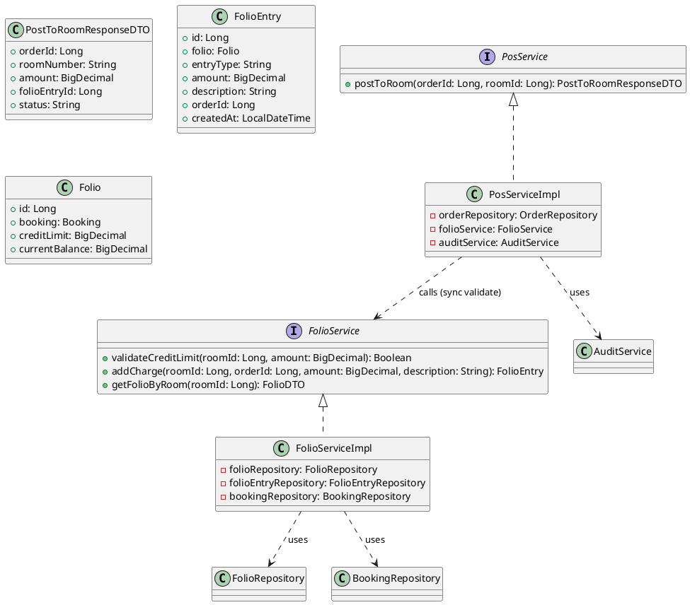
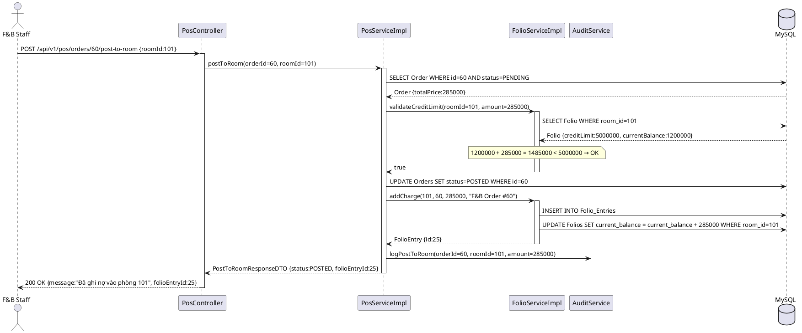
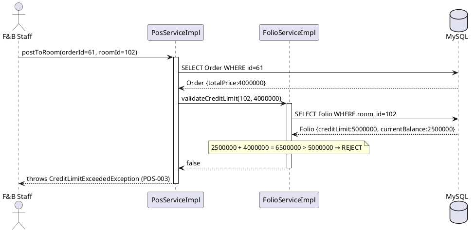
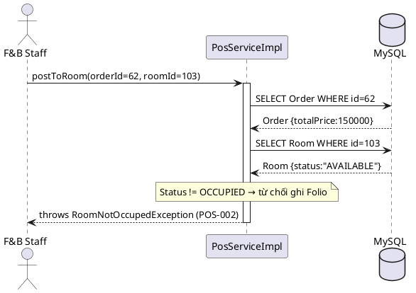
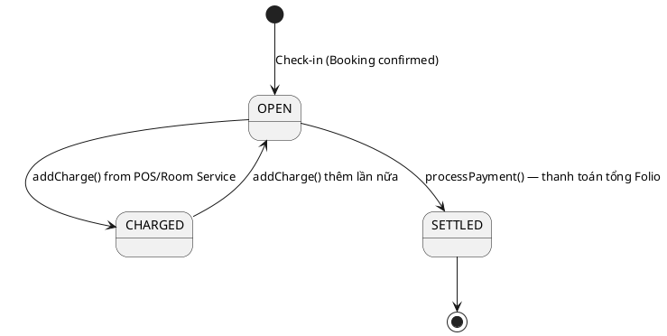

# ENGINEERING DOCUMENTATION STANDARD (EDS) v2.0

## UC18 — Post to Room & Credit Limit (PosService / FolioService)

| Field | Value |
|-------|-------|
| **Document ID** | `HOANIEN-EDS-MOD3-UC18-001` |
| **Version** | 1.0 |
| **Date** | 2026-06-14 |
| **Status** | Approved |
| **Document Owner** | Trịnh Minh Đức |
| **Author** | Trịnh Minh Đức — Developer |
| **Reviewed by** | Nguyễn Xuân Lưu — Tech Lead |
| **DPO Sign-off** | `[x] Approved – 2026-06-14 – Nguyễn Xuân Lưu` |
| **Approved by** | `[x] Nguyễn Xuân Lưu – 2026-06-14` |
| **Last Review** | 2026-06-14 |
| **Based on EDS** | v2.0 |

---

### CHANGELOG
| Ngày | Người thực hiện | Nội dung thay đổi |
|------|-----------------|-------------------|
| 2026-06-14 | Trịnh Minh Đức | Tạo tài liệu lần đầu |

---

### MỤC LỤC
1. [Tổng quan Module](#1)
2. [Ma trận Truy vết](#2)
3. [ADR](#3)
4. [Non-Functional & SLA](#4)
5. [Static Modeling](#5)
6. [Dynamic Modeling](#6)
7. [Domain Event Catalog](#7)
8. [Interface Specification](#8)
9. [API Specification](#9)
10. [Bảng mã lỗi](#10)
11. [Quy trình Triển khai](#11)
12. [Rollback & Incident Runbook](#12)
13. [Kịch bản Kiểm thử](#13)
14. [Phương pháp Xác minh](#14)
15. [Mẫu thử thực tế](#15)
16. [Authorization Matrix](#16)
17. [Phụ lục](#17)

---

### 1. Tổng quan Module

| Field | Value |
|-------|-------|
| **Module Name** | Post to Room & Credit Limit (UC18) |
| **Bounded Context** | POS & F&B Context ↔ Folio Context |
| **Use Case** | UC18: Ghi nợ hóa đơn ăn uống vào Folio phòng; xác thực Credit Limit trước khi ghi; từ chối nếu vượt hạn mức |
| **Data Classification** | Financial / Restricted |
| **Compliance Scope** | Luật Kế toán Việt Nam; Quy định Resort (BR-FO-06) |
| **Upstream Dependencies** | UC16 (POS Order PENDING → payment POST_TO_ROOM), Module 2 — Booking (Folio, Credit Limit) |
| **Downstream Consumers** | Module 5 — Finance (Folio total calculation) |

---

### 2. Ma trận Truy vết

| Requirement ID | Loại | Mô tả | Thành phần Code | Compliance | ADR |
|----------------|------|-------|-----------------|------------|-----|
| UC18.1 | US | Ghi nợ tiền ăn uống vào Folio phòng | `PosService.postToRoom()` / `FolioService.addCharge()` | Luật Kế toán | ADR-001 |
| UC18.2 | US | Xác thực Credit Limit trước khi ghi nợ | `PosService.postToRoom()` | BR-FO-06 | — |
| BR-POS-01 | BR | Post to Room phải xác thực Credit Limit | `PosService.postToRoom()` | BR-FO-06 | — |
| BR-FO-06 | BR | Tổng Folio không vượt Credit Limit | `FolioService.addCharge()` | Luật Kế toán | — |

---

### 3. Architecture Decision Records (ADR)

#### ADR-001 — Event-driven Post to Room (Revisited)

| Field | Value |
|-------|-------|
| **Status** | Accepted |
| **Deciders** | Nguyễn Xuân Lưu, Trịnh Minh Đức |
| **Date** | 2026-06-12 |

**Bối cảnh:** POS cần ghi nợ vào Folio nhưng không nên trực tiếp gọi FolioService (tight coupling). Credit Limit phải được kiểm tra ngay trước khi ghi để tránh vượt hạn.

**Quyết định:** POS gọi `FolioService.validateCreditLimit(roomId, amount)` đồng bộ trước. Nếu OK, publish event `PosOrderPostedToRoomEvent`. FolioService lắng nghe async và ghi `FolioEntry`.

**Hệ quả:**
- Credit Limit được kiểm tra đồng bộ → khách nhận phản hồi ngay.
- Ghi Folio bất đồng bộ → retry nếu Folio service tạm thời lỗi.
- POS và Folio vẫn loosely coupled.

---

### 4. Non-Functional Requirements & SLA

#### 4.1. Performance & Availability

| Category | Requirement | Target SLA | Measurement |
|----------|-------------|------------|-------------|
| **Latency** | Post to Room response (p99) | < 200ms | k6 load test |
| **Availability** | Uptime POS + Folio | 99.9% | Uptime monitor |
| **Consistency** | Folio balance always accurate | Eventual consistency | Integration test |

#### 4.2. Security

| Category | Requirement | Target | Verification |
|----------|-------------|--------|--------------|
| **Auth** | Chỉ F&B Staff, Receptionist, Admin | JWT + Role | Integration test |
| **Financial Audit** | Mọi giao dịch Post to Room phải ghi AuditLog | AuditService | Unit test |

---

### 5. Static Modeling

#### 5.1. Class Diagram



#### 5.2. Data Structure

```sql
CREATE TABLE Folios (
    id BIGINT AUTO_INCREMENT PRIMARY KEY,
    booking_id BIGINT NOT NULL,
    room_id BIGINT NOT NULL,
    credit_limit DECIMAL(18,2) DEFAULT 5000000,
    current_balance DECIMAL(18,2) DEFAULT 0,
    FOREIGN KEY (booking_id) REFERENCES Bookings(id)
);

CREATE TABLE Folio_Entries (
    id BIGINT AUTO_INCREMENT PRIMARY KEY,
    folio_id BIGINT NOT NULL,
    entry_type VARCHAR(50) NOT NULL COMMENT 'ROOM_CHARGE, F&B_CHARGE, PAYMENT',
    amount DECIMAL(18,2) NOT NULL,
    description VARCHAR(255),
    order_id BIGINT NULL,
    created_at TIMESTAMP DEFAULT CURRENT_TIMESTAMP,
    FOREIGN KEY (folio_id) REFERENCES Folios(id)
);
```

---

### 6. Dynamic Modeling

#### 6.1. Sequence Diagram — Happy Path: Post to Room thành công



#### 6.2. Sequence Diagram — Vượt Credit Limit → từ chối



#### 6.3. Sequence Diagram — Phòng không OCCUPIED → từ chối



#### 6.4. State Machine — Folio Balance



---

### 7. Domain Event Catalog

| Event Name | Trigger | Publisher | Subscriber(s) | Async? |
|------------|---------|-----------|---------------|--------|
| `PosOrderPostedToRoomEvent` | Post to Room OK | `PosService` | `FolioService` (addCharge async), `AuditService` | Yes |
| `CreditLimitExceededEvent` | Vượt Credit Limit | `FolioService.validateCreditLimit()` | `NotificationService` (báo lễ tân) | Yes |

---

### 8. Interface Specification

```java
// PosService.java
// @version 1.0

public interface PosService {
    /**
     * Ghi nợ hóa đơn POS vào Folio phòng.
     * Xác thực Credit Limit đồng bộ; ghi FolioEntry bất đồng bộ.
     *
     * @param orderId ID của POS order
     * @param roomId  ID của phòng cần ghi nợ
     * @return PostToRoomResponseDTO
     * @throws OrderNotFoundException      nếu orderId không tồn tại (POS-009)
     * @throws RoomNotOccupedException     nếu phòng không OCCUPIED (POS-002)
     * @throws CreditLimitExceededException nếu vượt Credit Limit (POS-003)
     */
    PostToRoomResponseDTO postToRoom(Long orderId, Long roomId);
}

// FolioService.java

public interface FolioService {
    /**
     * Kiểm tra số dư Credit Limit có đủ để ghi thêm một khoản không.
     *
     * @param roomId ID phòng
     * @param amount Số tiền cần ghi thêm
     * @return true nếu đủ; false nếu vượt
     */
    boolean validateCreditLimit(Long roomId, BigDecimal amount);

    /**
     * Thêm FolioEntry vào Folio phòng.
     *
     * @param roomId      ID phòng
     * @param orderId     ID POS order
     * @param amount      Số tiền
     * @param description Mô tả khoản phí
     * @return FolioEntry đã được tạo
     */
    FolioEntry addCharge(Long roomId, Long orderId, BigDecimal amount, String description);
}
```

---

### 9. API Specification

| Method | Path | Auth | Roles | Rate Limit | Idempotent? |
|--------|------|------|-------|------------|-------------|
| POST | `/api/v1/pos/orders/{orderId}/post-to-room` | JWT | F&B STAFF, RECEPTIONIST, ADMIN | 50/min | No |
| GET | `/api/v1/folio?roomId={id}` | JWT | RECEPTIONIST, ADMIN | 100/min | Yes |

**POST `/api/v1/pos/orders/60/post-to-room`**
*Request:* `{"roomId": 101}`
*Response 200:*
```json
{
  "orderId": 60,
  "roomNumber": "101",
  "amount": 285000,
  "folioEntryId": 25,
  "status": "POSTED",
  "message": "Đã ghi nợ vào Folio phòng 101"
}
```
*Response 400 (Credit Limit):* `{"error": {"code": "POS-003", "message": "Vượt hạn mức tín dụng (Credit Limit: 5,000,000 VNĐ, Current: 4,800,000 VNĐ)"}}`
*Response 400 (Not Occupied):* `{"error": {"code": "POS-002", "message": "Phòng không ở trạng thái OCCUPIED"}}`

---

### 10. Bảng mã lỗi

| Code | HTTP | Message (EN) | Message (VI) | Trigger |
|------|------|--------------|--------------|---------|
| `POS-001` | 404 | Room not found | Phòng không tồn tại | roomId không hợp lệ |
| `POS-002` | 400 | Room not occupied | Phòng không ở trạng thái OCCUPIED | Room.status != OCCUPIED |
| `POS-003` | 400 | Credit limit exceeded | Vượt hạn mức tín dụng | currentBalance + amount > creditLimit |
| `POS-009` | 404 | Order not found | Không tìm thấy order | orderId không tồn tại |
| `POS-004` | 400 | Order already settled | Order đã được ghi nợ rồi | Order.status = POSTED |

---

### 11. Quy trình Triển khai

#### 11.1. Prerequisites
- [x] Database đã có Folios (với creditLimit), Folio_Entries, Bookings, Rooms

#### 11.2. Deployment
```bash
mvn clean package -DskipTests
java -jar target/hoanien-backend-1.0.jar --spring.profiles.active=staging
```

#### 11.3. Verification
```bash
# Ghi nợ vào phòng
curl -X POST http://localhost:8080/api/v1/pos/orders/60/post-to-room \
  -H "Authorization: Bearer [JWT]" \
  -H "Content-Type: application/json" \
  -d '{"roomId": 101}'

# Xem Folio phòng
curl -X GET "http://localhost:8080/api/v1/folio?roomId=101" \
  -H "Authorization: Bearer [JWT]"
```

---

### 12. Rollback & Incident Runbook

| Điều kiện | Ngưỡng | Người quyết định |
|-----------|--------|-------------------|
| FolioEntry ghi sai số tiền | Bất kỳ | Tech Lead + Finance |
| Post to Room fail rate | > 2% trong 5 phút | On-call Engineer |

**Rollback Folio Entry nhầm:**
```sql
-- Tìm entry ghi nhầm
SELECT * FROM Folio_Entries WHERE order_id = :orderId;
-- Xóa entry và hoàn lại balance
DELETE FROM Folio_Entries WHERE id = :entryId;
UPDATE Folios SET current_balance = current_balance - :amount WHERE room_id = :roomId;
```

**Rollback code:** `git checkout tags/v1.0.0 && mvn clean package`

---

### 13. Kịch bản Kiểm thử

**[Policy]** Test Data: SYNTHETIC. ❌ KHÔNG dùng Production data.

#### 13.1. Unit Tests
- TC-UNIT-UC18-001: Post to Room thành công → FolioEntry được tạo, Order POSTED, AuditService được gọi
- TC-UNIT-UC18-002: Post to Room vượt Credit Limit → POS-003, Order vẫn PENDING
- TC-UNIT-UC18-003: Post to Room phòng không OCCUPIED → POS-002
- TC-UNIT-UC18-004: validateCreditLimit: balance + amount < limit → true
- TC-UNIT-UC18-005: validateCreditLimit: balance + amount > limit → false

#### 13.2. E2E Tests
- TC-E2E-UC18-001: POS Dine-In → Chọn POST_TO_ROOM → Kiểm tra FolioEntry DB + Order POSTED

---

### 14. Phương pháp Xác minh

```sql
-- Kiểm tra Folio sau khi Post to Room
SELECT id, room_id, credit_limit, current_balance FROM Folios WHERE room_id = 101;

-- Kiểm tra FolioEntry được tạo
SELECT id, entry_type, amount, description, order_id, created_at
FROM Folio_Entries WHERE folio_id = :folioId ORDER BY created_at DESC;

-- Kiểm tra Order đã POSTED
SELECT id, order_status, payment_method FROM Orders WHERE id = 60;

-- Xác minh Credit Limit chưa vượt
SELECT (credit_limit - current_balance) as remaining_credit
FROM Folios WHERE room_id = 101;
```

---

### 15. Mẫu thử thực tế

```bash
# Post to Room thành công
curl -X POST https://api.hoanienretreat.com/api/v1/pos/orders/60/post-to-room \
  -H "Authorization: Bearer [JWT]" \
  -H "Content-Type: application/json" \
  -d '{"roomId": 101}'

# Xem Folio chi tiết
curl -X GET "https://api.hoanienretreat.com/api/v1/folio?roomId=101" \
  -H "Authorization: Bearer [JWT]"

# Test vượt Credit Limit (negative test)
curl -X POST https://api.hoanienretreat.com/api/v1/pos/orders/61/post-to-room \
  -H "Authorization: Bearer [JWT]" \
  -H "Content-Type: application/json" \
  -d '{"roomId": 102}'
# Expected: 400 {"code":"POS-003"}
```

---

### 16. Authorization Matrix

| Endpoint | GUEST | CUSTOMER | F&B STAFF | RECEPTIONIST | ADMIN |
|----------|:-----:|:--------:|:---------:|:------------:|:-----:|
| `POST /api/v1/pos/orders/{id}/post-to-room` | ❌ | ❌ | ✔️ | ✔️ | ✔️ |
| `GET /api/v1/folio?roomId={id}` | ❌ | ❌ | ❌ | ✔️ | ✔️ |

---

### PHỤ LỤC

#### A. Glossary
| Thuật ngữ | Định nghĩa |
|-----------|------------|
| **Post to Room** | Cơ chế ghi nợ chi phí ăn uống/dịch vụ vào hóa đơn phòng thay vì thanh toán trực tiếp |
| **Folio** | Hóa đơn tổng hợp của khách trong suốt kỳ lưu trú |
| **FolioEntry** | Một khoản phí/hoàn tiền trong Folio |
| **Credit Limit** | Hạn mức tín dụng tối đa khách được nợ trước khi phải thanh toán |
| **BR-FO-06** | Business Rule: Tổng Folio không được vượt Credit Limit đã thỏa thuận |

#### B. Tài liệu tham chiếu
| Document | Path |
|----------|------|
| TDD UC18 | `06-Testing/mod3_pos/uc18/TDD_UC18_SPEC.md` |
| EDS MOD3 | `06-Testing/mod3_pos/EDS_MOD3_SPEC.md` |
| ADR-001 | Trong EDS này, section 3 |

---

*EDS v2.0*