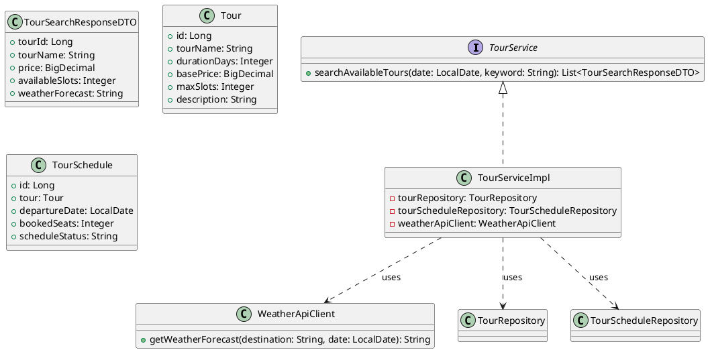
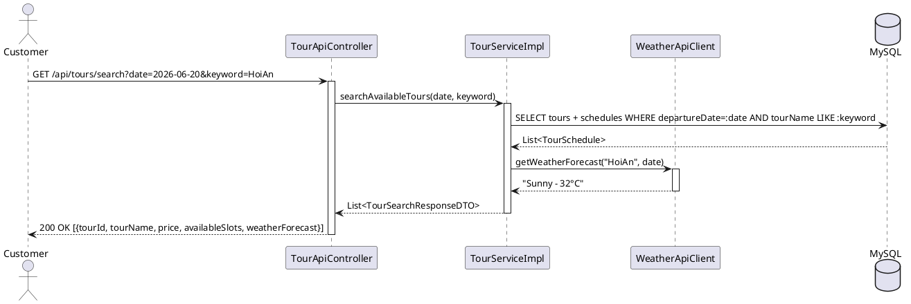
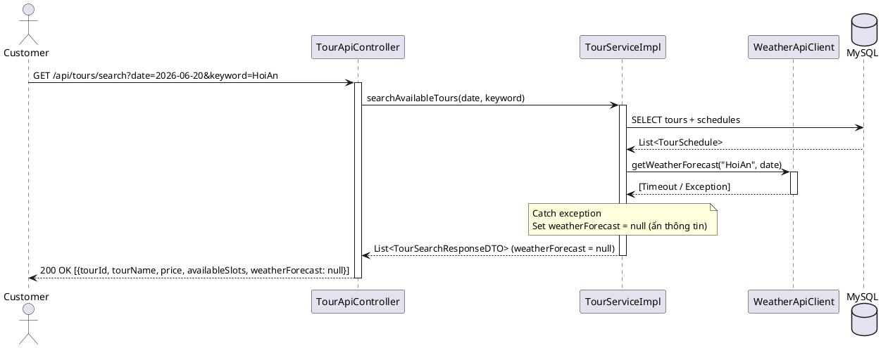
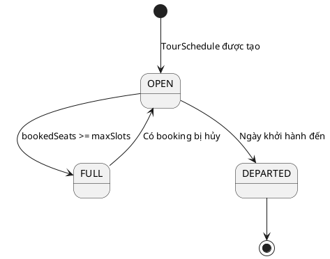

# ENGINEERING DOCUMENTATION STANDARD (EDS) v2.0

## UC19 — Tìm kiếm Tour & Thời tiết (TourService)

| Field | Value |
|-------|-------|
| **Document ID** | `HOANIEN-EDS-MOD4-UC19-001` |
| **Version** | 1.0 |
| **Date** | 2026-06-14 |
| **Status** | Approved |
| **Document Owner** | Nguyễn Thị Thúy Ngọc |
| **Author** | Nguyễn Thị Thúy Ngọc — Developer |
| **Reviewed by** | Nguyễn Xuân Lưu — Tech Lead |
| **DPO Sign-off** | `[x] Approved – 2026-06-14 – Nguyễn Xuân Lưu` |
| **Approved by** | `[x] Nguyễn Xuân Lưu – 2026-06-14` |
| **Last Review** | 2026-06-14 |
| **Based on EDS** | v2.0 |

---

### CHANGELOG
| Ngày | Người thực hiện | Nội dung thay đổi |
|------|-----------------|-------------------|
| 2026-06-14 | Nguyễn Thị Thúy Ngọc | Tạo tài liệu lần đầu |

---

### MỤC LỤC
1. [Tổng quan Module](#1)
2. [Ma trận Truy vết](#2)
3. [ADR](#3)
4. [Non-Functional & SLA](#4)
5. [Static Modeling](#5)
6. [Dynamic Modeling](#6)
7. [Domain Event Catalog](#7)
8. [Interface Specification](#8)
9. [API Specification](#9)
10. [Bảng mã lỗi](#10)
11. [Quy trình Triển khai](#11)
12. [Rollback & Incident Runbook](#12)
13. [Kịch bản Kiểm thử](#13)
14. [Phương pháp Xác minh](#14)
15. [Mẫu thử thực tế](#15)
16. [Authorization Matrix](#16)
17. [Phụ lục](#17)

---

### 1. Tổng quan Module

| Field | Value |
|-------|-------|
| **Module Name** | Tìm kiếm Tour & Thời tiết (UC19) |
| **Bounded Context** | Tour & Review Context |
| **Use Case** | UC19: Tìm kiếm tour khả dụng theo ngày, từ khóa; tích hợp thời tiết |
| **Data Classification** | Public |
| **Compliance Scope** | Luật Du lịch Việt Nam 2017 |
| **Upstream Dependencies** | Module 1 — Auth (JWT required) |
| **Downstream Consumers** | UC20 (Đặt tour) |

---

### 2. Ma trận Truy vết

| Requirement ID | Loại | Mô tả | Thành phần Code | Compliance | ADR |
|----------------|------|-------|-----------------|------------|-----|
| UC19.1 | US | Tìm kiếm tour theo ngày và từ khóa | `TourService.searchAvailableTours()` | Luật Du lịch 2017 | ADR-002 |
| UC19.2 | US | Hiển thị dự báo thời tiết tại điểm đến | `WeatherApiClient.getWeatherForecast()` | — | ADR-002 |
| BR-TOUR-03 | BR | Nếu Weather API lỗi, vẫn trả danh sách tour (ẩn thông tin thời tiết) | `TourServiceImpl.searchAvailableTours()` | — | ADR-002 |

---

### 3. Architecture Decision Records (ADR)

#### ADR-002 — Tích hợp Weather API Không Chặn (Fail-safe)

| Field | Value |
|-------|-------|
| **Status** | Accepted |
| **Deciders** | Nguyễn Xuân Lưu, Nguyễn Thị Thúy Ngọc |
| **Date** | 2026-06-13 |

**Bối cảnh:** Khi tìm kiếm danh sách Tour, hệ thống cần hiển thị dự báo thời tiết tại điểm đến. Nếu Weather API của bên thứ 3 gặp sự cố, hệ thống không được trả về lỗi 500 cho khách hàng.

**Quyết định:** Triển khai cơ chế bao bọc `try-catch` bắt lỗi cô lập. Khi Weather API lỗi hoặc quá hạn phản hồi (timeout 500ms), hệ thống sẽ trả về danh sách Tour bình thường nhưng ẩn/trống thông tin thời tiết.

**Hệ quả:** 100% uptime cho tính năng tìm kiếm tour; trải nghiệm degraded nhẹ (không có thời tiết) thay vì lỗi hoàn toàn.

---

### 4. Non-Functional Requirements & SLA

#### 4.1. Performance & Availability

| Category | Requirement | Target SLA | Measurement |
|----------|-------------|------------|-------------|
| **Latency** | Tour search response (p99) | < 500ms | k6 load test |
| **Availability** | Uptime (monthly) | 99.9% | Uptime monitor |
| **Fail-safe** | Weather API timeout | < 500ms, degrade gracefully | Integration test |

#### 4.2. Security

| Category | Requirement | Target | Verification |
|----------|-------------|--------|--------------|
| **Auth** | JWT required cho search | Bearer token | Integration test |
| **Rate Limit** | Tìm kiếm | 60 req/min | API Gateway |

---

### 5. Static Modeling

#### 5.1. Class Diagram



#### 5.2. Data Structure

```sql
CREATE TABLE Tours (
    id BIGINT AUTO_INCREMENT PRIMARY KEY,
    tour_name VARCHAR(255) NOT NULL,
    duration_days INT NOT NULL,
    base_price DECIMAL(18,2) NOT NULL,
    max_slots INT NOT NULL,
    destination VARCHAR(255) NOT NULL,
    description TEXT,
    created_at TIMESTAMP DEFAULT CURRENT_TIMESTAMP
);

CREATE TABLE Tour_Schedules (
    schedule_id BIGINT AUTO_INCREMENT PRIMARY KEY,
    tour_id BIGINT NOT NULL,
    departure_date DATE NOT NULL,
    departure_time TIME NOT NULL,
    booked_seats INT DEFAULT 0,
    schedule_status VARCHAR(50) DEFAULT 'OPEN',
    FOREIGN KEY (tour_id) REFERENCES Tours(id)
);
```

---

### 6. Dynamic Modeling

#### 6.1. Sequence Diagram — Happy Path: Tìm kiếm Tour



#### 6.2. Sequence Diagram — Weather API Lỗi (Graceful Degradation)



#### 6.3. State Machine



---

### 7. Domain Event Catalog

| Event Name | Trigger | Publisher | Subscriber(s) | Async? |
|------------|---------|-----------|---------------|--------|
| `TourSearchedEvent` | Khách tìm kiếm tour | `TourService` | `AnalyticsService` | Yes |

---

### 8. Interface Specification

```java
// TourService.java
// @version 1.0

public interface TourService {
    /**
     * Tìm kiếm danh sách tour khả dụng theo ngày và từ khóa.
     * Tích hợp dự báo thời tiết (fail-safe: nếu Weather API lỗi, trả null).
     *
     * @param date    Ngày khởi hành
     * @param keyword Tên tour hoặc điểm đến
     * @return Danh sách TourSearchResponseDTO
     */
    List<TourSearchResponseDTO> searchAvailableTours(LocalDate date, String keyword);
}
```

---

### 9. API Specification

| Method | Path | Auth | Roles | Rate Limit | Idempotent? |
|--------|------|------|-------|------------|-------------|
| GET | `/api/tours/search` | JWT | All | 60/min | Yes |

**GET `/api/tours/search`**
*Query Params:* `date=2026-06-20&keyword=HoiAn`

*Response 200:*
```json
[
  {
    "tourId": 1,
    "tourName": "Tinh hoa di sản Hội An",
    "price": 1200000,
    "availableSlots": 12,
    "weatherForecast": "Sunny - 32°C"
  },
  {
    "tourId": 2,
    "tourName": "Phố cổ Hội An ban đêm",
    "price": 800000,
    "availableSlots": 5,
    "weatherForecast": null
  }
]
```

*Response 400:* `{"error": {"code": "TOUR-003", "message": "Invalid date format"}}`
*Response 401:* `{"error": {"code": "AUTH-001", "message": "Authentication required"}}`

---

### 10. Bảng mã lỗi

| Code | HTTP | Message (EN) | Message (VI) | Trigger |
|------|------|--------------|--------------|---------|
| `TOUR-003` | 400 | Invalid date format | Định dạng ngày không hợp lệ | Ngày không đúng ISO 8601 |
| `TOUR-004` | 400 | Keyword too short | Từ khóa quá ngắn (tối thiểu 2 ký tự) | keyword.length < 2 |
| `AUTH-001` | 401 | Authentication required | Cần xác thực | Thiếu JWT |

---

### 11. Quy trình Triển khai

#### 11.1. Prerequisites
- [x] Database đã có bảng Tours, Tour_Schedules
- [x] Weather API key đã được cấu hình trong `application.properties`

#### 11.2. Deployment
```bash
mvn clean package -DskipTests
java -jar target/hoanien-backend-1.0.jar --spring.profiles.active=staging
```

#### 11.3. Verification
```bash
curl -X GET "http://localhost:8080/api/tours/search?date=2026-06-20&keyword=HoiAn" \
  -H "Authorization: Bearer [JWT]"
```

---

### 12. Rollback & Incident Runbook

| Điều kiện | Ngưỡng | Người quyết định |
|-----------|--------|-------------------|
| Search API fail rate | > 5% trong 5 phút | On-call Engineer |
| Weather API timeout | > 90% requests | Tech Lead (disable weather feature) |

**Rollback:** `git checkout tags/v1.0.0 && mvn clean package`

---

### 13. Kịch bản Kiểm thử

**[Policy]** Test Data: SYNTHETIC. ❌ KHÔNG dùng Production PII.

#### 13.1. Unit Tests
- TC-UNIT-UC19-001: Search tour theo ngày + keyword → trả danh sách có thời tiết
- TC-UNIT-UC19-002: Weather API timeout → trả danh sách tour, weatherForecast = null
- TC-UNIT-UC19-003: Không tìm thấy tour → trả mảng rỗng []
- TC-UNIT-UC19-004: Keyword < 2 ký tự → 400 TOUR-004
- TC-UNIT-UC19-005: Thiếu JWT → 401 AUTH-001

#### 13.2. E2E Tests
- TC-E2E-UC19-001: Login → Search tour → Xem kết quả có thời tiết

---

### 14. Phương pháp Xác minh

```sql
-- Kiểm tra danh sách tour khả dụng theo ngày
SELECT t.tour_name, ts.departure_date, ts.booked_seats, t.max_slots,
       (t.max_slots - ts.booked_seats) AS available_slots
FROM Tours t
JOIN Tour_Schedules ts ON t.id = ts.tour_id
WHERE ts.departure_date = '2026-06-20'
  AND t.tour_name LIKE '%HoiAn%'
  AND ts.schedule_status = 'OPEN';
```

---

### 15. Mẫu thử thực tế

```bash
# Tìm kiếm tour theo ngày và từ khóa
curl -X GET "https://api.hoanienretreat.com/api/tours/search?date=2026-06-20&keyword=HoiAn" \
  -H "Authorization: Bearer [JWT]"

# Tìm kiếm với keyword ngắn (kiểm tra validation)
curl -X GET "https://api.hoanienretreat.com/api/tours/search?date=2026-06-20&keyword=A" \
  -H "Authorization: Bearer [JWT]"
```

---

### 16. Authorization Matrix

| Endpoint | GUEST | CUSTOMER | TOURGUIDE | RECEPTIONIST | ADMIN |
|----------|:-----:|:--------:|:---------:|:------------:|:-----:|
| `GET /api/tours/search` | ✔️ | ✔️ | ✔️ | ✔️ | ✔️ |

---

### PHỤ LỤC

#### A. Glossary
| Thuật ngữ | Định nghĩa |
|-----------|------------|
| **Weather API** | API bên thứ 3 cung cấp dự báo thời tiết theo địa điểm |
| **Graceful Degradation** | Kỹ thuật xử lý lỗi nhẹ nhàng: giảm chức năng thay vì báo lỗi hoàn toàn |
| **availableSlots** | Số chỗ còn trống = maxSlots - bookedSeats |

#### B. Tài liệu tham chiếu
| Document | Path |
|----------|------|
| TDD UC19 | `06-Testing/mod4_tour/uc19/TDD_UC19_SPEC.md` |
| EDS MOD4 | `06-Testing/mod4_tour/EDS_MOD4_SPEC.md` |
| ADR-002 | `06-Testing/mod4_tour/EDS_MOD4_SPEC.md#adr-002` |

---

*EDS v2.0*