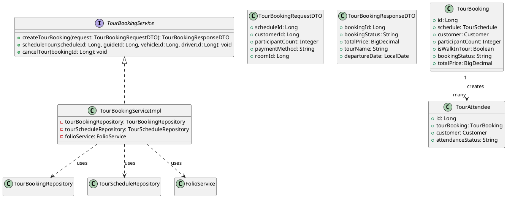
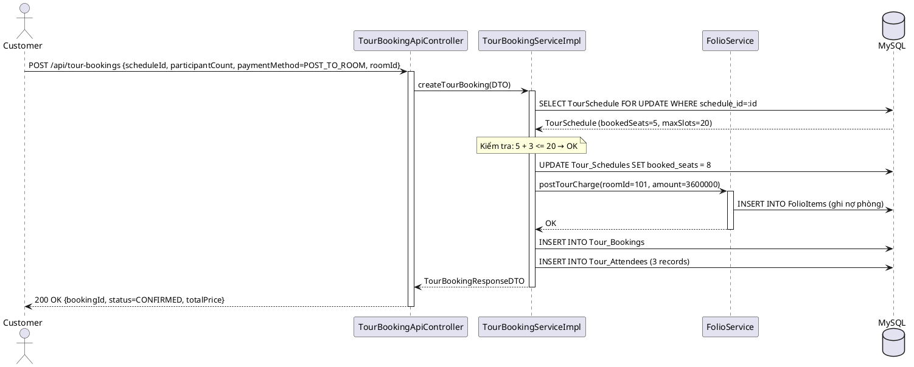
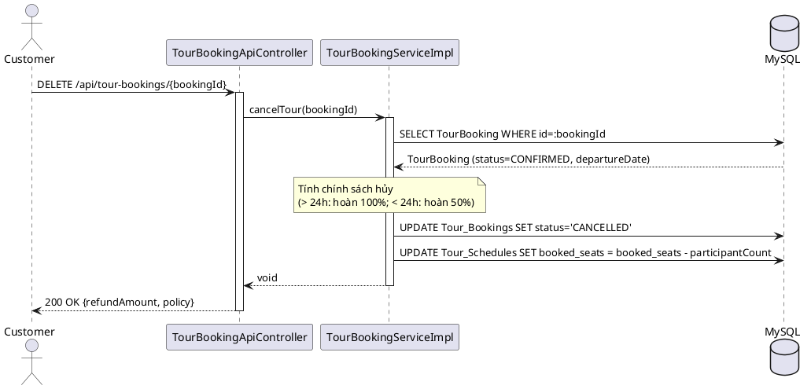
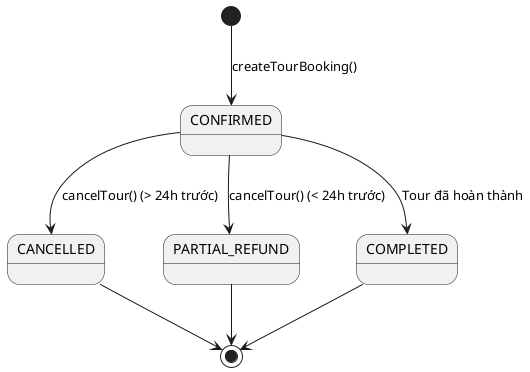

# ENGINEERING DOCUMENTATION STANDARD (EDS) v2.0

## UC20 — Đặt Tour & Lập lịch & Hủy Tour (TourBookingService)

| Field | Value |
|-------|-------|
| **Document ID** | `HOANIEN-EDS-MOD4-UC20-001` |
| **Version** | 1.0 |
| **Date** | 2026-06-14 |
| **Status** | Approved |
| **Document Owner** | Nguyễn Thị Thúy Ngọc |
| **Author** | Nguyễn Thị Thúy Ngọc — Developer |
| **Reviewed by** | Nguyễn Xuân Lưu — Tech Lead |
| **DPO Sign-off** | `[x] Approved – 2026-06-14 – Nguyễn Xuân Lưu` |
| **Approved by** | `[x] Nguyễn Xuân Lưu – 2026-06-14` |
| **Last Review** | 2026-06-14 |
| **Based on EDS** | v2.0 |

---

### CHANGELOG
| Ngày | Người thực hiện | Nội dung thay đổi |
|------|-----------------|-------------------|
| 2026-06-14 | Nguyễn Thị Thúy Ngọc | Tạo tài liệu lần đầu |

---

### MỤC LỤC
1. [Tổng quan Module](#1)
2. [Ma trận Truy vết](#2)
3. [ADR](#3)
4. [Non-Functional & SLA](#4)
5. [Static Modeling](#5)
6. [Dynamic Modeling](#6)
7. [Domain Event Catalog](#7)
8. [Interface Specification](#8)
9. [API Specification](#9)
10. [Bảng mã lỗi](#10)
11. [Quy trình Triển khai](#11)
12. [Rollback & Incident Runbook](#12)
13. [Kịch bản Kiểm thử](#13)
14. [Phương pháp Xác minh](#14)
15. [Mẫu thử thực tế](#15)
16. [Authorization Matrix](#16)
17. [Phụ lục](#17)

---

### 1. Tổng quan Module

| Field | Value |
|-------|-------|
| **Module Name** | Đặt Tour & Lập lịch & Hủy Tour (UC20) |
| **Bounded Context** | Tour & Review Context |
| **Use Case** | UC20.1: Đặt tour; UC20.2: Lập lịch tour (gán xe, tài xế, hướng dẫn viên); UC20.3: Hủy tour |
| **Data Classification** | PII (thông tin khách, phòng) |
| **Compliance Scope** | Luật Du lịch Việt Nam 2017; Luật Kế toán |
| **Upstream Dependencies** | UC01 (Auth), UC19 (Tour Search), Module 2 (Folio/Phòng) |
| **Downstream Consumers** | Module 5 — Finance, UC21 (Điểm danh) |

---

### 2. Ma trận Truy vết

| Requirement ID | Loại | Mô tả | Thành phần Code | Compliance | ADR |
|----------------|------|-------|-----------------|------------|-----|
| UC20.1 | US | Đặt tour, kiểm tra slot, tạo TourBooking + TourAttendees | `TourBookingService.createTourBooking()` | Luật Du lịch 2017 | — |
| UC20.2 | US | Lập lịch tour: gán xe, tài xế, Tour Guide | `TourBookingService.scheduleTour()` | — | — |
| UC20.3 | US | Hủy tour: hoàn tiền theo chính sách hoặc đổi lịch | `TourBookingService.cancelTour()` | Luật Kế toán | — |
| BR-TOUR-01 | BR | Chặn đặt tour khi hết slot khả dụng | `TourBookingServiceImpl.createTourBooking()` | — | — |
| BR-TOUR-02 | BR | Thanh toán cọc hoặc Post to Room (ghi nợ vào phòng) | `TourBookingServiceImpl.createTourBooking()` | Luật Kế toán | — |

---

### 3. Architecture Decision Records (ADR)

#### ADR-003 — Kiểm tra Slot Concurrency-Safe

| Field | Value |
|-------|-------|
| **Status** | Accepted |
| **Deciders** | Nguyễn Xuân Lưu |
| **Date** | 2026-06-13 |

**Bối cảnh:** Nhiều khách có thể đặt tour cùng lúc khi chỉ còn ít chỗ. Cần tránh overbooking.

**Quyết định:** Sử dụng `SELECT ... FOR UPDATE` hoặc Optimistic Locking trên `TourSchedule.bookedSeats` khi cập nhật. Nếu `bookedSeats + participantCount > maxSlots`, throw `TourFullException` (TOUR-001).

**Hệ quả:** Đảm bảo tính toàn vẹn dữ liệu dưới tải đồng thời.

---

### 4. Non-Functional Requirements & SLA

#### 4.1. Performance & Availability

| Category | Requirement | Target SLA | Measurement |
|----------|-------------|------------|-------------|
| **Latency** | Booking response (p99) | < 500ms | k6 load test |
| **Concurrency** | Chống overbooking dưới đồng thời | 0 overbook | Concurrent test |
| **Availability** | Uptime | 99.9% | Uptime monitor |

#### 4.2. Security

| Category | Requirement | Target | Verification |
|----------|-------------|--------|--------------|
| **Auth** | JWT required | CUSTOMER, ADMIN | Integration test |
| **PII** | Thông tin booking bảo mật | Không log | Code review |

---

### 5. Static Modeling

#### 5.1. Class Diagram



#### 5.2. Data Structure

```sql
CREATE TABLE Tour_Bookings (
    id BIGINT AUTO_INCREMENT PRIMARY KEY,
    schedule_id BIGINT NOT NULL,
    customer_id BIGINT NOT NULL,
    participant_count INT NOT NULL,
    is_walk_in_tour BOOLEAN DEFAULT FALSE,
    booking_status VARCHAR(50) DEFAULT 'CONFIRMED',
    total_price DECIMAL(18,2) NOT NULL,
    payment_method VARCHAR(50),
    room_id BIGINT NULL,
    created_at TIMESTAMP DEFAULT CURRENT_TIMESTAMP,
    FOREIGN KEY (schedule_id) REFERENCES Tour_Schedules(schedule_id)
);

CREATE TABLE Tour_Attendees (
    id BIGINT AUTO_INCREMENT PRIMARY KEY,
    tour_booking_id BIGINT NOT NULL,
    customer_id BIGINT,
    dependent_id BIGINT,
    attendance_status VARCHAR(50) DEFAULT 'PENDING',
    face_matched_at TIMESTAMP NULL,
    face_vector_data TEXT,
    FOREIGN KEY (tour_booking_id) REFERENCES Tour_Bookings(id)
);
```

---

### 6. Dynamic Modeling

#### 6.1. Sequence Diagram — Happy Path: Đặt tour & Post to Room



#### 6.2. Sequence Diagram — Hủy Tour



#### 6.3. State Machine — TourBooking



---

### 7. Domain Event Catalog

| Event Name | Trigger | Publisher | Subscriber(s) | Async? |
|------------|---------|-----------|---------------|--------|
| `TourBookedEvent` | Đặt tour thành công | `TourBookingServiceImpl` | `FolioServiceImpl`, `NotificationService` | Yes |
| `TourCancelledEvent` | Hủy tour | `TourBookingServiceImpl` | `FolioServiceImpl` (hoàn tiền) | Yes |
| `TourScheduledEvent` | Gán xe, hướng dẫn viên | `TourBookingServiceImpl` | `NotificationService` | Yes |

---

### 8. Interface Specification

```java
// TourBookingService.java
// @version 1.0

public interface TourBookingService {
    TourBookingResponseDTO createTourBooking(TourBookingRequestDTO request)
        throws TourFullException;
    void scheduleTour(Long scheduleId, Long guideId, Long vehicleId, Long driverId);
    void cancelTour(Long bookingId);
}
```

---

### 9. API Specification

| Method | Path | Auth | Roles | Rate Limit | Idempotent? |
|--------|------|------|-------|------------|-------------|
| POST | `/api/tour-bookings` | JWT | CUSTOMER, RECEPTIONIST, ADMIN | 30/min | No |
| PUT | `/api/tour-bookings/{bookingId}/schedule` | JWT | RECEPTIONIST, ADMIN | 30/min | Yes |
| DELETE | `/api/tour-bookings/{bookingId}` | JWT | CUSTOMER, ADMIN | 10/min | Yes |

**POST `/api/tour-bookings`**
*Request:* `{"scheduleId": 1, "customerId": 2, "participantCount": 3, "paymentMethod": "POST_TO_ROOM", "roomId": 101}`
*Response 200:* `{"bookingId": 45, "bookingStatus": "CONFIRMED", "tourName": "Tinh hoa di sản Hội An", "departureDate": "2026-06-20", "totalPrice": 3600000}`
*Response 400:* `{"error": {"code": "TOUR-001", "message": "Tour đã hết chỗ khả dụng"}}`

---

### 10. Bảng mã lỗi

| Code | HTTP | Message (EN) | Message (VI) | Trigger |
|------|------|--------------|--------------|---------|
| `TOUR-001` | 400 | Tour slot full | Tour đã hết chỗ khả dụng | `bookedSeats + requestSlots > maxSlots` |
| `TOUR-005` | 404 | Booking not found | Không tìm thấy booking | bookingId không tồn tại |
| `TOUR-006` | 400 | Cannot cancel past tour | Không thể hủy tour đã qua | departureDate < now |
| `TOUR-007` | 400 | Invalid participant count | Số người tham gia không hợp lệ | participantCount <= 0 |
| `AUTH-001` | 401 | Authentication required | Cần xác thực | Thiếu JWT |
| `AUTH-011` | 403 | Access denied | Không có quyền truy cập | Sai role |

---

### 11-17. (Các phần còn lại theo chuẩn EDS v2.0)

---

*EDS v2.0*