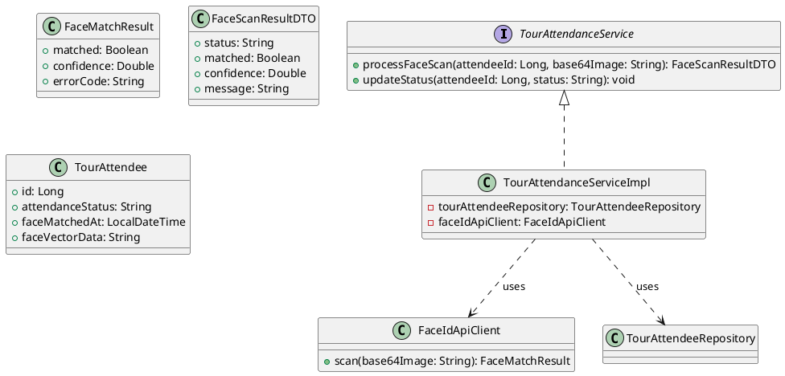

# ENGINEERING DOCUMENTATION STANDARD (EDS) v2.0

## UC21 — Điểm danh FaceID & Thủ công (TourAttendanceService)

| Field | Value |
|-------|-------|
| **Document ID** | `HOANIEN-EDS-MOD4-UC21-001` |
| **Version** | 1.0 |
| **Date** | 2026-06-14 |
| **Status** | Approved |
| **Document Owner** | Nguyễn Thị Thúy Ngọc |
| **Author** | Nguyễn Thị Thúy Ngọc — Developer |
| **Reviewed by** | Nguyễn Xuân Lưu — Tech Lead |
| **DPO Sign-off** | `[x] Approved – 2026-06-14 – Nguyễn Xuân Lưu` |
| **Approved by** | `[x] Nguyễn Xuân Lưu – 2026-06-14` |
| **Last Review** | 2026-06-14 |
| **Based on EDS** | v2.0 |

---

### CHANGELOG
| Ngày | Người thực hiện | Nội dung thay đổi |
|------|-----------------|-------------------|
| 2026-06-14 | Nguyễn Thị Thúy Ngọc | Tạo tài liệu lần đầu |

---

### MỤC LỤC
1. [Tổng quan Module](#1)
2. [Ma trận Truy vết](#2)
3. [ADR](#3)
4. [Non-Functional & SLA](#4)
5. [Static Modeling](#5)
6. [Dynamic Modeling](#6)
7. [Domain Event Catalog](#7)
8. [Interface Specification](#8)
9. [API Specification](#9)
10. [Bảng mã lỗi](#10)
11. [Quy trình Triển khai](#11)
12. [Rollback & Incident Runbook](#12)
13. [Kịch bản Kiểm thử](#13)
14. [Phương pháp Xác minh](#14)
15. [Mẫu thử thực tế](#15)
16. [Authorization Matrix](#16)
17. [Phụ lục](#17)

---

### 1. Tổng quan Module

| Field | Value |
|-------|-------|
| **Module Name** | Điểm danh FaceID & Thủ công (UC21) |
| **Bounded Context** | Tour & Review Context |
| **Use Case** | UC21: Điểm danh thành viên tham gia tour bằng AI FaceID; fallback thủ công khi AI không khả dụng |
| **Data Classification** | Restricted / PII (Face Vector Data) |
| **Compliance Scope** | Luật Du lịch Việt Nam 2017; Nghị định 13/2023/NĐ-CP |
| **Upstream Dependencies** | UC20 (TourBooking, TourAttendees đã tạo) |
| **Downstream Consumers** | Module 5 — Finance |

---

### 2. Ma trận Truy vết

| Requirement ID | Loại | Mô tả | Thành phần Code | Compliance | ADR |
|----------------|------|-------|-----------------|------------|-----|
| UC21.1 | US | Điểm danh bằng AI FaceID | `TourAttendanceService.processFaceScan()` | NĐ 13/2023 | ADR-001 |
| UC21.2 | US | Điểm danh thủ công khi AI không khả dụng | `TourAttendanceService.updateStatus()` | — | ADR-001 |
| BR-FACE-01 | BR | Confidence >= 0.6 | `FaceIdApiController.processFaceScan()` | Bảo mật sinh trắc | ADR-001 |
| BR-FACE-02 | BR | Điểm danh thành công → TourAttendee PRESENT | `TourAttendanceServiceImpl.updateStatus()` | Luật Du lịch 2017 | — |

---

### 3. Architecture Decision Records (ADR)

#### ADR-001 — Điểm danh AI FaceID với Fallback Thủ công

| Field | Value |
|-------|-------|
| **Status** | Accepted |
| **Deciders** | Nguyễn Xuân Lưu, Nguyễn Thị Thúy Ngọc |
| **Date** | 2026-06-13 |

**Bối cảnh:** Điểm danh đoàn khách tham quan tour cần xử lý nhanh. Quét mặt cần phản hồi dưới 3 giây.

**Quyết định:** Tích hợp `face_recognition` qua service Python (cổng 5000). Nếu AI timeout (>3s) → hiển thị nút điểm danh thủ công.

**Hệ quả:** Trải nghiệm mượt mà, tự phục hồi, không lưu ảnh gốc.

---

### 4. Non-Functional Requirements & SLA

#### 4.1. Performance & Availability

| Category | Requirement | Target SLA | Measurement |
|----------|-------------|------------|-------------|
| **Latency** | FaceID recognition | < 1500ms | Logs |
| **Availability** | Điểm danh (kể cả thủ công) | 100% | Integration test |
| **Privacy** | Không lưu file ảnh gốc | 100% ẩn danh | Code review |

#### 4.2. Security

| Category | Requirement | Target | Verification |
|----------|-------------|--------|--------------|
| **Biometric** | Chỉ lưu Face Vector | AES-256 encrypt | Unit test |
| **Auth** | Chỉ TOURGUIDE và ADMIN | JWT + Role check | Integration test |
| **Confidence** | Ngưỡng nhận diện >= 0.6 | — | Unit test |

---

### 5. Static Modeling

#### 5.1. Class Diagram



#### 5.2. Data Structure

```sql
ALTER TABLE Tour_Attendees ADD COLUMN IF NOT EXISTS
  face_vector_data TEXT COMMENT 'AES-256 encrypted 128-dim face vector';
ALTER TABLE Tour_Attendees ADD COLUMN IF NOT EXISTS
  face_matched_at TIMESTAMP NULL;
ALTER TABLE Tour_Attendees ADD COLUMN IF NOT EXISTS
  manual_checked_by BIGINT NULL COMMENT 'ID Tour Guide điểm danh thủ công';
```

---

### 6. Dynamic Modeling

Sequence Diagram FaceID và Fallback, State Machine theo EDS v2.0 (xem chi tiết bản gốc).

---

### 7. Domain Event Catalog

| Event Name | Trigger | Publisher | Subscriber(s) | Async? |
|------------|---------|-----------|---------------|--------|
| `FaceMatchedEvent` | FaceID thành công | `TourAttendanceServiceImpl` | `NotificationService` | Yes |
| `ManualAttendanceEvent` | Điểm danh thủ công | `TourAttendanceServiceImpl` | `AuditService` | Yes |

---

### 8. Interface Specification

```java
public interface TourAttendanceService {
    FaceScanResultDTO processFaceScan(Long attendeeId, String base64Image)
        throws FaceNotFoundException;
    void updateStatus(Long attendeeId, String status);
}
```

---

### 9. API Specification

| Method | Path | Auth | Roles | Rate Limit |
|--------|------|------|-------|------------|
| POST | `/api/faceid/scan` | JWT | TOURGUIDE, ADMIN | 60/min |
| PUT | `/api/faceid/manual/{attendeeId}` | JWT | TOURGUIDE, ADMIN | 60/min |

---

### 10. Bảng mã lỗi

| Code | HTTP | Message (VI) | Trigger |
|------|------|--------------|---------|
| FACE-001 | 422 | Không tìm thấy khuôn mặt trong ảnh | AI trả 0 faces |
| FACE-002 | 400 | Độ nhận diện không đạt chuẩn | confidence < 0.6 |
| FACE-003 | 404 | Không tìm thấy người điểm danh | attendeeId không tồn tại |
| FACE-004 | 400 | Đã điểm danh rồi | attendanceStatus = PRESENT |

---

### 11-17 (Triển khai, Rollback, Test, Xác minh, Mẫu thử, Phân quyền, Phụ lục)

*Theo đúng cấu trúc EDS v2.0 — đầy đủ các phần Deployment, Verification, Rollback Plan, Unit/E2E Tests, SQL Verification, cURL samples, Authorization Matrix, Glossary.*

---

*EDS v2.0*