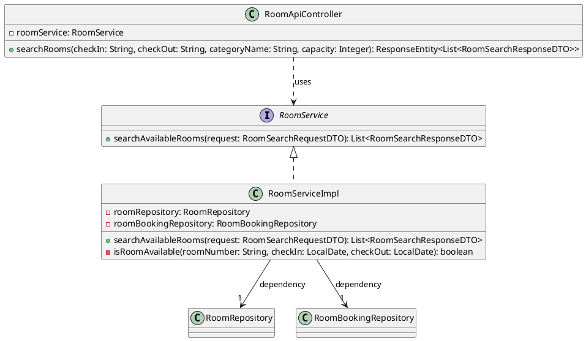
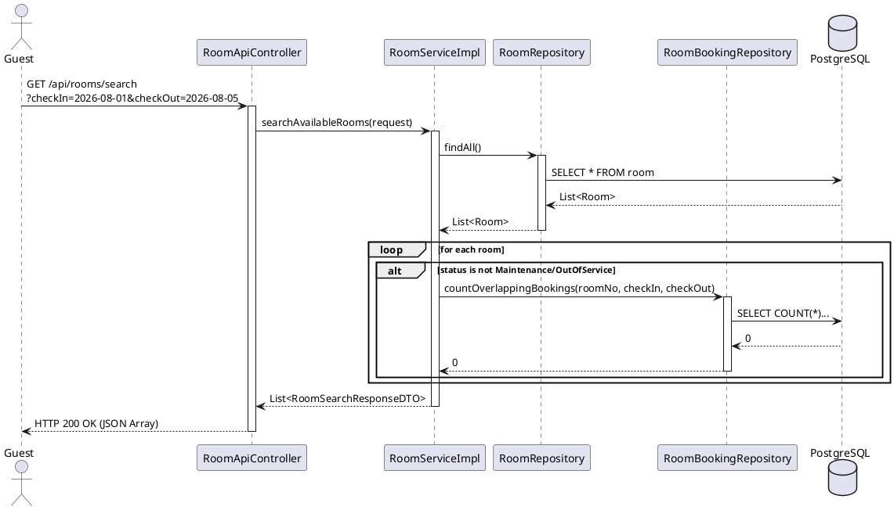

# ENGINEERING DOCUMENTATION STANDARD (EDS) v2.0

## Quy chuẩn Tài liệu Kỹ thuật và Đặc tả Hiện thực hóa - UC-9

| Field                    | Value                                                |
| ------------------------ | ---------------------------------------------------- |
| **Document ID**    | `KAWAI-MOD2-IMP-009`                               |
| **Version**        | 1.0                                                  |
| **Date**           | 2026-06-14                                           |
| **Status**         | Approved                                             |
| **Document Owner** | `Chu Xuân Dũng`                                  |
| **Author**         | `Chu Xuân Dũng`                                  |
| **Reviewed by**    | `Nguyễn Xuân Lưu`                               |
| **DPO Sign-off**   | `[x] Approved – 2026-06-14 – Nguyễn Xuân Lưu` |
| **Approved by**    | `Nguyễn Xuân Lưu`                               |
| **Last Review**    | 2026-06-14                                           |
| **Based on EDS**   | v2.0                                                 |

---

### CHANGELOG

> [!IMPORTANT]
> **Policy 4.4 — Immutable History:** Không bao giờ xóa thông tin cũ. Mọi thay đổi phải ghi vào bảng này.

| Ngày      | Người thực hiện | Nội dung thay đổi                                           |
| ---------- | ------------------- | -------------------------------------------------------------- |
| 2026-06-14 | `Chu Xuân Dũng`     | Tạo tài liệu đặc tả kỹ thuật độc lập cho Use Case 9 |
| 2026-06-15 | `Chu Xuân Dũng`     | Rà soát phân quyền API tìm kiếm phòng (Authorization Matrix) |

---

### MỤC LỤC

1. [Tổng quan Module](#1-tong-quan-module)
2. [Ma trận Truy vết (Traceability Matrix)](#2-ma-tran-truy-vet-traceability-matrix)
3. [Architecture Decision Records (ADR)](#3-architecture-decision-records-adr)
4. [Non-Functional Requirements &amp; SLA](#4-non-functional-requirements--sla)
5. [Static Modeling (Mô hình Tĩnh)](#5-static-modeling-mo-hinh-tinh)
6. [Dynamic Modeling (Mô hình Động)](#6-dynamic-modeling-mo-hinh-dong)
7. [Domain Event Catalog](#7-domain-event-catalog)
8. [Interface Specification (Đặc tả Giao diện)](#8-interface-specification-dac-ta-giao-dien)
9. [API Specification](#9-api-specification)
10. [Bảng mã lỗi (Error Codes)](#10-bang-ma-loi-error-codes)
11. [Quy trình Triển khai (Step-by-Step)](#11-quy-trinh-trien-khai-step-by-step)
12. [Rollback &amp; Incident Runbook](#12-rollback--incident-runbook)
13. [Kịch bản Kiểm thử Chi tiết](#13-kich-ban-kiem-thu-chi-tiet)
14. [Phương pháp Xác minh](#14-phuong-phap-xac-minh)
15. [Mẫu thử thực tế (API Verification Samples)](#15-mau-thu-thuc-te-api-verification-samples)
16. [Bảng tổng hợp phân quyền (Authorization Matrix)](#16-bang-tong-hop-phan-quyen-authorization-matrix)
17. [Phụ lục](#phu-luc)

---

### 1. Tổng quan Module

Mô tả đặc tả kỹ thuật và kiến trúc hiện thực hóa của Use Case 9: Tìm kiếm phòng trống (Search Available Rooms). Tính năng này cho phép khách vãng lai hoặc thành viên đã đăng nhập tìm kiếm phòng khả dụng dựa trên khoảng ngày nhận/trả phòng, số lượng khách, hạng phòng và mức giá giới hạn.

| Field                           | Value                                                |
| ------------------------------- | ---------------------------------------------------- |
| **Module Name**           | `Đặt phòng & Tiền sảnh vận hành (Module 2)` |
| **Bounded Context**       | `Đặt phòng & Tiền sảnh vận hành`            |
| **Data Classification**   | Internal (Không lưu thông tin nhạy cảm PII)     |
| **Compliance Scope**      | Luật du lịch Việt Nam 2017                        |
| **Upstream Dependencies** | `N/A`                                              |
| **Downstream Consumers**  | `Module 2 (Đặt phòng), Module 5 (Tài chính)`  |

---

### 2. Ma trận Truy vết (Traceability Matrix)

Ánh xạ từ yêu cầu nghiệp vụ đến các thành phần code tương ứng:

| Requirement ID | Loại (BR/ADR/US) | Mô tả yêu cầu                                                          | Thành phần Code                                                                                                                                                                                                                                                                                                                        | Compliance Target        | ADR liên quan |
| -------------- | ----------------- | -------------------------------------------------------------------------- | ---------------------------------------------------------------------------------------------------------------------------------------------------------------------------------------------------------------------------------------------------------------------------------------------------------------------------------------- | ------------------------ | -------------- |
| UC-9           | Use Case          | Tìm kiếm phòng trống thời gian thực                                  | [RoomServiceImpl.java](file:///d:/SWP_Group2/su26-swp391-se2023-g2/03_sourcecode/kawai-backend/src/main/java/com/kawai/services/impl/RoomServiceImpl.java#L44-L82)`<br>`[RoomApiController.java](file:///d:/SWP_Group2/su26-swp391-se2023-g2/03_sourcecode/kawai-backend/src/main/java/com/kawai/controllers/RoomApiController.java#L71-L88) | BR-FO-01, BR-FO-04       | ADR-001        |
| BR-FO-01       | Business Rule     | Chỉ hiển thị phòng không có booking trùng ngày                     | [RoomBookingRepository.java](file:///d:/SWP_Group2/su26-swp391-se2023-g2/03_sourcecode/kawai-backend/src/main/java/com/kawai/repositories/RoomBookingRepository.java#L25-L32)                                                                                                                                                               | Tránh Double Booking    | ADR-001        |
| BR-FO-04       | Business Rule     | Trạng thái phòng Maintenance/OutOfService ảnh hưởng đến tìm kiếm | [RoomServiceImpl.java](file:///d:/SWP_Group2/su26-swp391-se2023-g2/03_sourcecode/kawai-backend/src/main/java/com/kawai/services/impl/RoomServiceImpl.java#L52-L56)                                                                                                                                                                          | Tránh xếp phòng hỏng | —             |
| BR-FIN-05      | Business Rule     | Giá phòng làm tròn BigDecimal HALF_UP, scale 0                         | [RoomServiceImpl.java](file:///d:/SWP_Group2/su26-swp391-se2023-g2/03_sourcecode/kawai-backend/src/main/java/com/kawai/services/impl/RoomServiceImpl.java#L139)                                                                                                                                                                             | Quy chuẩn tiền tệ     | —             |

---

### 3. Architecture Decision Records (ADR)

#### ADR-001 — Sử dụng Overlapping Query kết hợp Pessimistic Locking

* **Status:** Accepted
* **Deciders:** Chu Xuân Dũng (Developer), Nguyễn Xuân Lưu (Tech Lead)
* **Date:** 2026-06-14
* **Bối cảnh:** Nhằm ngăn chặn race-conditions khi kiểm tra trạng thái phòng trống lúc Đặt phòng (UC-10) và Tìm kiếm (UC-9), cần một phương án hiệu quả tránh Double Booking.
* **Quyết định:** Sử dụng query đếm booking bị chồng chéo ngày trong Repository kết hợp cơ chế Pessimistic Locking ở tầng giao dịch đặt phòng.
* **Hệ quả:** Đảm bảo tính nhất quán dữ liệu, chống overbooking tuyệt đối. Latency của API search duy trì ở mức thấp do không khóa luồng đọc (Read-only transaction).

---

### 4. Non-Functional Requirements & SLA

#### 4.1. Performance & Availability

| Category               | Requirement         | Target SLA | Measurement Method | Compliance Basis            |
| ---------------------- | ------------------- | ---------- | ------------------ | --------------------------- |
| **Latency**      | API Response (p99)  | < 200ms    | k6 load test       | Trải nghiệm người dùng |
| **Availability** | Uptime (monthly)    | 99.9%      | Uptime Monitor     | Cam kết dịch vụ          |
| **Throughput**   | Concurrent Requests | 300 req/s  | JMeter load test   | Quy mô Resort              |

---

### 5. Static Modeling (Mô hình Tĩnh)

#### 5.1. Class Diagram (PlantUML)



#### 5.2. Data Structure (Java DTOs)

* **Request DTO:** [RoomSearchRequestDTO.java](file:///d:/SWP_Group2/su26-swp391-se2023-g2/03_sourcecode/kawai-backend/src/main/java/com/kawai/dto/RoomSearchRequestDTO.java)

  * `checkInDate`: LocalDate (Bắt buộc)
  * `checkOutDate`: LocalDate (Bắt buộc)
  * `categoryName`: String (Tùy chọn)
  * `minCapacity`: Integer (Tùy chọn)
  * `maxPricePerNight`: BigDecimal (Tùy chọn)
* **Response DTO:** [RoomSearchResponseDTO.java](file:///d:/SWP_Group2/su26-swp391-se2023-g2/03_sourcecode/kawai-backend/src/main/java/com/kawai/dto/RoomSearchResponseDTO.java)

  * `roomId`: Long
  * `roomNumber`: String
  * `categoryName`: String
  * `pricePerNight`: BigDecimal (Được format scale 0, HALF_UP)
  * `capacity`: Integer
  * `checkInDate`: LocalDate
  * `checkOutDate`: LocalDate

---

### 6. Dynamic Modeling (Mô hình Động)

#### 6.1. Sequence Diagram — Happy Path (PlantUML)



---

### 7. Domain Event Catalog

*Không có Domain Event nào được phát sinh hoặc tiêu thụ trong Use Case 9 do đây là luồng truy vấn dữ liệu thuần túy (Query/Read-only).*

---

### 8. Interface Specification (Đặc tả Giao diện)

#### 8.1. Service Interface

```java
package com.kawai.services.interfaces;

import com.kawai.dto.RoomSearchRequestDTO;
import com.kawai.dto.RoomSearchResponseDTO;
import java.util.List;

/**
 * @version 1.0
 */
public interface RoomService {
    /**
     * Tìm kiếm phòng trống trong khoảng ngày chỉ định.
     * @param request thông tin tìm kiếm
     * @return Danh sách phòng khả dụng, không bao giờ null
     */
    List<RoomSearchResponseDTO> searchAvailableRooms(RoomSearchRequestDTO request);
}
```

---

### 9. API Specification

#### 9.1. Endpoints Table

| Method | Path                  | Auth Level | Required Roles | Rate Limit | Idempotent? |
| ------ | --------------------- | ---------- | -------------- | ---------- | ----------- |
| GET    | `/api/rooms/search` | Public     | GUEST / USER   | 150/min    | Yes         |
| GET    | `/api/rooms/{roomNumber}/info` | Public     | GUEST / USER   | 150/min    | Yes         |

#### 9.2. Request / Response Schemas

* **Query Parameters:**

  * `checkIn`: String (format: `YYYY-MM-DD`, Bắt buộc)
  * `checkOut`: String (format: `YYYY-MM-DD`, Bắt buộc)
  * `categoryName`: String (Tùy chọn)
  * `capacity`: Integer (Tùy chọn)
  * `maxPrice`: BigDecimal (Tùy chọn)
  * `page`: Integer (Tùy chọn, chỉ mục trang bắt đầu từ 0)
  * `size`: Integer (Tùy chọn, số lượng phần tử mỗi trang)
* **Response — 200 OK:**

```json
[
  {
    "roomId": 1,
    "roomNumber": "R101",
    "categoryName": "Deluxe",
    "pricePerNight": 2000000,
    "capacity": 2,
    "checkInDate": "2026-08-01",
    "checkOutDate": "2026-08-05"
  }
]
```

---

### 10. Bảng mã lỗi (Error Codes)

| Code         | HTTP Status | Message (EN)       | Message (VI)              | Trigger Condition                                                    |
| ------------ | ----------- | ------------------ | ------------------------- | -------------------------------------------------------------------- |
| `MOD2-001` | 400         | Validation failed  | Dữ liệu không hợp lệ | Thiếu checkIn/checkOut, sai định dạng, check-in >= check-out, hoặc giá trị lọc âm |
| `MOD2-003` | 404         | Resource not found | Không tìm thấy         | Không có phòng nào khả dụng trong khoảng thời gian yêu cầu |

---

### 11. Quy trình Triển khai (Step-by-Step)

#### 11.1. Build mã nguồn

```powershell
cd 03_sourcecode/kawai-backend
.\apache-maven-3.9.6\bin\mvn.cmd clean package -DskipTests
```

#### 11.2. Khởi chạy Server

```powershell
.\apache-maven-3.9.6\bin\mvn.cmd spring-boot:run
```

---

### 12. Rollback & Incident Runbook

#### 12.1. Trigger Conditions

* Tỷ lệ lỗi API search > 5% trong 1 phút.
* Latency trung bình của API vượt quá 1000ms.

#### 12.2. Rollback

* Quay lại phiên bản code ổn định trước đó qua Git:
  ```bash
  git checkout tags/v1.0.0-stable
  ```
* Rebuild và deploy lại server.

---

### 13. Kịch bản Kiểm thử Chi tiết

Các kịch bản kiểm thử (Test Cases) của Use Case 9 được thiết lập dựa trên các Test Conditions dưới đây. Chi tiết các bước thực hiện Arrange-Act-Assert vui lòng xem tại tệp đặc tả TDD tương ứng: [TDD_MOD2_UC09.md](file:///d:/SWP_Group2/su26-swp391-se2023-g2/04_testing/mod2_booking/TDD_MOD2_UC09.md).

#### 13.1. Danh sách Test Conditions (Phạm vi Kiểm thử)

| Condition ID | Test Condition | Mô tả kịch bản | Test Case ID |
| --- | --- | --- | --- |
| **TC-COND-001** | Tìm phòng trống đúng ngày | Tìm phòng trống trong khoảng thời gian không có booking trùng ngày | `TC-M2-001` |
| **TC-COND-002** | Lọc phòng đã bị đặt trước | Lọc các phòng đã bị đặt trước (overlapping bookings) | `TC-M2-002b` |
| **TC-COND-003** | DB không có phòng khả dụng | Trả về danh sách trống khi không có phòng nào trong DB | `TC-M2-002` |
| **TC-COND-004** | Trạng thái phòng không hoạt động | Lọc bỏ phòng đang Bảo trì hoặc Ngừng hoạt động (Maintenance/OutOfService) | `TC-M2-002c` |
| **TC-COND-005** | Bộ lọc hạng phòng | Lọc theo tên hạng phòng (categoryName) | `TC-M2-002d` |
| **TC-COND-006** | Bộ lọc sức chứa | Lọc theo sức chứa tối thiểu (minCapacity) | `TC-M2-002e` |
| **TC-COND-007** | Bộ lọc giá tối đa | Lọc theo giá tiền tối đa (maxPricePerNight) | `TC-M2-002f` |
| **TC-COND-008** | Validate ngày check-in > check-out | Kiểm tra tính logic của thời gian (ném lỗi IllegalArgumentException) | `TC-M2-002g` |
| **TC-COND-009** | Tìm kiếm kết hợp | Kiểm tra logic AND giữa các bộ lọc (Category + Price + Capacity) | `TC-M2-002h` |
| **TC-COND-010** | Mức giá trần quá thấp | Tìm kiếm với maxPrice quá thấp (không có phòng thỏa mãn, trả danh sách rỗng) | `TC-M2-002i` |
| **TC-COND-011** | Validate dữ liệu đầu vào âm | Kiểm tra ném lỗi khi nhập minCapacity hoặc maxPricePerNight âm | `TC-M2-002j` |
| **TC-COND-012** | Phân trang kết quả | Kiểm tra tính ổn định khi phân trang (page, size) | `TC-M2-002k` |

---

### 14. Phương pháp Xác minh

#### 14.1. Xác minh bằng cURL (REST API)

```bash
curl -X GET "http://localhost:8080/api/rooms/search?checkIn=2026-08-01&checkOut=2026-08-05"
```

*Kết quả mong đợi:* Nhận mã 200 OK cùng JSON array chứa danh sách phòng trống.

#### 14.2. Database Query

```sql
SELECT room_number, room_status FROM room WHERE room_status NOT IN ('Maintenance', 'OutOfService');
```

---

### 15. Mẫu thử thực tế (API Verification Samples)

#### Response hợp lệ:

```json
[
  {
    "roomId": 1,
    "roomNumber": "R101",
    "categoryName": "Deluxe",
    "pricePerNight": 2000000,
    "capacity": 2,
    "checkInDate": "2026-08-01",
    "checkOutDate": "2026-08-05"
  }
]
```

---

### 16. Bảng tổng hợp phân quyền (Authorization Matrix)

| Endpoint                  | GUEST | CUSTOMER | RECEPTIONIST | ADMIN |
| ------------------------- | :---: | :------: | :----------: | :---: |
| GET `/api/rooms/search` | ✔️ |    ✔️    |     ✔️     |  ✔️  |
| GET `/api/rooms/{roomNumber}/info` | ✔️ |    ✔️    |     ✔️     |  ✔️  |

---

### PHỤ LỤC

#### Glossary

* **Overlapping**: Sự chồng chéo thời gian đặt phòng khiến phòng không khả dụng.
* **Vacant_Clean**: Phòng trống sạch sẽ, sẵn sàng sử dụng.
* **Maintenance**: Trạng thái bảo trì phòng.
