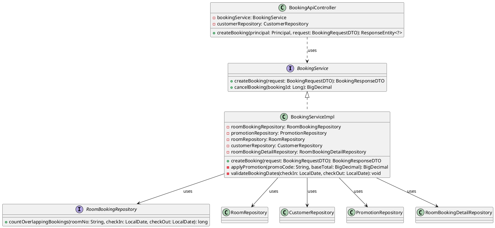
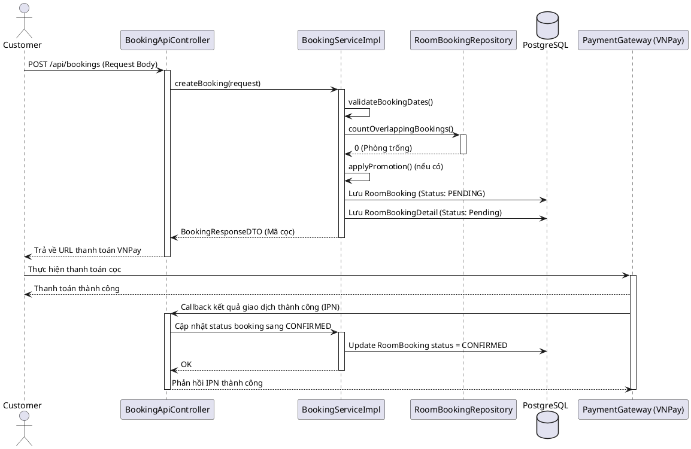
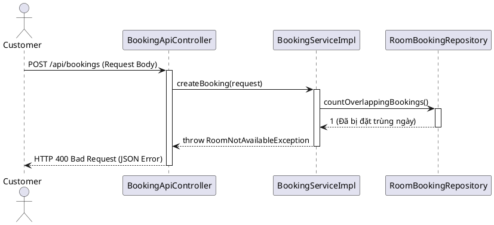

# ENGINEERING DOCUMENTATION STANDARD (EDS) v2.0

## Quy chuẩn Tài liệu Kỹ thuật và Đặc tả Hiện thực hóa - UC-10: Đặt phòng & Thanh toán cọc trực tuyến

| Field                    | Value                                                                                       |
| ------------------------ | ------------------------------------------------------------------------------------------- |
| **Document ID**    | `KAWAI-MOD2-IMP-010`                                                                        |
| **Version**        | 1.0                                                                                         |
| **Date**           | 2026-06-14                                                                                  |
| **Status**         | Approved                                                                                    |
| **Document Owner** | `Chu Xuân Dũng`                                                                             |
| **Author**         | `Chu Xuân Dũng – Developer`                                                                 |
| **Reviewed by**    | `Nguyễn Xuân Lưu – Tech Lead`                                                               |
| **DPO Sign-off**   | `[x] Approved – 2026-06-14 – Nguyễn Xuân Lưu`                                                |
| **Approved by**    | `Nguyễn Xuân Lưu`                                                                           |
| **Last Review**    | 2026-06-14                                                                                  |
| **Based on EDS**   | v2.0                                                                                        |

---

### CHANGELOG

> [!IMPORTANT]
> **Policy 4.4 — Immutable History:** Không bao giờ xóa thông tin cũ. Mọi thay đổi phải ghi vào bảng này.

| Ngày      | Người thực hiện | Nội dung thay đổi       |
| ---------- | ------------------- | -------------------------- |
| 2026-06-14 | `Chu Xuân Dũng`  | Tạo tài liệu đặc tả kỹ thuật độc lập cho Use Case 10 |
| 2026-06-15 | `Chu Xuân Dũng`  | Cập nhật phân quyền: loại bỏ quyền thao tác trực tiếp của Lễ tân đối với API Booking public |

---

### MỤC LỤC

1. [Tổng quan Module](#1-tong-quan-module)
2. [Ma trận Truy vết (Traceability Matrix)](#2-ma-tran-truy-vet-traceability-matrix)
3. [Architecture Decision Records (ADR)](#3-architecture-decision-records-adr)
4. [Non-Functional Requirements & SLA](#4-non-functional-requirements--sla)
5. [Static Modeling (Mô hình Tĩnh)](#5-static-modeling-mo-hinh-tinh)
6. [Dynamic Modeling (Mô hình Động)](#6-dynamic-modeling-mo-hinh-dong)
7. [Domain Event Catalog](#7-domain-event-catalog)
8. [Interface Specification (Đặc tả Giao diện)](#8-interface-specification-dac-ta-giao-dien)
9. [API Specification](#9-api-specification)
10. [Bảng mã lỗi (Error Codes)](#10-bang-ma-loi-error-codes)
11. [Quy trình Triển khai (Step-by-Step)](#11-quy-trinh-trien-khai-step-by-step)
12. [Rollback & Incident Runbook](#12-rollback--incident-runbook)
13. [Kịch bản Kiểm thử Chi tiết](#13-kich-ban-kiem-thu-chi-tiet)
14. [Phương pháp Xác minh](#14-phuong-phap-xac-minh)
15. [Mẫu thử thực tế (API Verification Samples)](#15-mau-thu-thuc-te-api-verification-samples)
16. [Bảng tổng hợp phân quyền (Authorization Matrix)](#16-bang-tong-hop-phan-quyen-authorization-matrix)
17. [Phụ lục](#phu-luc)

---

### 1. Tổng quan Module

Mô tả đặc tả kỹ thuật và kiến trúc hiện thực hóa của **Use Case 10: Đặt phòng & Thanh toán cọc trực tuyến (Book Room & Pay Online Deposit)**. Tính năng này cho phép khách hàng (Customer) đã đăng nhập thực hiện đặt một hoặc nhiều phòng trong một đơn đặt, tính toán tổng số tiền phòng và số tiền cọc (30% hoặc tùy cấu hình), áp dụng voucher giảm giá (nếu có), tạo đơn đặt phòng ở trạng thái tạm thời `PENDING` và liên kết với cổng thanh toán VNPay Sandbox. Sau khi có phản hồi kết quả thanh toán từ VNPay (callback), hệ thống cập nhật trạng thái đơn đặt phòng sang `CONFIRMED` hoặc hủy bỏ đơn. Nếu khách hàng không thanh toán trong vòng 10 phút, hệ thống tự động giải phóng phòng đã giữ (soft-lock).

| Field                           | Value                                                  |
| ------------------------------- | ------------------------------------------------------ |
| **Module Name**           | `Đặt phòng & Tiền sảnh vận hành (Module 2)`             |
| **Bounded Context**       | `Đặt phòng & Tiền sảnh vận hành`                       |
| **Data Classification**   | Confidential & PII (Chứa thông tin khách hàng, tiền giao dịch, mã số PIN bảo mật) |
| **Compliance Scope**      | Luật du lịch Việt Nam 2017 & Luật An ninh mạng Việt Nam|
| **Upstream Dependencies** | `Module 2 (Tìm kiếm phòng - UC-9)`                      |
| **Downstream Consumers**  | `Module 2 (Check-in - UC-13), Module 5 (Tài chính - USALI Decomposer)` |

---

### 2. Ma trận Truy vết (Traceability Matrix)

Ánh xạ trực tiếp từ yêu cầu nghiệp vụ đến các thành phần mã nguồn:

| Requirement ID | Loại (BR/ADR/US) | Mô tả yêu cầu | Thành phần Code | Compliance Target | ADR liên quan |
| -------------- | ----------------- | ----------------- | ------------------------------------ | ----------------- | -------------- |
| **UC-10**     | Use Case          | Khách hàng thực hiện đặt phòng trực tuyến | [BookingServiceImpl.java](file:///d:/SWP_Group2/su26-swp391-se2023-g2/03_sourcecode/kawai-backend/src/main/java/com/kawai/services/impl/BookingServiceImpl.java#L77-L165)`<br>`[BookingApiController.java](file:///d:/SWP_Group2/su26-swp391-se2023-g2/03_sourcecode/kawai-backend/src/main/java/com/kawai/controllers/BookingApiController.java#L26-L65) | Quy trình kinh doanh | ADR-002 |
| **BR-FO-01**   | Business Rule     | Chống đặt trùng lịch (double booking) | [RoomBookingRepository.java](file:///d:/SWP_Group2/su26-swp391-se2023-g2/03_sourcecode/kawai-backend/src/main/java/com/kawai/repositories/RoomBookingRepository.java) phương thức `countOverlappingBookings()` | Đảm bảo tính nhất quán | ADR-001 |
| **BR-FO-02**   | Business Rule     | Tự động hủy nếu không thanh toán cọc trong 10 phút | `Pending_Booking_Auto_Cancellation` background scheduler task | Giải phóng tài nguyên | — |
| **BR-DATE-01** | Business Rule     | Ngày Check-out phải sau ngày Check-in ít nhất 1 đêm | [BookingServiceImpl.java](file:///d:/SWP_Group2/su26-swp391-se2023-g2/03_sourcecode/kawai-backend/src/main/java/com/kawai/services/impl/BookingServiceImpl.java#L231-L243) | Ràng buộc nghiệp vụ thời gian | — |
| **BR-FIN-01**  | Business Rule     | Áp dụng voucher giảm giá (mã hoạt động, trong thời hạn) | [BookingServiceImpl.java](file:///d:/SWP_Group2/su26-swp391-se2023-g2/03_sourcecode/kawai-backend/src/main/java/com/kawai/services/impl/BookingServiceImpl.java#L201-L226) | Quy chuẩn khuyến mại | — |
| **BR-ERR-01**  | Business Rule     | Mã lỗi ngoại lệ voucher có tiền tố rõ ràng | [BookingServiceImpl.java](file:///d:/SWP_Group2/su26-swp391-se2023-g2/03_sourcecode/kawai-backend/src/main/java/com/kawai/services/impl/BookingServiceImpl.java#L208-L218) (`[ERR_PROMO_NOT_FOUND]`, `[ERR_PROMO_INACTIVE]`, `[ERR_PROMO_EXPIRED]`) | Chuẩn đoán lỗi dễ dàng | — |

---

### 3. Architecture Decision Records (ADR)

#### ADR-002 — Sử dụng VNPay Callback kết hợp Job tự động Timeout giải phóng giữ phòng (Soft-lock)

* **Status:** Accepted
* **Deciders:** Chu Xuân Dũng (Developer), Nguyễn Xuân Lưu (Tech Lead)
* **Date:** 2026-06-14
* **Bối cảnh:** Khi khách hàng click đặt phòng, hệ thống giữ phòng tạm thời nhưng chưa thanh toán. Cần cơ chế giữ phòng ngắn hạn và tự động giải phóng nếu giao dịch bị bỏ dở để tránh thất thoát doanh thu phòng trống.
* **Quyết định:** Khi tạo đặt phòng, lưu booking ở trạng thái `PENDING` và tạm thời đánh dấu giữ phòng trong vòng 10 phút. Sử dụng cơ chế Webhook / Callback từ VNPay để xác thực trạng thái thanh toán. Cấu hình một Spring Task Scheduler chạy mỗi 5 phút quét các booking ở trạng thái `PENDING` có thời gian tạo > 10 phút để thực hiện hủy và giải phóng phòng về trạng thái trống.
* **Hệ quả:** Ngăn chặn giữ chỗ ảo bất hợp lý, giải phóng phòng kịp thời cho khách hàng khác, đảm bảo tính công bằng và hiệu quả vận hành.

---

### 4. Non-Functional Requirements & SLA

#### 4.1. Performance & Availability

| Category               | Requirement         | Target SLA | Measurement Method | Compliance Basis |
| ---------------------- | ------------------- | ---------- | ------------------ | ---------------- |
| **Latency**      | Thời gian tạo booking (soft-lock) | < 250ms    | k6 load test       | Trải nghiệm người dùng |
| **Availability** | Cổng kết nối thanh toán | 99.9%      | Uptime monitor     | Cam kết đối tác |
| **Throughput**   | Số lượng đặt phòng đồng thời | 200 req/s  | Load test          | Giờ cao điểm mùa du lịch |

#### 4.2. Security

* **Hashing:** Mã số PIN tự phục vụ check-in (`personalPinHash`) được băm an toàn bằng thuật toán SHA-256 hoặc BCrypt, tuyệt đối không lưu dạng plain-text để tránh rò rỉ an ninh.
* **Data Transit:** Giao dịch qua cổng thanh toán VNPay Sandbox bắt buộc mã hóa truyền tải TLS 1.3 và chữ ký bảo mật checksum định dạng SHA-256.

---

### 5. Static Modeling (Mô hình Tĩnh)

#### 5.1. Class Diagram (PlantUML)



#### 5.2. Data Structure (Java Entities)

Các thực thể quan trọng liên quan:
* **RoomBooking:** Quản lý thông tin đặt phòng gồm `totalPrice`, `bookingStatus`, `checkInDate`, `checkOutDate`, `depositAmount`, `cancellationDeadline`, `personalPinHash`.
* **RoomBookingDetail:** Quản lý chi tiết từng phòng được đặt gồm `room`, `category`, `roomCharge`, `detailStatus`.
* **Promotion:** Lưu trữ thông tin khuyến mãi gồm `promoCode`, `discountValue`, `validTo`, `isActive`.

---

### 6. Dynamic Modeling (Mô hình Động)

#### 6.1. Sequence Diagram — Happy Path với VNPay Callback



#### 6.2. Sequence Diagram — Error Path do Hết phòng khả dụng (Overoverlapping Bookings)



---

### 7. Domain Event Catalog

| Event Name         | Trigger               | Publisher     | Subscriber(s)            | Payload Schema     | Async? |
| ------------------ | --------------------- | ------------- | ------------------------ | ------------------ | ------ |
| `BookingCreated`   | Tạo booking tạm thời  | `BookingService` | `PaymentGateway`      | `bookingId, depositAmount` | Yes |
| `BookingConfirmed` | Thanh toán cọc thành công | `BookingService` | `NotificationService, HousekeepingService` | `bookingId, customerEmail, roomNo` | Yes |
| `BookingCancelled` | Hết hạn thanh toán / Hủy | `BookingService` | `NotificationService` | `bookingId, reason` | Yes |

---

### 8. Interface Specification (Đặc tả Giao diện)

#### 8.1. Service Contract

```java
package com.kawai.services.interfaces;

import com.kawai.dto.BookingRequestDTO;
import com.kawai.dto.BookingResponseDTO;
import com.kawai.exceptions.RoomNotAvailableException;
import java.math.BigDecimal;

/**
 * @version 1.0
 */
public interface BookingService {
    /**
     * Tạo một đơn đặt phòng mới.
     * @param request dữ liệu yêu cầu đặt phòng từ khách hàng
     * @return DTO chứa kết quả thông tin đặt phòng
     * @throws RoomNotAvailableException khi phòng đã có người đặt trùng lịch
     * @throws IllegalArgumentException khi ngày check-in/out không hợp lệ
     */
    BookingResponseDTO createBooking(BookingRequestDTO request) throws RoomNotAvailableException, IllegalArgumentException;

    /**
     * Hủy đơn đặt phòng và tính toán số tiền hoàn cọc.
     * @param bookingId ID của đặt phòng cần hủy
     * @return Số tiền cọc được hoàn trả
     */
    BigDecimal cancelBooking(Long bookingId);
}
```

---

### 9. API Specification

#### 9.1. Endpoints Table

| Method | Path                       | Auth Level | Required Roles       | Rate Limit | Idempotent? |
| ------ | -------------------------- | ---------- | -------------------- | ---------- | ----------- |
| POST   | `/api/bookings`            | JWT Bearer | `ROLE_CUSTOMER`      | 50/min     | No          |
| GET    | `/api/bookings/{id}`       | JWT Bearer | `ROLE_CUSTOMER`      | 100/min    | Yes         |
| POST   | `/api/bookings/{id}/apply-coupon` | JWT Bearer | `ROLE_CUSTOMER`      | 50/min     | No          |
| POST   | `/api/bookings/{id}/confirm`      | JWT Bearer | `ROLE_CUSTOMER`      | 50/min     | No          |

#### 9.2. Request / Response Schemas

**POST `/api/bookings`**

*Request Body:*

```json
{
  "roomNumber": "R101",
  "checkInDate": "2026-07-15",
  "checkOutDate": "2026-07-20",
  "depositAmount": 2000000,
  "promotionCode": "SUMMER10"
}
```

*Response — 200 OK (Thành công bước đầu, trả về thông tin cọc & hạn thanh toán):*

```json
{
  "status": "success",
  "bookingId": 100,
  "depositAmount": 2000000,
  "cancellationDeadline": "2026-07-13T00:00:00",
  "message": "Đặt phòng thành công!"
}
```

*Response — 400 Bad Request (Lỗi Nghiệp vụ / Trùng lịch):*

```json
{
  "status": "error",
  "bookingId": null,
  "depositAmount": null,
  "cancellationDeadline": null,
  "message": "Room R101 is not available for the selected dates"
}
```

---

### 10. Bảng mã lỗi (Error Codes)

| Code          | HTTP Status | Message (VI)              | Trigger Condition  |
| ------------- | ----------- | ------------------------- | ------------------ |
| `ROOM_NOT_FOUND` | 400      | Không tìm thấy thông tin phòng | Số hiệu phòng không tồn tại trong hệ thống |
| `CUSTOMER_NOT_FOUND` | 400  | Không tìm thấy khách hàng  | Tài khoản chưa đăng ký thông tin khách hàng |
| `ROOM_NOT_AVAILABLE` | 400  | Phòng đã bị đặt trùng ngày | Có một booking khác chiếm chỗ trong khoảng ngày yêu cầu |
| `INVALID_DATE` | 400         | Ngày check-in phải ở tương lai và check-out phải sau check-in | Nhập ngày quá khứ hoặc check-out <= check-in |
| `[ERR_PROMO_NOT_FOUND]` | 400 | Mã khuyến mãi không tồn tại | Nhập sai mã voucher giảm giá |
| `[ERR_PROMO_INACTIVE]` | 400  | Mã khuyến mãi không hoạt động | Voucher bị khóa hoặc ngừng kích hoạt |
| `[ERR_PROMO_EXPIRED]` | 400   | Mã khuyến mãi đã hết hạn sử dụng | Ngày hiện tại vượt quá `validTo` của voucher |

---

### 11. Quy trình Triển khai (Step-by-Step)

#### 11.1. Build mã nguồn và Chạy cục bộ

```powershell
cd 03_sourcecode/kawai-backend
# Clean và đóng gói project Maven
.\apache-maven-3.9.6\bin\mvn.cmd clean package -DskipTests

# Chạy ứng dụng Spring Boot
.\apache-maven-3.9.6\bin\mvn.cmd spring-boot:run
```

---

### 12. Rollback & Incident Runbook

#### 12.1. Điều kiện kích hoạt Rollback

* Tỷ lệ lỗi API đặt phòng `/api/bookings` tăng > 8% trong 5 phút.
* Xảy ra tình trạng Overbooking (Double Booking) thực tế trong cơ sở dữ liệu.

#### 12.2. Quy trình Rollback dự phòng (Dev/Deploy)

* Bước 1: Revert mã nguồn trên Git về tag v1.0.0 ổn định trước đó.
* Bước 2: Deploy lại ứng dụng lên hệ thống Docker/Kubernetes container:
  ```bash
  kubectl rollout undo deployment/kawai-backend-service
  ```

---

### 13. Kịch bản Kiểm thử Chi tiết

Chi tiết các bước thực hiện Arrange-Act-Assert và dữ liệu mock được đặc tả chi tiết tại tài liệu kiểm thử TDD: [TDD_MOD2_UC10.md](file:///d:/SWP_Group2/su26-swp391-se2023-g2/04_testing/mod2_booking/TDD_MOD2_UC10.md).

#### 13.1. Danh sách Test Conditions (Phạm vi Kiểm thử)

| Condition ID | Mô tả kịch bản kiểm thử | Test Case ID tương ứng |
| ------------ | ---------------------- | ---------------------- |
| **TC-COND-001** | Khách hàng đặt phòng thành công với đầy đủ thông tin hợp lệ | `TC-M2-003` |
| **TC-COND-002** | Hai luồng đặt cùng một phòng đồng thời (Concurrency) | `TC-M2-004` |
| **TC-COND-003** | Ràng buộc ngày: ngày check-out <= check-in | `TC-M2-005`, `TC-M2-005b` |
| **TC-COND-004** | Đặt nhiều phòng trong một đơn đặt hàng (Multiple rooms) | `TC-M2-006` |
| **TC-COND-005** | Hết phòng trống khả dụng để chọn đặt phòng | `TC-M2-007` |
| **TC-COND-006** | Áp dụng mã giảm giá tính toán lại đơn hàng | `TC-M2-008`, `TC-M2-008b` |
| **TC-COND-007** | Nhập mã voucher không hợp lệ / lỗi điều kiện | `TC-M2-009a`, `TC-M2-009b`, `TC-M2-009c` |
| **TC-COND-008** | Tính toán tiền cọc theo tỷ lệ phần trăm (ví dụ: 30%) | `TC-M2-010` |
| **TC-COND-009** | Giao dịch chờ thanh toán trên cổng VNPay | `TC-M2-011` |
| **TC-COND-010** | Cổng VNPay callback báo thanh toán THÀNH CÔNG | `TC-M2-012` |
| **TC-COND-011** | Cổng VNPay callback báo thanh toán THẤT BẠI | `TC-M2-013` |
| **TC-COND-012** | Quá hạn thanh toán cọc 10 phút tự động hủy đơn | `TC-M2-014` |
| **TC-COND-013** | Xác nhận đặt phòng thành công gửi email tự động | `TC-M2-015` |

---

### 14. Phương pháp Xác minh

#### 14.1. Xác minh bằng cURL (REST API)

```bash
curl -X POST http://localhost:8080/api/bookings \
  -H "Content-Type: application/json" \
  -d '{
    "roomNumber": "R101",
    "checkInDate": "2026-07-15",
    "checkOutDate": "2026-07-20",
    "depositAmount": 2000000,
    "promotionCode": "SUMMER10"
  }'
```

#### 14.2. Database Verification

```sql
-- Kiểm tra bản ghi booking đã được lưu và có status chính xác
SELECT id, totalPrice, bookingStatus, depositAmount, cancellationDeadline 
FROM room_bookings 
WHERE customer_id = 1 
ORDER BY id DESC LIMIT 1;
```

---

### 15. Mẫu thử thực tế (API Verification Samples)

#### Response mẫu (Happy Path):

```json
{
  "status": "success",
  "bookingId": 100,
  "depositAmount": 2000000,
  "cancellationDeadline": "2026-07-13T00:00:00",
  "message": "Đặt phòng thành công!"
}
```

---

### 16. Bảng tổng hợp phân quyền (Authorization Matrix)

| Endpoint             | GUEST | CUSTOMER | RECEPTIONIST | ADMIN |
| -------------------- | :---: | :------: | :----------: | :---: |
| POST `/api/bookings` |  ❌  |    ✔️    |      ❌      |  ❌  |
| GET `/api/bookings/{id}` |  ❌  |   ✔️    |      ❌      |  ❌  |
| POST `/api/bookings/{id}/apply-coupon` |  ❌  |   ✔️   |      ❌      |  ❌  |
| POST `/api/bookings/{id}/confirm` |  ❌  |   ✔️    |      ❌      |  ❌  |

---

### PHỤ LỤC

#### A. Glossary (Thuật ngữ)

* **Soft-lock:** Khóa tạm thời phòng để giữ phòng cho khách hàng thanh toán trong thời gian ngắn (10 phút).
* **IPN Callback:** Lời gọi callback tự động giữa server-to-server để cập nhật trạng thái thanh toán từ cổng VNPay về hệ thống.
