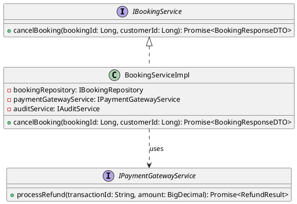
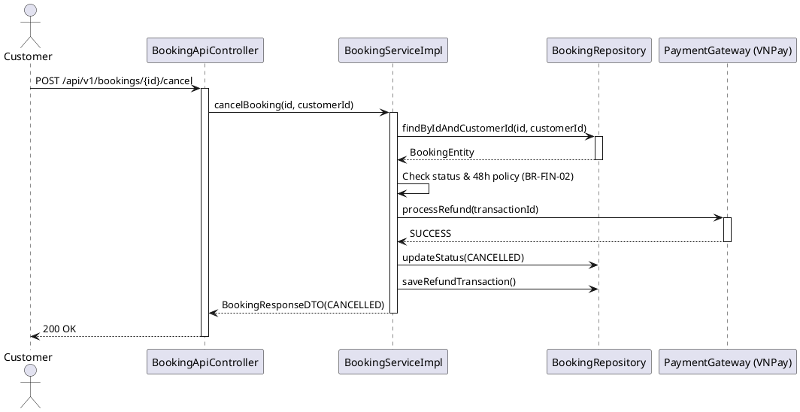

# ENGINEERING DOCUMENTATION STANDARD (EDS) v2.0

## Quy chuẩn Tài liệu Kỹ thuật và Đặc tả Hiện thực hóa - UC-11: Hủy đặt phòng (Cancel Booking)

| Field                    | Value                                                                                       |
| ------------------------ | ------------------------------------------------------------------------------------------- |
| **Document ID**    | `KAWAI-MOD2-IMP-011`                                                                        |
| **Version**        | 1.0                                                                                         |
| **Date**           | 2026-06-14                                                                                  |
| **Status**         | Approved                                                                                    |
| **Document Owner** | `Chu Xuân Dũng`                                                                             |
| **Author**         | `Chu Xuân Dũng – Developer`                                                                 |
| **Reviewed by**    | `Nguyễn Xuân Lưu – Tech Lead`                                                               |
| **DPO Sign-off**   | `[x] Approved – 2026-06-14 – Nguyễn Xuân Lưu`                                                |
| **Approved by**    | `Nguyễn Xuân Lưu`                                                                           |
| **Last Review**    | 2026-06-14                                                                                  |
| **Based on EDS**   | v2.0                                                                                        |

---

### CHANGELOG

> [!IMPORTANT]
> **Policy 4.4 — Immutable History:** Không bao giờ xóa thông tin cũ. Mọi thay đổi phải ghi vào bảng này.

| Ngày      | Người thực hiện | Nội dung thay đổi       |
| ---------- | ------------------- | -------------------------- |
| 2026-06-14 | `Chu Xuân Dũng`  | Tạo tài liệu đặc tả kỹ thuật độc lập cho Use Case 11 |
| 2026-06-15 | `Chu Xuân Dũng`  | Chuẩn hóa phân quyền API hủy phòng: khách hàng chỉ được hủy phòng của chính mình (Own) |
| 2026-06-15 | `AI Agent`       | Hoàn tất hiện thực hóa (GREEN Phase). Đã thêm các Mock Service (PaymentGateway, Notification) và TDD Pass toàn bộ. |


---

### MỤC LỤC
1. [Tổng quan Module](#1-tong-quan-module)
2. [Ma trận Truy vết (Traceability Matrix)](#2-ma-tran-truy-vet-traceability-matrix)
3. [Architecture Decision Records (ADR)](#3-architecture-decision-records-adr)
4. [Non-Functional Requirements & SLA](#4-non-functional-requirements--sla)
5. [Static Modeling (Mô hình Tĩnh)](#5-static-modeling-mo-hinh-tinh)
6. [Dynamic Modeling (Mô hình Động)](#6-dynamic-modeling-mo-hinh-dong)
7. [Domain Event Catalog](#7-domain-event-catalog)
8. [Interface Specification (Đặc tả Giao diện)](#8-interface-specification-dac-ta-giao-dien)
9. [API Specification](#9-api-specification)
10. [Bảng mã lỗi (Error Codes)](#10-bang-ma-loi-error-codes)
11. [Quy trình Triển khai (Step-by-Step)](#11-quy-trinh-trien-khai-step-by-step)
12. [Rollback & Incident Runbook](#12-rollback--incident-runbook)
13. [Kịch bản Kiểm thử Chi tiết](#13-kich-ban-kiem-thu-chi-tiet)
14. [Phương pháp Xác minh](#14-phuong-phap-xac-minh)
15. [Mẫu thử thực tế (API Verification Samples)](#15-mau-thu-thuc-te-api-verification-samples)
16. [Bảng tổng hợp phân quyền (Authorization Matrix)](#16-bang-tong-hop-phan-quyen-authorization-matrix)
17. [Phụ lục](#phu-luc)

---

### 1. Tổng quan Module

Mô tả đặc tả kỹ thuật và kiến trúc hiện thực hóa của **Use Case 11: Hủy đặt phòng (Cancel Booking)**. Tính năng này cho phép khách hàng hủy đơn đặt phòng đã xác nhận (Confirmed) trước ngày Check-in. Hệ thống sẽ kiểm tra thời gian hủy để xác định xem khách hàng có đủ điều kiện được hoàn tiền cọc hay không theo chính sách 48 giờ. Nếu hủy trước 48 giờ so với giờ check-in, hệ thống thực hiện hủy, giải phóng phòng và tự động hoàn cọc (nếu có). Ngược lại, yêu cầu hủy bị từ chối do quá hạn 48 giờ.

| Field                           | Value                                                  |
| ------------------------------- | ------------------------------------------------------ |
| **Module Name**           | `Đặt phòng & Tiền sảnh vận hành (Module 2)`             |
| **Bounded Context**       | `Đặt phòng & Tiền sảnh vận hành`                       |
| **Data Classification**   | Confidential & PII (Chứa thông tin khách hàng, tiền giao dịch) |
| **Compliance Scope**      | Luật du lịch Việt Nam 2017 & Luật Bảo vệ người tiêu dùng|
| **Upstream Dependencies** | `Module 2 (Book Room - UC-10)`                      |
| **Downstream Consumers**  | `Payment Gateway (VNPay), Module 5 (Tài chính - Hoàn tiền)` |

---

### 2. Ma trận Truy vết (Traceability Matrix)

Ánh xạ trực tiếp từ yêu cầu nghiệp vụ đến các thành phần mã nguồn:

| Requirement ID | Loại (BR/ADR/US) | Mô tả yêu cầu | Thành phần Code | Compliance Target | ADR liên quan |
| -------------- | ----------------- | ----------------- | ------------------------------------ | ----------------- | -------------- |
| **UC-11**     | Use Case          | Khách hàng thực hiện hủy đặt phòng | `BookingService.cancelBooking` `<br>` `BookingApiController.cancelBooking` | Quy trình kinh doanh | ADR-003 |
| **BR-FIN-02** | Business Rule     | Chính sách hoàn tiền 48 giờ | `BookingService.cancelBooking` | Bảo vệ lợi ích | — |
| **BR-SYS-04** | Business Rule     | Ghi log giao dịch tài chính/hủy | `AuditService.logCancellation` | Kiểm toán hệ thống | — |

---

### 3. Architecture Decision Records (ADR)

#### ADR-003 — Sử dụng Transactional cho quá trình Hủy và Hoàn tiền (Cancellation & Refund)

* **Status:** Accepted
* **Deciders:** Chu Xuân Dũng (Developer), Nguyễn Xuân Lưu (Tech Lead)
* **Date:** 2026-06-14
* **Bối cảnh:** Khi hủy đặt phòng, hệ thống phải thực hiện 3 tác vụ: cập nhật trạng thái Booking thành Cancelled, giải phóng phòng (Room Inventory), và tạo giao dịch hoàn tiền thông qua Payment Gateway. Nếu một trong các bước thất bại (ví dụ lỗi mạng kết nối VNPay), dữ liệu sẽ không nhất quán.
* **Quyết định:** Gói toàn bộ tác vụ hủy vào trong một `@Transactional`. Sử dụng cơ chế Two-Phase Commit hoặc kết hợp gọi API Refund Gateway ở bước cuối cùng trước khi commit DB. Nếu Gateway lỗi, ném `PaymentGatewayException` để rollback toàn bộ thay đổi trong Database.
* **Hệ quả:** Đảm bảo tính nhất quán của dữ liệu (ACID). Tuy nhiên, có thể tăng rủi ro timeout nếu Gateway phản hồi chậm.

---

### 4. Non-Functional Requirements & SLA

#### 4.1. Performance & Availability

| Category               | Requirement         | Target SLA | Measurement Method | Compliance Basis |
| ---------------------- | ------------------- | ---------- | ------------------ | ---------------- |
| **Latency**      | API response (p99)  | < 2s (Bao gồm Refund) | JMeter / k6 | —               |
| **Availability** | Uptime (monthly)    | 99.9%      | Uptime monitor     | —               |

#### 4.2. Data Integrity & Retention

| Category              | Requirement            | Target  | Verification Method | Compliance Basis |
| --------------------- | ---------------------- | ------- | ------------------- | ---------------- |
| **Durability**  | Zero record loss       | RPO = 0 | Transaction log     | — |
| **Consistency** | Booking <-> Refund sync| 100%    | Reconciliation job  | Bảo vệ quyền lợi KH |

#### 4.3. Security

| Category                        | Requirement   | Target          | Verification Method   | Compliance Basis |
| ------------------------------- | ------------- | --------------- | --------------------- | ---------------- |
| **Access control**        | Role-based (Customer) | Least privilege | Spring Security Context | GDPR Art. 25     |

---

### 5. Static Modeling (Mô hình Tĩnh)

#### 5.1. Class Diagram (PlantUML)



---

### 6. Dynamic Modeling (Mô hình Động)

#### 6.1. Sequence Diagram — Happy Path (PlantUML)



---

### 7. Domain Event Catalog

#### 7.1. Events Published (Phát ra)

| Event Name         | Trigger               | Publisher     | Subscriber(s)            | Payload Schema     | Async? |
| ------------------ | --------------------- | ------------- | ------------------------ | ------------------ | ------ |
| `BookingCancelled` | Khi khách hàng hủy đơn thành công | `BookingService` | `AuditService`, `NotificationService` | `BookingCancelled.ts` | Yes |
| `BookingCancellationFailed` | Khi quá trình hủy đơn thất bại | `BookingService` | `AuditService`, `NotificationService` | `BookingCancellationFailed.ts` | Yes |

---

### 8. Interface Specification (Đặc tả Giao diện)

#### 8.1. Service Interface

```java
public interface BookingService {
    /**
     * Hủy đơn đặt phòng và xử lý hoàn tiền
     * @param bookingId ID của đơn đặt phòng
     * @param customerId ID của khách hàng yêu cầu hủy
     * @return BookingResponseDTO trạng thái sau khi hủy
     * @throws BusinessException Khi vi phạm chính sách 48h
     */
    BookingResponseDTO cancelBooking(Long bookingId, Long customerId);
}
```

---

### 9. API Specification

#### 9.1. Endpoints Table

| Method | Path                                | Auth Level | Required Roles  | Rate Limit | Idempotent? |
| ------ | ----------------------------------- | ---------- | --------------- | ---------- | ----------- |
| POST   | `/api/bookings/{id}/cancel` | JWT Bearer | `ROLE_CUSTOMER` | 50/min     | Yes         |

#### 9.2. Request / Response Schemas

**POST `/api/bookings/{id}/cancel`**

*Response — 200 OK (Happy Path):*
```json
{
  "id": 123,
  "bookingStatus": "CANCELLED",
  "refundAmount": 2000000,
  "message": "Cancellation successful. Refund has been processed."
}
```

*Response — 400 Bad Request (Vi phạm 48h):*
```json
{
  "error": {
    "code": "BKG-004",
    "message": "Booking cannot be canceled as more than 48 hours have passed."
  }
}
```

---

### 10. Bảng mã lỗi (Error Codes)

| Code          | HTTP Status | Message (EN)             | Message (VI)              | Trigger Condition  |
| ------------- | ----------- | ------------------------ | ------------------------- | ------------------ |
| `BKG-003`     | 404         | Booking not found        | Không tìm thấy đơn đặt    | Sai ID hoặc sai Owner |
| `BKG-004`     | 400         | Cancellation policy violated | Hủy thất bại do quá hạn 48h | Thời gian hiện tại < 48h so với check-in (MSG22) |
| `BKG-005`     | 400         | Invalid booking status   | Trạng thái không hợp lệ   | Cố gắng hủy đơn đã Checked-In hoặc đã Cancelled |
| `PGW-001`     | 502         | Gateway timeout/error    | Lỗi cổng thanh toán       | Hoàn tiền thất bại do VNPay lỗi |

---

### 11. Quy trình Triển khai (Step-by-Step)
- [x] ADR-003 đã được duyệt
- [x] Kiểm tra tích hợp API Hoàn tiền VNPay trên môi trường Sandbox

---

### 12. Rollback & Incident Runbook

| Điều kiện                            | Ngưỡng           | Người quyết định |
| --------------------------------------- | ------------------ | --------------------- |
| **Lỗi kết nối VNPay kéo dài**  | > 5% lỗi 502 trong 10 phút | On-call Engineer      |
| **Dữ liệu hoàn tiền không đồng bộ**  | 1 ca phát hiện | Tech Lead       |

---

### 13. Kịch bản Kiểm thử Chi tiết (Refer TDD)
*Xem chi tiết trong file `TDD_MOD2_UC11.md`*

---

### 14. Phương pháp Xác minh
- Kiểm tra DB `Bookings` xem status đã đổi thành `CANCELLED`.
- Kiểm tra DB `Payment_Transactions` có record `Refund` mới.

---

### 15. Mẫu thử thực tế (API Verification Samples)

```bash
curl -X POST http://localhost:8080/api/v1/bookings/123/cancel \
  -H "Authorization: Bearer <TOKEN>"
```

---

### 16. Bảng tổng hợp phân quyền (Authorization Matrix)

| Endpoint                          | GUEST | CUSTOMER | RECEPTIONIST | ADMIN |
| --------------------------------- | :---: | :------: | :----------: | :---: |
| POST `/api/bookings/{id}/cancel` |  ❌  |   ✔️    |      ❌      |  ❌  |

*(Receptionist hủy phòng sẽ dùng API nội bộ khác dành cho quản lý, không dùng API này)*
