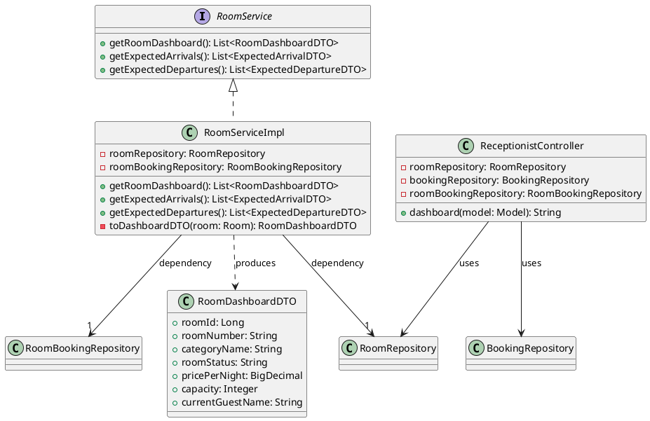
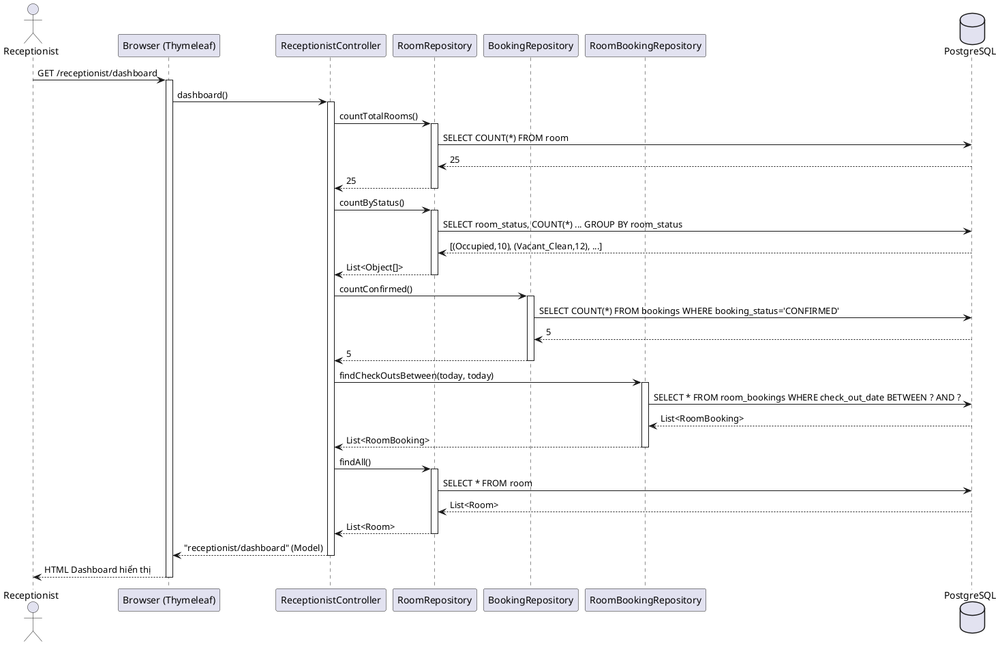
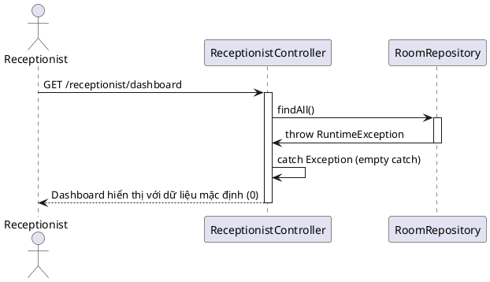

# ENGINEERING DOCUMENTATION STANDARD (EDS) v2.0

## Quy chuẩn Tài liệu Kỹ thuật và Đặc tả Hiện thực hóa - UC-12: Xem Sơ đồ Ma trận Phòng & Khách Dự kiến

| Field                    | Value                               |
| ------------------------ | ----------------------------------- |
| **Document ID**    | `KAWAI-MOD2-IMP-012`              |
| **Version**        | 1.0                                 |
| **Date**           | 2026-06-15                          |
| **Status**         | Approved                            |
| **Document Owner** | `Chu Xuân Dũng`                 |
| **Author**         | `Chu Xuân Dũng – Developer`    |
| **Reviewed by**    | `Nguyễn Xuân Lưu – Tech Lead` |
| **DPO Sign-off**   | `[ ] Pending`                     |
| **Approved by**    | `[ ] Pending`                     |
| **Last Review**    | 2026-06-15                          |
| **Based on EDS**   | v2.0                                |

---

### CHANGELOG

> [!IMPORTANT]
> **Policy 4.4 — Immutable History:** Không bao giờ xóa thông tin cũ. Mọi thay đổi phải ghi vào bảng này.

| Ngày      | Người thực hiện | Nội dung thay đổi                                            |
| ---------- | ------------------- | --------------------------------------------------------------- |
| 2026-06-15 | `Chu Xuân Dũng` | Đồng bộ bộ 13 test condition — bổ sung Floor Filter, Last Sync, Data Sync Error, Refresh, Booked Count |
| 2026-06-15 | `Chu Xuân Dũng` | Tạo tài liệu đặc tả kỹ thuật độc lập cho Use Case 12 |
| 2026-06-15 | `Chu Xuân Dũng` | Chuẩn hóa Authorization Matrix: cấp quyền truy cập Dashboard cho Receptionist  |

---

### MỤC LỤC

1. [Tổng quan Module](#1-tong-quan-module)
2. [Ma trận Truy vết (Traceability Matrix)](#2-ma-tran-truy-vet-traceability-matrix)
3. [Architecture Decision Records (ADR)](#3-architecture-decision-records-adr)
4. [Non-Functional Requirements &amp; SLA](#4-non-functional-requirements--sla)
5. [Static Modeling (Mô hình Tĩnh)](#5-static-modeling-mo-hinh-tinh)
6. [Dynamic Modeling (Mô hình Động)](#6-dynamic-modeling-mo-hinh-dong)
7. [Domain Event Catalog](#7-domain-event-catalog)
8. [Interface Specification (Đặc tả Giao diện)](#8-interface-specification-dac-ta-giao-dien)
9. [API Specification](#9-api-specification)
10. [Bảng mã lỗi (Error Codes)](#10-bang-ma-loi-error-codes)
11. [Quy trình Triển khai (Step-by-Step)](#11-quy-trinh-trien-khai-step-by-step)
12. [Rollback &amp; Incident Runbook](#12-rollback--incident-runbook)
13. [Kịch bản Kiểm thử Chi tiết](#13-kich-ban-kiem-thu-chi-tiet)
14. [Phương pháp Xác minh](#14-phuong-phap-xac-minh)
15. [Mẫu thử thực tế (API Verification Samples)](#15-mau-thu-thuc-te-api-verification-samples)
16. [Bảng tổng hợp phân quyền (Authorization Matrix)](#16-bang-tong-hop-phan-quyen-authorization-matrix)
17. [Phụ lục](#phu-luc)

---

### 1. Tổng quan Module

Mô tả đặc tả kỹ thuật và kiến trúc hiện thực hóa của **Use Case 12: Xem Sơ đồ Ma trận Phòng & Khách Dự kiến (View Expected Arrivals Matrix)**. Tính năng này cung cấp một bảng điều khiển (Dashboard) trực quan cho Nhân viên Lễ tân (Receptionist) để theo dõi khách dự kiến đến, số lượng phòng đã đặt, phòng trống, phòng đang sử dụng, và danh sách khách dự kiến check-out trong ngày. Giao diện được mã hóa màu (color-coded) để nhận diện trạng thái phòng tức thì.

| Field                           | Value                                                |
| ------------------------------- | ---------------------------------------------------- |
| **Module Name**           | `Đặt phòng & Tiền sảnh vận hành (Module 2)` |
| **Bounded Context**       | `Đặt phòng & Tiền sảnh vận hành`            |
| **Data Classification**   | Internal (Không lưu thông tin nhạy cảm PII)     |
| **Compliance Scope**      | Luật du lịch Việt Nam 2017                        |
| **Upstream Dependencies** | `UC-10 (Book Room), UC-13 (Check-In)`              |
| **Downstream Consumers**  | `Receptionist Front Desk Dashboard`                |

---

### 2. Ma trận Truy vết (Traceability Matrix)

Ánh xạ từ yêu cầu nghiệp vụ đến các thành phần code tương ứng:

| Requirement ID | Loại (BR/ADR/US) | Mô tả yêu cầu                                                               | Thành phần Code                                                                                                                                                                                                                                                                                                                                         | Compliance Target        | ADR liên quan |
| -------------- | ----------------- | ------------------------------------------------------------------------------- | --------------------------------------------------------------------------------------------------------------------------------------------------------------------------------------------------------------------------------------------------------------------------------------------------------------------------------------------------------- | ------------------------ | -------------- |
| UC-12          | Use Case          | Xem sơ đồ ma trận phòng & khách dự kiến                                 | [RoomServiceImpl.java](file:///d:/SWP_Group2/su26-swp391-se2023-g2/03_sourcecode/kawai-backend/src/main/java/com/kawai/services/impl/RoomServiceImpl.java#L127-L136) `<br>`[ReceptionistController.java](file:///d:/SWP_Group2/su26-swp391-se2023-g2/03_sourcecode/kawai-backend/src/main/java/com/kawai/controllers/web/ReceptionistController.java#L27-L71) | BR-FO-04, BR-FO-05       | ADR-004        |
| BR-FO-04       | Business Rule     | Room status lifecycle: Vacant_Clean → Occupied → Vacant_Dirty → Vacant_Clean | [RoomServiceImpl.java](file:///d:/SWP_Group2/su26-swp391-se2023-g2/03_sourcecode/kawai-backend/src/main/java/com/kawai/services/impl/RoomServiceImpl.java#L146-L157)                                                                                                                                                                                         | Chuẩn hóa trạng thái | —             |
| BR-FO-05       | Business Rule     | Phòng Rush Room được ưu tiên trong housekeeping queue                     | `HousekeepingServiceImpl` (sắp xếp ưu tiên task)                                                                                                                                                                                                                                                                                                    | Tối ưu vận hành      | —             |
| BR-FIN-05      | Business Rule     | Giá phòng làm tròn BigDecimal HALF_UP, scale 0                              | [RoomServiceImpl.java](file:///d:/SWP_Group2/su26-swp391-se2023-g2/03_sourcecode/kawai-backend/src/main/java/com/kawai/services/impl/RoomServiceImpl.java#L152-L156)                                                                                                                                                                                         | Quy chuẩn tiền tệ     | —             |

---

### 3. Architecture Decision Records (ADR)

#### ADR-004 — Sử dụng Spring MVC Thymeleaf cho Front Desk Dashboard (Server-Side Rendering)

* **Status:** Accepted
* **Deciders:** Chu Xuân Dũng (Developer), Nguyễn Xuân Lưu (Tech Lead)
* **Date:** 2026-06-15
* **Bối cảnh:** Receptionist cần một Dashboard hiển thị thời gian thực trạng thái phòng và khách dự kiến. Có 2 hướng tiếp cận: (A) REST API + SPA (JS fetch polling), (B) Server-Side Rendering với Thymeleaf.
* **Quyết định:** Sử dụng Thymeleaf Server-Side Rendering cho Front Desk Dashboard vì: (1) Không cần real-time sub-second update — Receptionist có thể refresh trang thủ công; (2) Giảm độ phức tạp client-side; (3) Tận dụng Spring Security context để kiểm soát role dễ dàng. Hỗ trợ thêm REST endpoint `/api/rooms/dashboard` nếu sau này cần SPA.
* **Hệ quả:** Giảm thời gian phát triển ban đầu, dễ bảo trì. Nếu cần real-time sau này sẽ migrate sang WebSocket/SSE.

---

### 4. Non-Functional Requirements & SLA

#### 4.1. Performance & Availability

| Category               | Requirement               | Target SLA | Measurement Method | Compliance Basis       |
| ---------------------- | ------------------------- | ---------- | ------------------ | ---------------------- |
| **Latency**      | Dashboard page load (p99) | < 500ms    | Browser DevTools   | Trải nghiệm Lễ tân |
| **Availability** | Uptime (monthly)          | 99.9%      | Uptime Monitor     | Cam kết dịch vụ     |
| **Throughput**   | Concurrent Receptionists  | 10 users   | Manual test        | Quy mô Resort         |

---

### 5. Static Modeling (Mô hình Tĩnh)

#### 5.1. Class Diagram (PlantUML)



#### 5.2. Data Structure (Java DTOs)

* **RoomDashboardDTO:** [RoomDashboardDTO.java](file:///d:/SWP_Group2/su26-swp391-se2023-g2/03_sourcecode/kawai-backend/src/main/java/com/kawai/dto/RoomDashboardDTO.java)

  * `roomId`: Long — ID phòng
  * `roomNumber`: String — Số hiệu phòng (R101, R201, ...)
  * `categoryName`: String — Tên hạng phòng (Deluxe, Suite, ...)
  * `roomStatus`: String — Trạng thái hiện tại (Vacant_Clean, Occupied, Vacant_Dirty, Maintenance, OutOfService)
  * `pricePerNight`: BigDecimal — Giá mỗi đêm (scale 0, HALF_UP)
  * `capacity`: Integer — Sức chứa tối đa
  * `currentGuestName`: String — Tên khách đang ở (nullable, chỉ có khi Occupied)

---

### 6. Dynamic Modeling (Mô hình Động)

#### 6.1. Sequence Diagram — Happy Path (PlantUML)



#### 6.2. Sequence Diagram — Error Path (Data Sync Error)



---

### 7. Domain Event Catalog

*Không có Domain Event nào được phát sinh hoặc tiêu thụ trong Use Case 12 do đây là luồng truy vấn dữ liệu thuần túy (Query/Read-only).*

---

### 8. Interface Specification (Đặc tả Giao diện)

#### 8.1. Service Interface

```java
package com.kawai.services.interfaces;

import com.kawai.dto.RoomDashboardDTO;
import java.util.List;

/**
 * @version 1.1
 */
public interface RoomService {
    /**
     * Lấy sơ đồ phòng (Room Matrix) thời gian thực cho Front Desk Dashboard (UC-12).
     * @return Danh sách DTO hiển thị trạng thái các phòng, rỗng nếu chưa có.
     */
    List<RoomDashboardDTO> getRoomDashboard();

    /**
     * Lấy danh sách khách dự kiến đến hôm nay (UC-12).
     * @return Danh sách booking CONFIRMED có checkInDate = today, không bao giờ null.
     */
    List<ExpectedArrivalDTO> getExpectedArrivals();

    /**
     * Lấy danh sách khách dự kiến check-out hôm nay (UC-12).
     * @return Danh sách booking CHECKED_IN có checkOutDate = today, không bao giờ null.
     */
    List<ExpectedDepartureDTO> getExpectedDepartures();
}
```

---

### 9. API Specification

#### 9.1. Endpoints Table

| Method | Path                       | Auth Level | Required Roles         | Rate Limit | Idempotent? |
| ------ | -------------------------- | ---------- | ---------------------- | ---------- | ----------- |
| GET    | `/receptionist/dashboard`  | Web Session| `ROLE_RECEPTIONIST`    | N/A        | Yes         |
| GET    | `/admin/dashboard`         | Web Session| `ROLE_ADMIN`           | N/A        | Yes         |
| GET    | `/manager/dashboard`       | Web Session| `ROLE_MANAGER`         | N/A        | Yes         |
| GET    | `/api/rooms/dashboard`     | JWT Bearer | `RECEPTIONIST`, `ADMIN`| 100/min    | Yes         |

#### 9.2. Response — `/api/rooms/dashboard` (REST API)

*Response — 200 OK:*

```json
{
  "kpi": {
    "totalRooms": 25,
    "occupiedRooms": 10,
    "dirtyRooms": 3,
    "availableRooms": 12
  },
  "rooms": [
    {
      "roomId": 1,
      "roomNumber": "R101",
      "categoryName": "Deluxe",
      "roomStatus": "Vacant_Clean",
      "pricePerNight": 2000000,
      "capacity": 2,
      "currentGuestName": null
    },
    {
      "roomId": 2,
      "roomNumber": "R201",
      "categoryName": "Suite",
      "roomStatus": "Occupied",
      "pricePerNight": 3500000,
      "capacity": 4,
      "currentGuestName": "Nguyen Van A"
    }
  ],
  "expectedArrivals": [
    {
      "bookingId": 1001,
      "customerName": "Tran Thi B",
      "checkInDate": "2026-06-15",
      "checkOutDate": "2026-06-20",
      "roomCategoryName": "Deluxe",
      "bookingStatus": "CONFIRMED"
    }
  ],
  "expectedDepartures": [
    {
      "bookingId": 900,
      "customerName": "Pham Van D",
      "roomNumber": "R105",
      "checkOutDate": "2026-06-15"
    }
  ]
}
```

---

### 10. Bảng mã lỗi (Error Codes)

| Code         | HTTP Status | Message (EN)   | Message (VI)       | Trigger Condition                                          |
| ------------ | ----------- | -------------- | ------------------ | ---------------------------------------------------------- |
| `MOD2-005` | 500         | Internal error | Lỗi hệ thống    | Lỗi database connection khi load dashboard                |
| `MOD2-004` | 403         | Access denied  | Không đủ quyền | Non-Receptionist cố truy cập `/receptionist/dashboard` |

---

### 11. Quy trình Triển khai (Step-by-Step)

#### 11.1. Kiểm tra code hiện có

`ReceptionistController.dashboard()` và `RoomServiceImpl.getRoomDashboard()` đã có implementation cơ bản. Cần bổ sung:

- `getExpectedArrivals()` method trong `RoomService` + `RoomServiceImpl`
- `getExpectedDepartures()` method trong `RoomService` + `RoomServiceImpl`
- `ExpectedArrivalDTO` và `ExpectedDepartureDTO` class mới
- `RoomDashboardKpiDTO` hoặc embed KPI trong response
- Trường `floor` (String) trong `Room` entity và `RoomDashboardDTO` để hỗ trợ filter theo tầng
- `lastSyncTimestamp` attribute trong model/response (AF-02)
- `syncError` / `warningMessage` attribute khi DB lỗi (E1)
- `pendingCheckIns` (booked rooms count) từ `bookingRepository.countConfirmed()`
- REST endpoint `/api/rooms/dashboard` (tùy chọn)

#### 11.2. Build mã nguồn

```powershell
cd 03_sourcecode/kawai-backend
.\apache-maven-3.9.6\bin\mvn.cmd clean package -DskipTests
```

#### 11.3. Chạy test

```powershell
.\apache-maven-3.9.6\bin\mvn.cmd test -Dtest=RoomServiceUC12Test
```

#### 11.4. Khởi chạy Server

```powershell
.\apache-maven-3.9.6\bin\mvn.cmd spring-boot:run
```

#### 11.5. Verification

Mở browser truy cập `http://localhost:8080/receptionist/dashboard` sau khi đăng nhập với role RECEPTIONIST.

---

### 12. Rollback & Incident Runbook

#### 12.1. Trigger Conditions

* Trang dashboard load > 2 giây liên tục trong 5 phút.
* Dữ liệu KPI sai lệch > 10% so với database thực tế.

#### 12.2. Rollback

* Quay lại phiên bản code ổn định trước đó qua Git:
  ```bash
  git checkout -- 03_sourcecode/kawai-backend/src/main/java/com/kawai/services/impl/RoomServiceImpl.java
  git checkout -- 03_sourcecode/kawai-backend/src/main/java/com/kawai/controllers/web/ReceptionistController.java
  ```
* Rebuild và deploy lại server.

---

### 13. Kịch bản Kiểm thử Chi tiết

Các kịch bản kiểm thử (Test Cases) của Use Case 12 được thiết lập dựa trên các Test Conditions dưới đây. Chi tiết các bước thực hiện Arrange-Act-Assert vui lòng xem tại tệp đặc tả TDD tương ứng: [TDD_MOD2_UC12.md](file:///d:/SWP_Group2/su26-swp391-se2023-g2/04_testing/mod2_booking/TDD_MOD2_UC12.md).

#### 13.1. Danh sách Test Conditions (Phạm vi Kiểm thử)

| Condition ID          | Test Condition                                | Mô tả kịch bản                                                        | Test Case ID       |
| --------------------- | --------------------------------------------- | ------------------------------------------------------------------------- | ------------------ |
| **TC-COND-001** | Lấy toàn bộ dashboard room matrix     | Hiển thị tất cả các phòng trong hệ thống lên Dashboard, giá đúng BigDecimal scale 0 HALF_UP | `TC-M2-UC12-001` |
| **TC-COND-002** | Dashboard rỗng khi không có phòng   | Trả về danh sách rỗng khi DB chưa có dữ liệu phòng                                        | `TC-M2-UC12-002` |
| **TC-COND-003** | Occupied room hiển thị tên khách   | Phòng Occupied hiển thị `currentGuestName`, phòng khác để null                            | `TC-M2-UC12-003` |
| **TC-COND-004** | Filter theo room status               | Lọc danh sách phòng theo `roomStatus` (Vacant_Clean, Occupied, ...)                       | `TC-M2-UC12-004` |
| **TC-COND-005** | Filter theo room type                 | Lọc danh sách phòng theo `categoryName` (Deluxe, Suite, ...)                              | `TC-M2-UC12-005` |
| **TC-COND-006** | Tính KPI dashboard                    | Tính toán chính xác totalRooms, occupied, dirty, available                                 | `TC-M2-UC12-006` |
| **TC-COND-007** | Expected arrivals hôm nay             | Lấy danh sách booking CONFIRMED có checkInDate = today                                     | `TC-M2-UC12-007` |
| **TC-COND-008** | Expected departures hôm nay           | Lấy danh sách booking CHECKED_IN có checkOutDate = today                                   | `TC-M2-UC12-008` |
| **TC-COND-009** | Filter theo floor                     | Lọc danh sách phòng theo tầng (R1xx = tầng 1, R2xx = tầng 2) — AF-01              | `TC-M2-UC12-009` |
| **TC-COND-010** | Hiển thị last sync timestamp         | Hiển thị thời điểm đồng bộ cuối cùng định dạng ISO 8601 khi dữ liệu bị trễ — AF-02  | `TC-M2-UC12-010` |
| **TC-COND-011** | Data synchronization error            | Dashboard hiển thị warning "Unable to refresh data..." khi DB lỗi — E1              | `TC-M2-UC12-011` |
| **TC-COND-012** | Refresh dashboard                     | Dashboard phản ánh đúng thay đổi trạng thái phòng sau khi refresh (không cache)      | `TC-M2-UC12-012` |
| **TC-COND-013** | Booked rooms count hiển thị đúng  | `pendingCheckIns` chỉ đếm booking CONFIRMED, không bao gồm CANCELLED                  | `TC-M2-UC12-013` |

---

### 14. Phương pháp Xác minh

#### 14.1. Xác minh bằng Browser (Web Thymeleaf)

Truy cập `http://localhost:8080/receptionist/dashboard` sau khi đăng nhập với role RECEPTIONIST.
*Kết quả mong đợi:* Trang HTML hiển thị đầy đủ KPI (totalRooms, occupied, dirty, pendingCheckIns, checkoutsToday), bảng Room Matrix với mã màu trạng thái, và danh sách phòng.

#### 14.2. Xác minh bằng cURL (REST API)

```bash
curl -X GET "http://localhost:8080/api/rooms/dashboard" \
  -H "Authorization: Bearer [RECEPTIONIST_TOKEN]"
```

*Kết quả mong đợi:* Nhận mã 200 OK cùng JSON object chứa `kpi`, `rooms`, `expectedArrivals`, `expectedDepartures`.

#### 14.3. Database Query

```sql
-- Kiểm tra KPI
SELECT room_status, COUNT(*) FROM room GROUP BY room_status;

-- Kiểm tra expected arrivals hôm nay
SELECT rb.id, c.full_name, rb.check_in_date
FROM room_bookings rb
JOIN customers c ON rb.customer_id = c.id
WHERE rb.booking_status = 'CONFIRMED' AND rb.check_in_date = CURRENT_DATE;

-- Kiểm tra expected departures hôm nay
SELECT rb.id, c.full_name, r.room_number, rb.check_out_date
FROM room_bookings rb
JOIN customers c ON rb.customer_id = c.id
JOIN room_booking_details rbd ON rbd.room_booking_id = rb.id
JOIN rooms r ON rbd.room_id = r.id
WHERE rb.booking_status = 'CHECKED_IN' AND rb.check_out_date = CURRENT_DATE;
```

---

### 15. Mẫu thử thực tế (API Verification Samples)

#### Response hợp lệ (Dashboard có dữ liệu):

```json
{
  "kpi": {
    "totalRooms": 25,
    "occupiedRooms": 10,
    "dirtyRooms": 3,
    "availableRooms": 10,
    "maintenanceRooms": 2
  },
  "rooms": [
    {
      "roomId": 1,
      "roomNumber": "R101",
      "categoryName": "Deluxe",
      "roomStatus": "Vacant_Clean",
      "pricePerNight": 2000000,
      "capacity": 2,
      "currentGuestName": null
    },
    {
      "roomId": 2,
      "roomNumber": "R201",
      "categoryName": "Suite",
      "roomStatus": "Occupied",
      "pricePerNight": 3500000,
      "capacity": 4,
      "currentGuestName": "Nguyen Van A"
    }
  ],
  "expectedArrivals": [
    {
      "bookingId": 1001,
      "customerName": "Tran Thi B",
      "checkInDate": "2026-06-15",
      "checkOutDate": "2026-06-20",
      "roomCategoryName": "Deluxe",
      "bookingStatus": "CONFIRMED"
    }
  ],
  "expectedDepartures": [
    {
      "bookingId": 900,
      "customerName": "Pham Van D",
      "roomNumber": "R105",
      "checkOutDate": "2026-06-15"
    }
  ]
}
```

---

### 16. Bảng tổng hợp phân quyền (Authorization Matrix)

| Endpoint                        | GUEST | CUSTOMER | RECEPTIONIST | ADMIN | MANAGER |
| ------------------------------- | :---: | :------: | :----------: | :---: | :-----: |
| GET `/receptionist/dashboard`   |  ❌  |    ❌    |      ✔️      |  ❌   |   ❌   |
| GET `/admin/dashboard`          |  ❌  |    ❌    |      ❌      |  ✔️   |   ❌   |
| GET `/manager/dashboard`        |  ❌  |    ❌    |      ❌      |  ❌   |   ✔️   |
| GET `/api/rooms/dashboard`      |  ❌  |    ❌    |      ✔️      |  ✔️   |   ✔️   |

---

### PHỤ LỤC

#### A. Glossary (Thuật ngữ)

* **Room Matrix:** Sơ đồ trực quan hiển thị tất cả phòng trong resort kèm trạng thái màu sắc (Xanh = Vacant_Clean, Đỏ = Occupied, Vàng = Vacant_Dirty, Xám = Maintenance).
* **Expected Arrivals:** Danh sách booking có trạng thái CONFIRMED với `checkInDate` trùng ngày hiện tại — tức khách dự kiến sẽ đến check-in hôm nay.
* **Expected Departures:** Danh sách booking có trạng thái CHECKED_IN với `checkOutDate` trùng ngày hiện tại — tức khách dự kiến sẽ check-out hôm nay.
* **KPI:** Key Performance Indicators trên Dashboard (tổng phòng, đang ở, chờ dọn, trống, bảo trì).
* **Vacant_Clean:** Phòng trống, đã dọn sạch, sẵn sàng nhận khách.
* **Vacant_Dirty:** Phòng trống nhưng chưa dọn (sau khi khách check-out).
