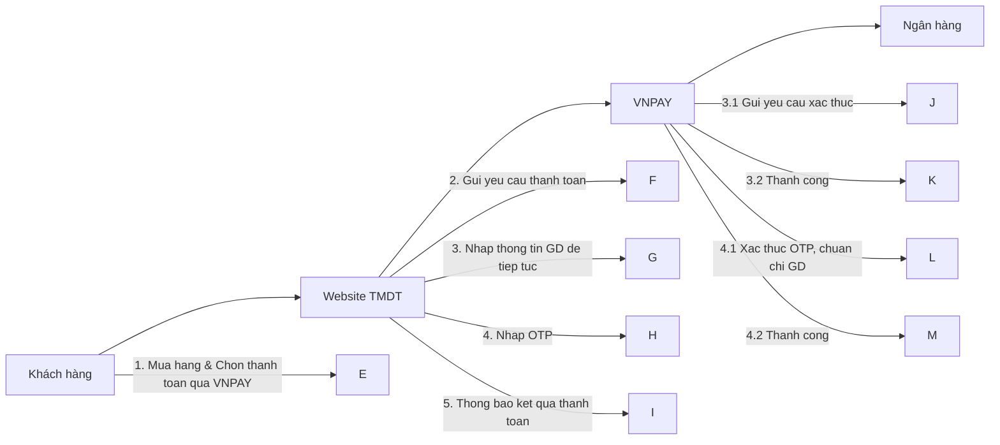

CÔNG TY CỔ PHẦN GIẢI PHÁP THANH TOÁN VIỆT NAM

## VNPAY

Simplifying the life

# HỆ THỐNG CỔNG THANH TOÁN

# TÀI LIÊU ĐẶC TẮ KẾT NỐI

# MERCHANT TMDT

Mã hiệu dự án: VPG

Mã hiệu tài liệu: VPG\_DTKN\_TMDT

Phiên bản: 2.1.0

Hà Nội, tháng 9 năm 2015

# HỆ THỐNG CỔNG THANH TOÁN

# TÀI LIÊU ĐẶC TẮ KẾT NỐI

# MERCHANT TMDT

Mã hiệu dự án: VPG

Mã hiệu tài liệu: VPG\_DTKN\_TMDT

Phiên bản: 2.1.0

<Hà Nội, 9/2015>

## BẢNG GHI NHẬN THAY ĐỒI

$^{*}$ A – Tạo mới, M – Sửa đổi, D – Xóa bổ

<table><tr><td>Ngày thay đổi</td><td>Vị trí thay đổi</td><td>A* M, D</td><td>Nguồn gốc</td><td>Phiên bản cũ</td><td>Mô tả thay đổi</td><td>Phiên bản mới</td></tr><tr><td>24/09/2015</td><td></td><td></td><td></td><td></td><td>Tạo mới</td><td>v1.0.0</td></tr><tr><td>01/06/2016</td><td></td><td></td><td></td><td></td><td>Cập nhật thêm API: querydr,refund</td><td>v1.0.1</td></tr><tr><td>10/03/2017</td><td></td><td></td><td></td><td></td><td>Cập nhật bằng mã lỗi</td><td>v1.0.2</td></tr><tr><td>11/06/2018</td><td></td><td></td><td></td><td></td><td>Cập nhật thêm tham số đầu vào thanh toán, chuyển API sang POST, Bổ sung SHA256</td><td>v2.0.1</td></tr><tr><td>19/07/2021</td><td></td><td></td><td></td><td></td><td>Cập nhật tham số đầu vào thanh toán, bổ sung HMACSHA512</td><td>v2.1.0</td></tr><tr><td>24/09/2021</td><td></td><td></td><td></td><td></td><td>Cập nhật thêm API: refundbatch</td><td>v2.1.0</td></tr><tr><td></td><td></td><td></td><td></td><td></td><td></td><td></td></tr><tr><td></td><td></td><td></td><td></td><td></td><td></td><td></td></tr><tr><td></td><td></td><td></td><td></td><td></td><td></td><td></td></tr><tr><td></td><td></td><td></td><td></td><td></td><td></td><td></td></tr><tr><td></td><td></td><td></td><td></td><td></td><td></td><td></td></tr><tr><td></td><td></td><td></td><td></td><td></td><td></td><td></td></tr><tr><td></td><td></td><td></td><td></td><td></td><td></td><td></td></tr><tr><td></td><td></td><td></td><td></td><td></td><td></td><td></td></tr></table>

## MỤC LỤC

## 1. GIÓI THIỆU......5

1.1. Mục đích tài liệu....5  
1.2. Phạm vi tài liệu....5  
1.3. Định nghĩa thuật ngữ và các từ viết tắt....5

## 2. MÔ HÌNH KẾT NÓI VÀ ĐẶC TẮ DŨ LIÊU TRAO ĐÕI ......6

2.1. Mô hình kết nối website TMĐT với Cổng thanh toán VNPAY......6  
2.2. Mô tả quy trình thanh toán ...... 6  
2.3. Xử lý đơn hàng....6  
2.4. Sơ đồ tuần tự....7  
2.5. Đặc tả dữ liệu trao đổi 8

2.5.1 Kiểu dữ liệu....8  
2.5.2 Các trường thông tin trao đổi 8  
2.5.3 Yêu cầu thanh toán (vnp\_Command=pay) 8  
2.5.4 Yêu cầu truy vấn giao dịch (vnp\_Command=querydr) 15  
2.5.5 Yêu cầu hoàn trả giao dịch (vnp\_Command=refund) 21  
2.5.6 Yêu cầu hoàn trả giao dịch theo lô (vnp\_Command=refundbacth)......26  
2.5.7 Bảng mã lỗi....34  
2.5.8 Thư viện kết nối....36  
2.5.9 Liên hệ 39

## 1. GIÓI THIÊU

## 1.1. Mục đích tài liệu

Tài liệu cung cấp đặc tả kỹ thuật của kết nối Cổng thanh toán VNPAY dành cho Merchant TMĐT.

## 1.2. Phạm vi tài liệu

Mô tả ngắn gọn Mô hình kết nối, sơ đồ tuần tự, các hàm API của các nghiệp vụ liên quan tới việc kết nối giữa hai hệ thống.

## 1.3. Định nghĩa thuật ngữ và các từ viết tắt

<table><tr><td>Thuật ngữ</td><td>Định nghĩa</td><td>Ghi chú</td></tr><tr><td>Tmdt</td><td>Thương mại điện tử</td><td></td></tr><tr><td>VnPayment</td><td>Cổng thanh toán VNPAY</td><td></td></tr><tr><td>Merchant</td><td>Đơn vị chấp nhận thể</td><td></td></tr><tr><td>Api</td><td>Giao diện kết nối để merchant có thể tương tác được với hệ thống của VNPAY</td><td></td></tr><tr><td>Checksum</td><td>Mã sử dụng để kiểm tra sư toàn vẹn của dữ liệu</td><td></td></tr><tr><td>OTP</td><td>Mật khẩu xác thực cho giao dịch (One Time Password)</td><td></td></tr><tr><td></td><td></td><td></td></tr></table>

Bảng 1: Thuật ngữ và định nghĩa

## 2. MÔ HÌNH KẾT NỐI VÀ ĐẶC TẮ DŨ LIỆU TRAO ĐÕI

## 2.1. Mô hình kết nối website TMĐT với Cổng thanh toán VNPAY


<details>
<summary>flowchart</summary>


</details>

## 2.2. Mô tả quy trình thanh toán


<details>
<summary>flowchart</summary>


</details>

- Khách hàng vào website TMĐT để mua hàng và chọn Thanh toán trực tuyến qua VNPAY.  
Website TMĐT gửi thông tin thanh toán của khách hàng sang VNPAY dưới dạng mở cửa sổ popup iframee. Thông tin gửi sang theo đặc tả kỹ thuật của tài liệu này  
- Khách hàng nhập thông tin xác thực tài khoản Ngân hàng tại VNPAY  
- Khách hàng thanh toán đơn hàng xong, VNPAY sẽ gửi thông báo kết quả thực hiện giao dịch cho Website TMĐT (thông qua IPN Url) và chuyển Khách hàng tới trang thông báo kết quả giao dịch.

## 2.3. Xử lý đơn hàng

Căn cứ vào kết quả thực hiện GD mua hàng của khách hàng, Đối tác TMĐT (người bán hàng, chủ sở hữu của website TMĐT) sẽ xử lý đơn hàng căn cứ theo kết quả thực hiện GD của khách hàng:

- Giao dịch thành công: Đối tác TMĐT tiến hành giao hàng hoặc cung cấp dịch vụ cho khách hàng theo đúng yêu cầu của đơn hàng.  
- Giao dịch thành công tại VNPAY – Hết hàng/Không cung cấp được dịch vụ cho khách hàng: Đối tác TMĐT sẽ lựa chọn việc cung cấp hàng hóa, dịch vụ theo yêu cầu của khách hàng hoặc đăng nhập vào hệ thống quản lý giao dịch dành cho Merchant do VNPAY cung cấp để thực hiện việc hoàn tiền cho khách hàng.  
- Giao dịch không thành công: Căn cứ vào mã lỗi trả về của VNPAY, website TMĐT sẽ hiển thị thông báo lỗi cho khách hàng biết.

## 2.4. So đồ tuần tự


<details>
<summary>flowchart</summary>


</details>

## Mô tả sơ đồ:

Bước 1: Khách hàng vào website TMĐT thực hiện mua hàng và chọn Thanh toán qua VNPAY

Bước 2: Website merchant gửi thông tin thanh toán của khách hàng sang VNPAY theo đặc tả kết nối (mục 2.5.2.1)

Bước 3: Khách hàng nhập thông tin xác thực thể thanh toán tại VNPAY. Thông qua kết nối riêng giữa VNPAY và Ngân hàng, VNPAY sẽ gửi yêu cầu sang bên Ngân hàng để thực hiện xác thực tài khoản

Xác thực thành công, Ngân hàng sẽ gửi mật khẩu OTP tới khách hàng, VNPAY chuyển khách hàng sang bước 4.

Bước 4: Khách hàng nhập mật khẩu OTP để hoàn tất giao dịch. VNPAY gửi yêu cầu xác thực OTP sang Ngân hàng. Xác thực OTP thành công, hệ thống Ngân hàng sẽ tiến hành chuẩn chỉ cho giao dịch. Kết thúc bước xác thực OTP hệ thống chuyển khách hàng sang bước 5.

Bước 5: VNPAY thông báo kết quả thanh toán Website TMĐT để website TMĐT tiến hành cập nhật giao dịch thanh toán (dữ liệu trao đổi mục 2.5.2.2). Nếu giao dịch thành công, Merchant tiến hành xử lý đơn hàng (mục 2.3)

## 2.5. Đặc tả dữ liệu trao đổi

## 2.5.1 Kiểu dữ liệu

<table><tr><td>Kiểu dữ liệu</td><td>Mô tả</td></tr><tr><td>Alpha</td><td>Dữ liệu kiểu chuỗi, chỉ bao gồm các ký tự in hoa (A-Z), thường (a-z)</td></tr><tr><td>Numeric</td><td>Dữ liệu kiểu số, chỉ bao gồm các ký tự số(0-9)</td></tr><tr><td>Alphanumeric</td><td>Dữ liệu kiểu số, bao gồm các ký tự in hoa, thường, ký tự số</td></tr></table>

## 2.5.2 Các trường thông tin trao đổi

<table><tr><td colspan="4">Tên tham số</td></tr><tr><td colspan="4">Mô tả</td></tr><tr><td>Bắt buộc/Tùy chọn</td><td>Kiểu dữ liệu</td><td>Min,Max</td><td>Ví dụ</td></tr></table>

## 2.5.3 Yêu cầu thanh toán (vnp\_Command=pay)

## 2.5.3.1 Merchant gửi VNPAY

<table><tr><td colspan="4">vnp_Version</td></tr><tr><td colspan="4">Phiên bản api mà merchant kết nối. Phiên bản hiện tại là 2.1.0</td></tr><tr><td>Bắt buộc</td><td>Alphanumeric</td><td>1,8</td><td>2.1.0</td></tr></table>

<table><tr><td colspan="4">vnp_Command</td></tr><tr><td colspan="4">Mã API sử dụng, mã cho giao dịch thanh toán là pay</td></tr><tr><td>Bắt buộc</td><td>Alpha</td><td>1,16</td><td>pay</td></tr></table>

<table><tr><td colspan="4">vnp_TmnCode</td></tr><tr><td colspan="4">Mã định danh (app/website/dịch vụ) của merchant trên hệ thống của VNPAY</td></tr><tr><td>Bắt buộc</td><td>Alphanumeric</td><td>8</td><td>VNPAY001</td></tr><tr><td colspan="4">vnp_BankCode</td></tr><tr><td colspan="4">Mã Ngân hàng thanh toán. Nếu không truyền giá trị cho tham số này, Khách hàng sẽ chọn Ngân hàng thanh toán tại VNPAY.</td></tr><tr><td>Tùy chọn</td><td>Alphanumeric</td><td>3,20</td><td>VIETCOMBANK</td></tr></table>

<table><tr><td colspan="4">vnp_Locale</td></tr><tr><td colspan="4">Ngôn ngữ khách hàng đang sử dụng. Hiện tại hỗ trợ Tiếng Việt (vn), Tiếng Anh (en)</td></tr><tr><td>Bắt buộc</td><td>Alpha</td><td>2,5</td><td>vn</td></tr></table>

<table><tr><td colspan="4">vnp_CurrCode</td></tr><tr><td colspan="4">Đơn vị tiền tệ sử dụng thanh toán. Hiện tại chỉ hỗ trợ VND,USD</td></tr><tr><td>Bắt buộc</td><td>Alpha</td><td>3</td><td>VND</td></tr></table>

<table><tr><td colspan="4">vnp_TxnRef</td></tr><tr><td colspan="4">Mã tham chiếu của giao dịch tại hệ thống của merchant. Mã này là duy nhất dùng để phân biệt các đơn hàng gửi sang VNPAY. Không được trùng lặp trong ngày</td></tr><tr><td>Bắt buộc</td><td>Alphanumeric</td><td>1,100</td><td>VNPAY123</td></tr></table>

<table><tr><td colspan="4">vnp_OrderInfo</td></tr><tr><td colspan="4">Thông tin mô tả nội dung thanh toán (Tiếng Việt, không dấu)</td></tr><tr><td>Bắt buộc</td><td>Alphanumeric</td><td>1,255</td><td>Nap 100K cho so dien thoai 0934998386</td></tr></table>

<table><tr><td colspan="4">vnp_OrderType</td></tr><tr><td colspan="4">Mã danh mục hàng hóa. Mỗi hàng hóa sẽ thuộc một nhóm danh mục do VNPAY quy định. VNPAY sẽ cung cấp bằng danh mục này tại trang dành cho merchant của VNPAY</td></tr><tr><td>Bắt buộc</td><td>Alphanumeric</td><td>1,100</td><td>topup</td></tr><tr><td colspan="4">vnp_Amount</td></tr><tr><td colspan="4">Số tiền thanh toán. Số tiền không mang các ký tự phân tách thập phân, phần nghìn, ký tự tiền tệ. Để gửi số tiền thanh toán là 10,000 VND (mười nghìn VNĐ) thì merchant cần nhân thêm 100 lần (khử phần thập phân), sau đó gửi sang VNPAY là: 1000000</td></tr><tr><td>Bắt buộc</td><td>Numeric</td><td>1,12</td><td>100000</td></tr></table>

<table><tr><td colspan="4">vnp_ReturnUrl</td></tr><tr><td colspan="4">Địa chỉ trả về khi khách hàng thực hiện thanh toán xong</td></tr><tr><td>Bắt buộc</td><td>Alphanumeric</td><td>10,255</td><td>https://merchant.com/return</td></tr></table>

<table><tr><td colspan="4">vnp_IpAddr</td></tr><tr><td colspan="4">Địa chỉ IP của khách hàng thực hiện giao dịch</td></tr><tr><td>Bắt buộc</td><td>Alphanumeric</td><td>7,45</td><td>123.123.123.123</td></tr></table>

<table><tr><td colspan="4">vnp_CreateDate</td></tr><tr><td colspan="4">Thời gian ghi nhận giao dịch tại website của merchant GMT+7, định dạng: yyyyMMddHHmmss</td></tr><tr><td>Bắt buộc</td><td>Numeric</td><td>14</td><td>20150924080900</td></tr></table>

<table><tr><td colspan="4">vnp_ExpireDate</td></tr><tr><td colspan="4">Thời gian hết hạn thanh toán GMT+7, định dạng: yyyyMMddHHmmss</td></tr><tr><td>Bắt buộc</td><td>Numeric</td><td>14</td><td>20150924083000</td></tr></table>

<table><tr><td colspan="4">vnp_Bill_Mobile</td></tr><tr><td colspan="4">Số điện thoại của khách hàng</td></tr><tr><td>Tùy chọn</td><td>Alphanumeric</td><td>14</td><td>84932224546</td></tr></table>

<table><tr><td>vnp_Bill_Email</td></tr><tr><td>Địa chỉ email của khách hàng</td></tr></table>

<table><tr><td>Tùy chọn</td><td>Alphanumeric</td><td>100</td><td>khachhang@vnpay.vn</td></tr></table>

<table><tr><td colspan="4">vnp_Bill_FirstName</td></tr><tr><td colspan="4">Hộ của khách hàng (trong tên đầy đủ gồm có Hộ + Đệm + Tên)</td></tr><tr><td>Tùy chọn</td><td>Alpha</td><td>20</td><td>NGUYEN</td></tr></table>

<table><tr><td colspan="4">vnp_Bill_LastName</td></tr><tr><td colspan="4">Đệm và Tên của khách hàng</td></tr><tr><td>Tùy chọn</td><td>Alpha</td><td>50</td><td>VAN AN</td></tr></table>

<table><tr><td colspan="4">vnp_Bill_Address</td></tr><tr><td colspan="4">Địa chỉ của khách hàng</td></tr><tr><td>Tùy chọn</td><td>Alphanumeric</td><td>100</td><td>P315, 22 Lang Ha</td></tr></table>

<table><tr><td colspan="4">vnp_Bill_City</td></tr><tr><td colspan="4">Tỉnh/Thành phố của khách hàng</td></tr><tr><td>Tùy chọn</td><td>Alphanumeric</td><td>50</td><td>HANOI</td></tr></table>

<table><tr><td colspan="4">vnp_Bill_Country</td></tr><tr><td colspan="4">Mã Quốc gia 02 ký tự của khách hàng, theo bằng mã:https://en.wikipedia.org/wiki/ISO_3166-1_alpha-2</td></tr><tr><td>Tùy chọn</td><td>Alphanumeric</td><td>2</td><td>VN</td></tr></table>

<table><tr><td colspan="4">vnp_Bill_State</td></tr><tr><td colspan="4">Mã Bang, áp dụng cho các quốc gia như: Mỹ, Canada,...Mã bang tham khảo tại link:Mỹ (US):https://pe.usps.com/text/pub28/28apb.htmCanada(CA):https://pe.usps.com/text/pub28/28apa_005.htm</td></tr><tr><td>Tùy chơn</td><td>Alphanumeric</td><td>2</td><td>CA</td></tr><tr><td colspan="4">vnp_Inv_Phone</td></tr><tr><td colspan="4">Số điện thoại của cá nhân/tổ chức in trên hóa đơn điện tử</td></tr><tr><td>Tùy chọn</td><td>Alphanumeric</td><td>20</td><td>8491234567</td></tr></table>

<table><tr><td colspan="4">vnp_Inv_Email</td></tr><tr><td colspan="4">Địa chỉ email nhận Hóa đơn điện tử</td></tr><tr><td>Tùy chọn</td><td>Alphanumeric</td><td>100</td><td>hotro@vnpay.vn</td></tr></table>

<table><tr><td colspan="4">vnp_Inv_Customer</td></tr><tr><td colspan="4">Hộ tên của khách hàng in trên Hóa đơn điện tử</td></tr><tr><td>Tùy chọn</td><td>Alphanumeric</td><td>50</td><td>NGUYEN VAN A</td></tr></table>

<table><tr><td colspan="4">vnp_Inv_Address</td></tr><tr><td colspan="4">Địa chỉ ghi trên hóa đơn điện tử</td></tr><tr><td>Tùy chọn</td><td>Alphanumeric</td><td>14</td><td>22 Láng Hạ, Đống Đa, Hà Nội</td></tr></table>

<table><tr><td colspan="4">vnp_Inv_Company</td></tr><tr><td colspan="4">Tên Công ty/Tổ chức in trên hóa đơn điện tử</td></tr><tr><td>Tùy chọn</td><td>Alphanumeric</td><td>100</td><td>Công ty VNPAY</td></tr></table>

<table><tr><td colspan="4">vnp_Inv_Taxcode</td></tr><tr><td colspan="4">Mã số thuế của Công ty/Tổ chức</td></tr><tr><td>Tùy chọn</td><td>Alphanumeric</td><td>50</td><td>20180924080900</td></tr></table>

<table><tr><td>vnp_Inv_Type</td></tr><tr><td>Loại hóa đơn điện tử:- I: Cá nhân- O: Tổ chức</td></tr></table>

<table><tr><td>Tùy chơn</td><td>Alpha</td><td>1</td><td>I</td></tr></table>

<table><tr><td colspan="4">vnp_SecureHash</td></tr><tr><td colspan="4">Mã kiểm tra (checksum) để đảm bảo dữ liệu của giao dịch không bị thay đổi trong quá trình chuyển từ merchant sang VNPAY. Việc tạo ra mã này phụ thuộc vào cấu hình của merchant và phiên bản api sử dụng. Phiên bản hiện tại, mặc định hỗ trợ HMACSHA512</td></tr><tr><td>Bắt buộc</td><td>Alphanumeric</td><td>32,256</td><td>2cd8a970b02a4ddbe2272f05f3f818c9ddc27dcac0e3674a9cfd9f50fad52c4e96b7eee18775bcb8169415d35d87869c3ff911baa397134218d5c2ac6671b453</td></tr></table>

## 2.5.3.2 Thông tin nhận về từ VNPAY

<table><tr><td colspan="4">vnp_TmnCode</td></tr><tr><td colspan="4">Mã định danh (app/website/dịch vụ) của merchant trên hệ thống của VNPAY</td></tr><tr><td>Bắt buộc</td><td>Alphanumeric</td><td>8</td><td>VNPAY001</td></tr></table>

<table><tr><td colspan="4">vnp_TxnRef</td></tr><tr><td colspan="4">Mã tham chiếu của giao dịch tại hệ thống của merchant. Mã này do merchant gửi sang khi yêu cầu thanh toán. VNPAY gửi lại để merchant cập nhật</td></tr><tr><td>Bắt buộc</td><td>Alphanumeric</td><td>1,100</td><td>VNPAY123</td></tr></table>

<table><tr><td colspan="4">vnp_Amount</td></tr><tr><td colspan="4">Số tiền thanh toán. Số tiền không mang các ký tự phân tách thập phân, phần nghìn, ký tự tiền tệ. Để gửi số tiền thanh toán là 10,000 VND (mười nghìn VND) thì merchant cần nhân thêm 100 lần (khử phần thập phân), sau đó gửi sang VNPAY là: 1000000</td></tr><tr><td>Bắt buộc</td><td>Numeric</td><td>1,12</td><td>100000</td></tr></table>

<table><tr><td>vnp_OrderInfo</td></tr><tr><td>Thông tin mô tả nội dung thanh toán (Tiếng Việt, không dấu)</td></tr></table>

<table><tr><td>Bắt buộc</td><td>Alphanumeric</td><td>1,255</td><td>Nap 100K cho so dien thoai 0934998386</td></tr></table>

<table><tr><td colspan="4">vnp_ResponseCode</td></tr><tr><td colspan="4">Mã phần hồi kết quả thanh toán. Quy định mã trả lời 00 ứng với kết quả Thành công cho tất cả các API. Tham khảo thêm tại bằng mã lỗi</td></tr><tr><td>Bắt buộc</td><td>Numeric</td><td>2</td><td>00</td></tr></table>

<table><tr><td colspan="4">vnp_BankCode</td></tr><tr><td colspan="4">Mã Ngân hàng phát hành thể ( Ngân hàng thanh toán)</td></tr><tr><td>Bắt buộc</td><td>Alphanumeric</td><td>3,20</td><td>VIETCOMBANK</td></tr></table>

<table><tr><td colspan="4">vnp_BankTranNo</td></tr><tr><td colspan="4">Mã giao dịch tại Ngân hàng</td></tr><tr><td>Tùy chọn</td><td>Alphanumeric</td><td>3,255</td><td>20160802055902</td></tr></table>

<table><tr><td colspan="4">vnp_CardType</td></tr><tr><td colspan="4">Loại tài khoản/thẻ khách hàng sử dụng: ATM,IB,ACC,QRCODE</td></tr><tr><td>Tùy chọn</td><td>Alpha</td><td>3,20</td><td>QRCODE</td></tr></table>

<table><tr><td colspan="4">vnp_PayDate</td></tr><tr><td colspan="4">Thời gian khách hàng thanh toán, ghi nhận tại VNPAY tính theo GMT+7. Định dạng: yyyyMMddHHmmss</td></tr><tr><td>Bắt buộc</td><td>Numeric</td><td>14</td><td>20150924130500</td></tr></table>

<table><tr><td colspan="4">vnp_TransactionNo</td></tr><tr><td colspan="4">Mã giao dịch ghi nhận tại hệ thống VNPAY</td></tr><tr><td>Bắt buộc</td><td>Numeric</td><td>1,15</td><td>1001</td></tr><tr><td colspan="4">vnp_TransactionStatus</td></tr><tr><td colspan="4">Tình trạng của giao dịch tại Cổng thanh toán VNPAY. Xem thêm tại mục2.5.7.2- 00: Giao dịch thanh toán được thực hiện thành công tại VNPAY- Khác 00: Giao dịch không thành công tại VNPAY</td></tr><tr><td>Bắt buộc</td><td>Numeric</td><td>2</td><td>00</td></tr></table>

<table><tr><td colspan="4">vnp_SecureHash</td></tr><tr><td colspan="4">Mã kiểm tra (checksum) để đảm bảo dữ liệu của giao dịch không bị thay đổi trong quá trình chuyển từ VNPAY về merchant. Việc tạo ra mã này phụ thuộc vào cấu hình của merchant và phiên bản api sử dụng. Phiên bản hiện tại, mặc định hỗ trợ HMACSHA512. Quy tắc và Phương thức sử dụng giống với bước merchant gửi sang VNPAY</td></tr><tr><td>Bắt buộc</td><td>Alphanumeric</td><td>32,256</td><td>2cd8a970b02a4ddbe2272f05f3f818c9ddc27dcac0e3674a9cfd9f50fad52c4e96b7eee18775bcb8169415d35d87869c3ff911baa397134218d5c2ac6671b453</td></tr></table>

## 2.5.4 Yêu cầu truy vấn giao dịch (vnp\_Command=querydr)

Method: POST

Content-Type: application/json

## 2.5.4.1 Merchant gửi VNPAY

<table><tr><td colspan="4">vnp_RequestId</td></tr><tr><td colspan="4">Mã hệ thống merchant tự sinh ứng với mỗi yêu cầu truy vấn giao dịch. Mã này là duy nhất dùng để phân biệt các yêu cầu truy vấn giao dịch. Không được trùng lặp trong ngày.</td></tr><tr><td>Bắt buộc</td><td>Alphanumeric</td><td>1,32</td><td>6fd7af91-258b-4f32-a965-d1e1cfed61c8</td></tr></table>

<table><tr><td colspan="4">vnp_VersionPhiên bản api mà merchant kết nối. Phiên bản hiện tại là 2.1.0</td></tr><tr><td>Bắt buộc</td><td>Alphanumeric</td><td>1,8</td><td>2.1.0</td></tr></table>

<table><tr><td colspan="4">vnp_Command</td></tr><tr><td colspan="4">Mã API sử dụng, mã cho giao dịch thanh toán là querydr</td></tr><tr><td>Bắt buộc</td><td>Alpha</td><td>1,16</td><td>querydr</td></tr></table>

<table><tr><td colspan="4">vnp_TmnCode</td></tr><tr><td colspan="4">Mã định danh (app/website/dịch vụ) của merchant trên hệ thống của VNPAY</td></tr><tr><td>Bắt buộc</td><td>Alphanumeric</td><td>8</td><td>VNPAY001</td></tr></table>

<table><tr><td colspan="4">vnp_TxnRef</td></tr><tr><td colspan="4">Mã tham chiếu của giao dịch tại hệ thống của merchant. Mã này là duy nhất dùng để phân biệt các đơn hàng gửi sang VNPAY. Không được trùng lặp trong ngày</td></tr><tr><td>Bắt buộc</td><td>Alphanumeric</td><td>1,100</td><td>VNPAY123</td></tr></table>

<table><tr><td colspan="4">vnp_OrderInfo</td></tr><tr><td colspan="4">Mô tả thông tin yêu cầu (Request description)</td></tr><tr><td>Bắt buộc</td><td>Alphanumeric</td><td>1,255</td><td>Query transaction result, tranid=1234</td></tr></table>

<table><tr><td colspan="4">vnp_TransactionNo</td></tr><tr><td colspan="4">Mã giao dịch ghi nhận tại hệ thống VNPAY</td></tr><tr><td>Tùy chọn</td><td>Numeric</td><td>1,15</td><td>1001</td></tr></table>

<table><tr><td>vnp_TransactionDate</td></tr><tr><td>Thời gian ghi nhận giao dịch tại website của merchant tính theo GMT+7, định dạng: yyyyMMddHHmmss, tham khảo giá trị: vnp_CreateDate của vnp_Command=pay</td></tr></table>

<table><tr><td>Bắt buộc</td><td>Numeric</td><td>14</td><td>20150924080900</td></tr></table>

<table><tr><td colspan="4">vnp_CreateDate</td></tr><tr><td colspan="4">Thời gian phát sinh request (Request Date) GMT+7, định dạng: yyyyMMddHHmmss</td></tr><tr><td>Bắt buộc</td><td>Numeric</td><td>14</td><td>20150924080900</td></tr></table>

<table><tr><td colspan="4">vnp_IpAddr</td></tr><tr><td colspan="4">Địa chỉ IP của máy chủ thực hiện gọi API</td></tr><tr><td>Bắt buộc</td><td>Alphanumeric</td><td>7,45</td><td>123.123.123.123</td></tr></table>

<table><tr><td colspan="4">vnp_SecureHash</td></tr><tr><td colspan="4">Mã kiểm tra (checksum) để đảm bảo dữ liệu của giao dịch không bị thay đổi trong quá trình chuyển từ merchant sang VNPAY. Việc tạo ra mã này phụ thuộc vào cấu hình của merchant và phiên bản api sử dụng. Phiên bản hiện tại, mặc định hỗ trợ HMACSHA512</td></tr><tr><td>Bắt buộc</td><td>Alphanumeric</td><td>32,256</td><td>2cd8a970b02a4ddbe2272f05f3f818c9ddc27dcac0e3674a9cfd9f50fad52c4e96b7eee18775bcb8169415d35d87869c3ff911baa397134218d5c2ac6671b453</td></tr><tr><td>Quy tắc tạo checksum</td><td></td><td></td><td>data = vnp_RequestId + “|” + vnp_Version + “|” + vnp_Command + “|” + vnp_TmnCode + “|” + vnp_TxnRef + “|” + vnp_TransactionDate + “|” + vnp_CreateDate + “|” + vnp_IpAddr + “|” + vnp_OrderInfo;checksum = hashWithSecureType(secretKey, data);</td></tr></table>

## 2.5.4.2 Thông tin nhận về từ VNPAY

<table><tr><td colspan="4">vnp_ResponseId</td></tr><tr><td colspan="4">Mã hệ thống VNPAY tự sinh ứng với mỗi yêu cầu truy vấn giao dịch. Mã này là duy nhất dùng để phân biệt các yêu cầu truy vấn giao dịch. Không được trùng lặp trongngày.</td></tr><tr><td>Bắt buộc</td><td>Alphanumeric</td><td>1,32</td><td>6fd7af91-258b-4f32-a965-d1e1cfed61c8</td></tr></table>

<table><tr><td colspan="4">vnp_Command</td></tr><tr><td colspan="4">Mã API sử dụng, mã cho giao dịch thanh toán là querydr</td></tr><tr><td>Tùy chọn</td><td>Alpha</td><td>1,16</td><td>querydr</td></tr></table>

<table><tr><td colspan="4">vnp_TmnCode</td></tr><tr><td colspan="4">Mã định danh (app/website/dịch vụ) của merchant trên hệ thống của VNPAY</td></tr><tr><td>Bắt buộc</td><td>Alphanumeric</td><td>8</td><td>VNPAY001</td></tr></table>

<table><tr><td colspan="4">vnp_TxnRef</td></tr><tr><td colspan="4">Mã tham chiếu của giao dịch tại hệ thống của merchant. Mã này do merchant gửi sang khi yêu cầu thanh toán. VNPAY gửi lại để merchant cập nhật</td></tr><tr><td>Bắt buộc</td><td>Alphanumeric</td><td>1,100</td><td>VNPAY123</td></tr></table>

<table><tr><td colspan="4">vnp_Amount</td></tr><tr><td colspan="4">Số tiền thanh toán. Tham khảo vnp_Amount trong vnp_Command=pay</td></tr><tr><td>Bắt buộc</td><td>Numeric</td><td>1,12</td><td>100000</td></tr></table>

<table><tr><td colspan="4">vnp_OrderInfo</td></tr><tr><td colspan="4">Thông tin mô tả nội dung thanh toán (Tiếng Việt, không dấu)</td></tr><tr><td>Bắt buộc</td><td>Alphanumeric</td><td>1,255</td><td>Nap 100K cho so dien thoai 0934998386</td></tr><tr><td colspan="4">vnp_ResponseCode</td></tr><tr><td colspan="4">Mã phần hồi kết quả xử lý của API. Quy định mã trả lời 00 ứng với yêu cầu querydr được thực hiện thành công. Tham khảo thêm tại bằng mã lỗi.</td></tr><tr><td colspan="4">Chú ý: Đây là kết quả phần hồi của hệ thống. Kết quả của giao dịch (thành công/ không thành công) xem thêm tại: vnp_TransactionStatus</td></tr><tr><td>Bắt buộc</td><td>Numeric</td><td>2</td><td>00</td></tr></table>

<table><tr><td colspan="4">vnp_Message</td></tr><tr><td colspan="4">Mô tả thông tin tương ứng với vnp_ResponseCode</td></tr><tr><td>Bắt buộc</td><td>Alphanumeric</td><td>10,255</td><td>Query Success</td></tr></table>

<table><tr><td colspan="4">vnp_BankCode</td></tr><tr><td colspan="4">Mã Ngân hàng phát hành thể ( Ngân hàng thanh toán)</td></tr><tr><td>Bắt buộc</td><td>Alphanumeric</td><td>3,20</td><td>VIETCOMBANK</td></tr></table>

<table><tr><td colspan="4">vnp_CardType</td></tr><tr><td colspan="4">Loại tài khoản/thẻ khách hàng sử dụng: ATM,IB,ACC,QRCODE</td></tr><tr><td>Tùy chọn</td><td>Alpha</td><td>3,20</td><td>QRCODE</td></tr></table>

<table><tr><td colspan="4">vnp_PayDate</td></tr><tr><td colspan="4">Thời gian khách hàng thanh toán, ghi nhận tại VNPAY. Định dạng: yyyyMMddHHmmss</td></tr><tr><td>Tùy chọn</td><td>Numeric</td><td>14</td><td>20150924130500</td></tr></table>

<table><tr><td colspan="4">vnp_TransactionNo</td></tr><tr><td colspan="4">Mã giao dịch ghi nhận tại hệ thống VNPAY</td></tr><tr><td>Bắt buộc</td><td>Numeric</td><td>1,15</td><td>1001</td></tr></table>

<table><tr><td colspan="4">vnp_TransactionType</td></tr><tr><td colspan="4">Loại giao dịch tại hệ thống VNPAY:01: GD thanh toán</td></tr><tr><td colspan="4">02: Giao dịch hoàn trả toàn phần</td></tr><tr><td colspan="4">03: Giao dịch hoàn trả một phần</td></tr><tr><td>Bắt buộc</td><td>Numeric</td><td>2</td><td>02</td></tr></table>

<table><tr><td colspan="4">vnp_TransactionStatus</td></tr><tr><td colspan="4">Tình trạng của giao dịch tại Cổng thanh toán VNPAY. Xem thêm tại mục 2.5.7.2</td></tr><tr><td>Bắt buộc</td><td>Numeric</td><td>2</td><td>00</td></tr></table>

<table><tr><td colspan="4">vnp_PromotionCode</td></tr><tr><td colspan="4">Mã khuyến mại</td></tr><tr><td>Tùy chọn</td><td>Alphanumeric</td><td>1,12</td><td>VNPAY</td></tr></table>

<table><tr><td colspan="4">vnp_PromotionAmount</td></tr><tr><td colspan="4">Số tiền khuyến mại</td></tr><tr><td>Tùy chọn</td><td>Numeric</td><td>1,12</td><td>1000</td></tr></table>

<table><tr><td colspan="4">vnp_SecureHash</td></tr><tr><td colspan="4">Mã kiểm tra (checksum) để đảm bảo dữ liệu của giao dịch không bị thay đổi trong quá trình chuyển từ VNPAY về merchant. Việc tạo ra mã này phụ thuộc vào cấu hình của merchant và phiên bản api sử dụng. Phiên bản hiện tại hỗ trợ HMACSHA512. Quy tắc và Phương thức sử dụng giống với bước merchant gửi sang VNPAY</td></tr><tr><td>Tùy chọn</td><td>Alphanumeric</td><td>32,256</td><td>2cd8a970b02a4ddbe2272f05f3f818c9ddc27dcac0e3674a9cfd9f50fad52c4e96b7eee18775bcb8169415d35d87869c3ff911baa397134218d5c2ac6671b453</td></tr><tr><td>Quy tắc tạo checksum</td><td></td><td></td><td>data = vnp_ResponseId + “|” + vnp_Command + “|” + vnp_ResponseCode + “|” + vnp_Message + “|” + vnp_TmnCode + “|” + vnp_TxnRef + “|” + vnp_Amount + “|” vnp_BankCode + “|” + vnp_PayDate + “|” + vnp_TransactionNo + “|” +vnp_TransactionType + “|” + vnp_TransactionStatus + “|” + vnp_OrderInfo + “|” + vnp_PromotionCode + “|” + vnp_PromotionAmount; checksum = hashWithSecureType(secretKey, data);</td></tr></table>

## 2.5.5 Yêu cầu hoàn trả giao dịch (vnp\_Command=refund)

Merchant gửi yêu cầu sang Cổng thanh toán khi muốn thực hiện trả lại tiền cho khách hàng. Số tiền hoàn trả nhỏ hơn hoặc bằng số tiền của giao dịch thanh toán.

Method: POST

Content-Type: application/json

## 2.5.5.1 Merchant gửi VNPAY

<table><tr><td colspan="4">vnp_RequestId</td></tr><tr><td colspan="4">Mã hệ thống merchant tự sinh ứng với mỗi yêu cầu hoàn trả giao dịch. Mã này là duy nhất dùng để phân biệt các yêu cầu hoàn trả giao dịch. Không được trùng lặp trong ngày.</td></tr><tr><td>Bắt buộc</td><td>Alphanumeric</td><td>1,32</td><td>6fd7af91-258b-4f32-a965-d1e1cfed61c8</td></tr></table>

<table><tr><td colspan="4">vnp_Version</td></tr><tr><td colspan="4">Phiên bản api mà merchant kết nối. Phiên bản hiện tại là 2.1.0</td></tr><tr><td>Bắt buộc</td><td>Alphanumeric</td><td>1,8</td><td>2.1.0</td></tr></table>

<table><tr><td colspan="4">vnp_Command</td></tr><tr><td colspan="4">Mã API sử dụng, mã cho giao dịch thanh toán là refund</td></tr><tr><td>Bắt buộc</td><td>Alpha</td><td>1,16</td><td>refund</td></tr></table>

<table><tr><td colspan="4">vnp_TmnCode</td></tr><tr><td colspan="4">Mã định danh (app/website/dịch vụ) của merchant trên hệ thống của VNPAY</td></tr><tr><td>Bắt buộc</td><td>Alphanumeric</td><td>8</td><td>VNPAY001</td></tr><tr><td colspan="4">vnp_TransactionType</td></tr><tr><td colspan="4">Loại giao dịch tại hệ thống VNPAY:02: Giao dịch hoàn trả toàn phần03: Giao dịch hoàn trả một phần</td></tr><tr><td>Bắt buộc</td><td>Numeric</td><td>1,15</td><td>02</td></tr></table>

<table><tr><td colspan="4">vnp_TxnRef</td></tr><tr><td colspan="4">Mã tham chiếu của giao dịch tại hệ thống của merchant. Mã này là duy nhất dùng để phân biệt các đơn hàng gửi sang VNPAY. Không được trùng lặp trong ngày</td></tr><tr><td>Bắt buộc</td><td>Alphanumeric</td><td>1,100</td><td>VNPAY123</td></tr></table>

<table><tr><td colspan="4">vnp_Amount</td></tr><tr><td colspan="4">Số tiền hoàn trả lại cho khách hàng. Số tiền này nhỏ hơn hoặc bằng số tiền của giao dịch thanh toán (vnp_Command=pay). Số tiền không mang các ký tự phân tách thập phân, phần nghìn, ký tự tiền tệ. Để gửi số tiền thanh toán là 10,000 VND (mười nghìn VNĐ) thì merchant cần nhân thêm 100 lần (khử phần thập phân), sau đó gửi sang VNPAY là: 1000000</td></tr><tr><td>Bắt buộc</td><td>Numeric</td><td>1,12</td><td>100000</td></tr></table>

<table><tr><td colspan="4">vnp_OrderInfo</td></tr><tr><td colspan="4">Nội dung của yêu cầu hoàn tiền (Request Description)</td></tr><tr><td>Bắt buộc</td><td>Alphanumeric</td><td>1,255</td><td>Khách hàng trả lại hàng</td></tr></table>

<table><tr><td colspan="4">vnp_TransactionNo</td></tr><tr><td colspan="4">Mã giao dịch ghi nhận tại hệ thống VNPAY</td></tr><tr><td>Tùy chọn</td><td>Numeric</td><td>1,15</td><td>1001</td></tr></table>

<table><tr><td>vnp_TransactionDate</td></tr><tr><td>Thời gian ghi nhận giao dịch tại website của merchant tính theo GMT+7, định dạng: yyyyMMddHHmmss, tham khảo giá trị: vnp_CreateDate của vnp_Command=pay</td></tr></table>

<table><tr><td>Bắt buộc</td><td>Numeric</td><td>14</td><td>20150924080900</td></tr></table>

<table><tr><td colspan="4">vnp_CreateBy</td></tr><tr><td colspan="4">Người khởi tạo hoàn tiền</td></tr><tr><td>Bắt buộc</td><td>Alphanumeric</td><td>1,245</td><td>anv@vnpay.vn</td></tr></table>

<table><tr><td colspan="4">vnp_CreateDate</td></tr><tr><td colspan="4">Thời gian phát sinh request (Request Date) GMT+7, định dạng: yyyyMMddHHmmss</td></tr><tr><td>Bắt buộc</td><td>Numeric</td><td>14</td><td>20150924080900</td></tr></table>

<table><tr><td colspan="4">vnp_IpAddr</td></tr><tr><td colspan="4">Địa chỉ IP của máy chủ thực hiện gọi API</td></tr><tr><td>Bắt buộc</td><td>Alphanumeric</td><td>7,45</td><td>123.123.123.123</td></tr></table>

<table><tr><td colspan="4">vnp_SecureHash</td></tr><tr><td colspan="4">Mã kiểm tra (checksum) để đảm bảo dữ liệu của giao dịch không bị thay đổi trong quá trình chuyển từ merchant sang VNPAY. Việc tạo ra mã này phụ thuộc vào cấu hình của merchant và phiên bản api sử dụng. Phiên bản hiện tại hỗ trợ HMACSHA512</td></tr><tr><td>Bắt buộc</td><td>Alphanumeric</td><td>32,256</td><td>2cd8a970b02a4ddbe2272f05f3f818c9ddc27dcac0e3674a9cfd9f50fad52c4e96b7eee18775bcb8169415d35d87869c3ff911baa397134218d5c2ac6671b453</td></tr><tr><td>Quy tắc tạo checksum</td><td></td><td></td><td>data = vnp_RequestId + “|” + vnp_Version + “|”+ vnp_Command + “|” + vnp_TmnCode + “|” +vnp_TransactionType + “|” + vnp_TxnRef + “|”+ vnp_Amount + “|” + vnp_TransactionNo + “|”+ vnp_TransactionDate + “|” + vnp_CreateBy +“|” + vnp_CreateDate + “|” + vnp_IpAddr + “|” +vnp_OrderInfo;checksum = hashWithSecureType(secretKey,data);</td></tr></table>

## 2.5.5.2 Thông tin nhận về từ VNPAY

<table><tr><td colspan="4">vnp_ResponseId</td></tr><tr><td colspan="4">Mã hệ thống VNPAY tự sinh ứng với mỗi yêu cầu hoàn trả giao dịch. Mã này là duy nhất dùng để phân biệt các yêu cầu hoàn trả giao dịch. Không được trùng lặp trong ngày.</td></tr><tr><td>Bắt buộc</td><td>Alphanumeric</td><td>1,32</td><td>6fd7af91-258b-4f32-a965-d1e1cfed61c8</td></tr></table>

<table><tr><td colspan="4">vnp_Command</td></tr><tr><td colspan="4">Mã API sử dụng, mã cho giao dịch thanh toán là refund</td></tr><tr><td>Tùy chọn</td><td>Alpha</td><td>1,16</td><td>refund</td></tr></table>

<table><tr><td colspan="4">vnp_TmnCode</td></tr><tr><td colspan="4">Mã định danh (app/website/dịch vụ) của merchant trên hệ thống của VNPAY</td></tr><tr><td>Bắt buộc</td><td>Alphanumeric</td><td>8</td><td>VNPAY001</td></tr></table>

<table><tr><td colspan="4">vnp_TxnRef</td></tr><tr><td colspan="4">Mã tham chiếu của giao dịch tại hệ thống của merchant. Mã này do merchant gửi sang khi yêu cầu thanh toán. VNPAY gửi lại để merchant cập nhật</td></tr><tr><td>Bắt buộc</td><td>Alphanumeric</td><td>1,100</td><td>VNPAY123</td></tr></table>

<table><tr><td colspan="4">vnp_Amount</td></tr><tr><td colspan="4">Số tiền hoàn. Tham khảo vnp_Amount ở phần gửi yêu cầu sang VNPAY.</td></tr><tr><td>Bắt buộc</td><td>Numeric</td><td>1,12</td><td>100000</td></tr></table>

<table><tr><td colspan="4">vnp_OrderInfo</td></tr><tr><td colspan="4">Nội dung của yêu cầu hoàn tiền</td></tr><tr><td>Tùy chọn</td><td>Alphanumeric</td><td>1,255</td><td>Khách hàng trả lại hàng</td></tr><tr><td colspan="4">vnp_ResponseCode</td></tr><tr><td colspan="4">Mã phần hồi kết quả xử lý của API. Quy định mã trả lời 00 ứng với yêu cầu refund được thực hiện thành công. Tham khảo thêm tại bằng mã lỗi.Chú ý: Đây là kết quả phần hồi của hệ thống. Kết quả tình trạng của giao dịch xem thêm tại: vnp_TransactionStatus</td></tr><tr><td>Bắt buộc</td><td>Numeric</td><td>2</td><td>00</td></tr></table>

<table><tr><td colspan="4">vnp_Message</td></tr><tr><td colspan="4">Mô tả thông tin tương ứng với vnp_ResponseCode</td></tr><tr><td>Bắt buộc</td><td>Alphanumeric</td><td>10,255</td><td>send refund success</td></tr></table>

<table><tr><td colspan="4">vnp_BankCode</td></tr><tr><td colspan="4">Mã Ngân hàng phát hành thể (Ngân hàng thanh toán)</td></tr><tr><td>Bắt buộc</td><td>Alpha</td><td>3,20</td><td>VIETCOMBANK</td></tr></table>

<table><tr><td colspan="4">vnp_PayDate</td></tr><tr><td colspan="4">Ngày hoàn trả. Định dạng: yyyyMMddHHmmss</td></tr><tr><td>Tùy chọn</td><td>Numeric</td><td>14</td><td>20150924130500</td></tr></table>

<table><tr><td colspan="4">vnp_TransactionNo</td></tr><tr><td colspan="4">Mã giao dịch hoàn trả tương ứng ghi nhận tại hệ thống VNPAY</td></tr><tr><td>Bắt buộc</td><td>Numeric</td><td>1,15</td><td>1001</td></tr></table>

<table><tr><td>vnp_TransactionType</td></tr><tr><td>Loại giao dịch tại hệ thống VNPAY:02: Giao dịch hoàn trả toàn phần03: Giao dịch hoàn trả một phần</td></tr></table>

<table><tr><td>Bắt buộc</td><td>Numeric</td><td>2</td><td>02</td></tr></table>

<table><tr><td colspan="4">vnp_TransactionStatus</td></tr><tr><td colspan="4">Tình trạng của giao dịch tại Cổng thanh toán VNPAY. Xem thêm tại mục 2.5.7.2</td></tr><tr><td>Bắt buộc</td><td>Numeric</td><td>2</td><td>00</td></tr></table>

<table><tr><td colspan="4">vnp_SecureHash</td></tr><tr><td colspan="4">Mã kiểm tra (checksum) để đảm bảo dữ liệu của giao dịch không bị thay đổi trong quá trình chuyển từ VNPAY về merchant. Việc tạo ra mã này phụ thuộc vào cấu hình của merchant và phiên bản api sử dụng. Phiên bản hiện tại hỗ trợ HMACSHA512. Quy tắc và Phương thức sử dụng giống với bước merchant gửi sang VNPAY</td></tr><tr><td>Tùy chọn</td><td>Alphanumeric</td><td>32,256</td><td>2cd8a970b02a4ddbe2272f05f3f818c9ddc27dcac 0e3674a9cfd9f50fad52c4e96b7eee18775bcb816 9415d35d87869c3ff911baa397134218d5c2ac667 1b453</td></tr><tr><td>Quy tắc tạo checksum</td><td></td><td></td><td>data = vnp_ResponseId + “|” + vnp_Command + “|” + vnp_ResponseCode + “|” + vnp_Message + “|” + vnp_TmnCode + “|” + vnp_TxnRef + “|” + vnp_Amount + “|” + vnp_BankCode + “|” + vnp_PayDate + “|” + vnp_TransactionNo + “|” + vnp_TransactionType + “|” + vnp_TransactionStatus + “|” + vnp_OrderInfo; checksum = hashWithSecureType(secretKey, data);</td></tr></table>

## 2.5.6 Yêu cầu hoàn trả giao dịch theo lô (vnp\_Command=refundbacth)

Merchant gửi yêu cầu sang Cổng thanh toán khi muốn thực hiện trả lại tiền cho khách hàng theo lô. Số tiền hoàn trả nhỏ hơn hoặc bằng số tiền của giao dịch thanh toán.

Method: POST

Content-Type: application/json

## 2.5.6.1 Merchant gửi VNPAY

<table><tr><td colspan="4">vnp_RequestId</td></tr><tr><td colspan="4">Mã hệ thống merchant tự sinh ứng với mỗi yêu cầu hoàn trả giao dịch theo lô. Mã này là duy nhất dùng để phân biệt các yêu cầu hoàn trả giao dịch theo lô. Không được trùng lặp trong ngày</td></tr><tr><td>Bắt buộc</td><td>Alphanumeric</td><td>1,32</td><td>6fd7af91-258b-4f32-a965-d1e1cfed61c8</td></tr></table>

<table><tr><td colspan="4">vnp_Version</td></tr><tr><td colspan="4">Phiên bản api mà merchant kết nối. Phiên bản hiện tại là 2.1.0</td></tr><tr><td>Bắt buộc</td><td>Alphanumeric</td><td>1,8</td><td>2.1.0</td></tr></table>

<table><tr><td colspan="4">vnp_Command</td></tr><tr><td colspan="4">Mã API sử dụng, mã cho giao dịch thanh toán là refundbacth</td></tr><tr><td>Bắt buộc</td><td>Alpha</td><td>1,16</td><td>refundbacth</td></tr></table>

<table><tr><td colspan="4">vnp_TmnCode</td></tr><tr><td colspan="4">Mã định danh (app/website/dịch vụ) của merchant trên hệ thống của VNPAY</td></tr><tr><td>Bắt buộc</td><td>Alphanumeric</td><td>8</td><td>VNPAY001</td></tr><tr><td colspan="4">vnp_CreateBy</td></tr><tr><td colspan="4">Người khởi tạo hoàn tiền</td></tr><tr><td>Bắt buộc</td><td>Alphanumeric</td><td>1,245</td><td>anv@vnpay.vn</td></tr></table>

<table><tr><td colspan="4">vnp_CreateDate</td></tr><tr><td colspan="4">Thời gian phát sinh request (Request Date) GMT+7, định dạng: yyyyMMddHHmmss</td></tr><tr><td>Bắt buộc</td><td>Numeric</td><td>14</td><td>20150924080900</td></tr></table>

<table><tr><td colspan="4">vnp_IpAddr</td></tr><tr><td colspan="4">Địa chỉ IP của máy chủ thực hiện gọi API</td></tr><tr><td>Bắt buộc</td><td>Alphanumeric</td><td>7,45</td><td>123.123.123.123</td></tr><tr><td colspan="4">vnp_Data</td></tr><tr><td colspan="4">Danh sách các giao dịch hoàn tiền. Giới hạn tối đa 50 giao dịch hoàn tiền trên 1 yêu cầu hoàn trả giao dịch theo lô</td></tr><tr><td>Bắt buộc</td><td>Alphanumeric</td><td>n</td><td>[{"vnp_DataId": "67c040b3-2361-45d0-81cb-969e2a4404c1","vnp_TransactionType": "03","vnp_TxnRef": "VNPAY1001","vnp_Amount": "100000","vnp_OrderInfo": "Hoan tien mot phan","vnp_TransDate": "20210924093643"},{"vnp_DataId": "0af2d7c5-b45b-4a65-aaa8-a9adb78b4924","vnp_TransactionType": "02","vnp_TxnRef": "VNPAY1002","vnp_Amount": "10000000","vnp_OrderInfo": "Hoan tien toan phan","vnp_TransDate": "20210924093802"}]</td></tr></table>

\- Chi tiết dữ liệu:

<table><tr><td colspan="4">vnp_DataId</td></tr><tr><td colspan="4">Mã định danh hệ thống merchant tự sinh ứng với mỗi yêu cầu hoàn trong lô. Mã này</td></tr><tr><td colspan="4">là duy nhất trong danh sách yêu cầu hoàn theo lô</td></tr><tr><td>Bắt buộc</td><td>Alphanumeric</td><td>1,32</td><td>67c040b3-2361-45d0-81cb-969e2a4404c1</td></tr></table>

<table><tr><td colspan="4">vnp_TransactionType</td></tr><tr><td colspan="4">Loại giao dịch tại hệ thống VNPAY:02: Giao dịch hoàn trả toàn phần03: Giao dịch hoàn trả một phần</td></tr><tr><td>Bắt buộc</td><td>Numeric</td><td>1,15</td><td>02</td></tr></table>

<table><tr><td colspan="4">vnp_TxnRef</td></tr><tr><td colspan="4">Mã tham chiếu của giao dịch tại hệ thống của merchant. Mã này là duy nhất dùng để phân biệt các đơn hàng gửi sang VNPAY. Không được trùng lặp trong ngày</td></tr><tr><td>Bắt buộc</td><td>Alphanumeric</td><td>1,100</td><td>VNPAY123</td></tr></table>

<table><tr><td colspan="4">vnp_Amount</td></tr><tr><td colspan="4">Số tiền hoàn trả lại cho khách hàng. Số tiền này nhỏ hơn hoặc bằng số tiền của giao dịch thanh toán (vnp_Command=pay). Số tiền không mang các ký tự phân tách thập phân, phần nghìn, ký tự tiền tệ. Để gửi số tiền thanh toán là 10,000 VND (mười nghìn VND) thì merchant cần nhân thêm 100 lần (khử phần thập phân), sau đó gửi sang VNPAY là: 1000000</td></tr><tr><td>Bắt buộc</td><td>Numeric</td><td>1,12</td><td>100000</td></tr></table>

<table><tr><td colspan="4">vnp_OrderInfo</td></tr><tr><td colspan="4">Nội dung của yêu cầu hoàn tiền (Request Description)</td></tr><tr><td>Bắt buộc</td><td>Alphanumeric</td><td>1,255</td><td>Khách hàng trả lại hàng</td></tr></table>

<table><tr><td colspan="4">vnp_TransactionNo</td></tr><tr><td colspan="4">Mã giao dịch ghi nhận tại hệ thống VNPAY</td></tr><tr><td>Tùy chọn</td><td>Numeric</td><td>1,15</td><td>1001</td></tr><tr><td colspan="4">vnp_TransDate</td></tr><tr><td colspan="4">Thời gian ghi nhận giao dịch tại website của merchant tính theo GMT+7, định dạng: yyyyMMddHHmmss, tham khảo giá trị: vnp_CreateDate của vnp_Command=pay</td></tr><tr><td>Bắt buộc</td><td>Numeric</td><td>14</td><td>20150924080900</td></tr></table>

<table><tr><td colspan="4">vnp_SecureHash</td></tr><tr><td colspan="4">Mã kiểm tra (checksum) để đảm bảo dữ liệu của giao dịch không bị thay đổi trong quá trình chuyển từ merchant sang VNPAY. Việc tạo ra mã này phụ thuộc vào cấu hình của merchant và phiên bản api sử dụng. Phiên bản hiện tại hỗ trợ HMACSHA512</td></tr><tr><td>Bắt buộc</td><td>Alphanumeric</td><td>32,256</td><td>2cd8a970b02a4ddbe2272f05f3f818c9ddc27dcac0e3674a9cfd9f50fad52c4e96b7eee18775bcb8169415d35d87869c3ff911baa397134218d5c2ac6671b453</td></tr><tr><td>Quy tắc tạo checksum</td><td></td><td></td><td>data = vnp_RequestId + “|” + vnp_Version + “|”+ vnp_Command + “|” + vnp_TmnCode + “|” +vnp_CreateBy + “|” + vnp_CreateDate + “|” +vnp_IpAddr + “|” + vnp_Data;checksum = hashWithSecureType(secretKey, data);</td></tr></table>

## 2.5.6.2 Thông tin nhận về từ VNPAY

<table><tr><td colspan="4">vnp_ResponseCode</td></tr><tr><td colspan="4">Mã phần hồi kết quả xử lý của API. Quy định mã trả lời 00 ứng với yêu cầu hoàn trả giao dịch theo lô được thực hiện thành công. Tham khảo thêm tại bằng mã lỗi.Chú ý: Đây là kết quả phần hồi của hệ thống ứng với yêu cầu hoàn trả giao dịch theo lô.Kết quả xử lý của mỗi giao dịch trong lô xem thêm tại: vnp_DataResponseCode</td></tr><tr><td>Bắt buộc</td><td>Numeric</td><td>2</td><td>00</td></tr></table>

<table><tr><td colspan="4">vnp_Message</td></tr><tr><td colspan="4">Mô tả thông tin tương ứng với vnp_ResponseCode</td></tr><tr><td>Bắt buộc</td><td>Alphanumeric</td><td>10,255</td><td>Success</td></tr></table>

<table><tr><td colspan="4">vnp_Data</td></tr><tr><td colspan="4">Danh sách kết quả xử lý các giao dịch hoàn tiền. Các giao dịch sẽ được xử lý theo thứ tự trong danh sách ở request</td></tr><tr><td>Tuỷ chọn</td><td>Alphanumeric</td><td>n</td><td>[{"vnp_DataId": "67c040b3-2361-45d0-81cb-969e2a4404c1","vnp_DataResponseCode": "00","vnp_DataMessage": "Success","vnp_TransactionType": "03","vnp_TxnRef": "VNPAY1001","vnp_Amount": "100000","vnp_OrderInfo": "Hoan tien mot phan","vnp_BankCode": "VIETCOMBANK","vnp_PayDate": "20210924174755","vnp_TransactionNo": "1001","vnp_TransactionStatus": "05"},{"vnp_DataId": "0af2d7c5-b45b-4a65-aaa8-a9adb78b4924","vnp_DataResponseCode": "00","vnp_DataMessage": "Success","vnp_TransactionType": "02",</td></tr><tr><td></td><td></td><td></td><td>"vnp_TxnRef": "VNPAY1002", "vnp_Amount": "10000000", "vnp_OrderInfo": "Hoan tien toan phan", "vnp_BankCode": "NCB", "vnp_PayDate": "20210924175509", "vnp_TransactionNo": "1002", "vnp_TransactionStatus": "05"}]</td></tr></table>

\- Chi tiết dữ liệu:

<table><tr><td colspan="4">vnp_DataId</td></tr><tr><td colspan="4">Mã định danh hệ thống merchant tự sinh ứng với mỗi yêu cầu hoàn trong lô. Mã này là duy nhất trong danh sách yêu cầu hoàn theo lô</td></tr><tr><td>Bắt buộc</td><td>Alphanumeric</td><td>1,32</td><td>67c040b3-2361-45d0-81cb-969e2a4404c1</td></tr></table>

<table><tr><td colspan="4">vnp_DataResponseCode</td></tr><tr><td colspan="4">Mã phần hồi kết quả xử lý của API. Quy định mã trả lời 00 ứng với yêu cầu refund được thực hiện thành công. Tham khảo thêm tại bằng mã lỗi.Chú ý: Đây là kết quả phần hồi của hệ thống. Kết quả tình trạng của giao dịch xem thêm tại: vnp_TransactionStatus</td></tr><tr><td>Bắt buộc</td><td>Numeric</td><td>2</td><td>00</td></tr></table>

<table><tr><td colspan="4">vnp_DataMessage</td></tr><tr><td colspan="4">Mô tả thông tin tương ứng với vnp_DataResponseCode</td></tr><tr><td>Bắt buộc</td><td>Alphanumeric</td><td>10,255</td><td>Success</td></tr></table>

<table><tr><td colspan="4">vnp_TransactionType</td></tr><tr><td colspan="4">Loại giao dịch tại hệ thống VNPAY:02: Giao dịch hoàn trả toàn phần03: Giao dịch hoàn trả một phần</td></tr><tr><td>Tuy chọn</td><td>Numeric</td><td>2</td><td>02</td></tr></table>

<table><tr><td colspan="4">vnp_TxnRef</td></tr><tr><td colspan="4">Mã tham chiếu của giao dịch tại hệ thống của merchant. Mã này do merchant gửi sang khi yêu cầu thanh toán. VNPAY gửi lại để merchant cập nhật</td></tr><tr><td>Tuỷ chọn</td><td>Alphanumeric</td><td>1,100</td><td>VNPAY123</td></tr></table>

<table><tr><td colspan="4">vnp_Amount</td></tr><tr><td colspan="4">Số tiền hoàn. Tham khảo vnp_Amount ở phần gửi yêu cầu sang VNPAY.</td></tr><tr><td>Tủy chọn</td><td>Numeric</td><td>1,12</td><td>100000</td></tr></table>

<table><tr><td colspan="4">vnp_OrderInfo</td></tr><tr><td colspan="4">Nội dung của yêu cầu hoàn tiền</td></tr><tr><td>Tùy chọn</td><td>Alphanumeric</td><td>1,255</td><td>Khách hàng trả lại hàng</td></tr></table>

<table><tr><td colspan="4">vnp_BankCode</td></tr><tr><td colspan="4">Mã Ngân hàng phát hành thể (Ngân hàng thanh toán)</td></tr><tr><td>Tuy chọn</td><td>Alpha</td><td>3,20</td><td>VIETCOMBANK</td></tr></table>

<table><tr><td colspan="4">vnp_PayDate</td></tr><tr><td colspan="4">Ngày hoàn trả. Định dạng: yyyyMMddHHmmss</td></tr><tr><td>Tùy chọn</td><td>Numeric</td><td>714</td><td>20150924130500</td></tr></table>

<table><tr><td>vnp_TransactionNo</td></tr><tr><td>Mã giao dịch hoàn trả tương ứng ghi nhận tại hệ thống VNPAY</td></tr></table>

<table><tr><td>Tuỷ chọn</td><td>Numeric</td><td>1,15</td><td>1001</td></tr></table>

<table><tr><td colspan="4">vnp_TransactionStatus</td></tr><tr><td colspan="4">Tình trạng của giao dịch tại Cổng thanh toán VNPAY. Xem thêm tại mục 2.5.7.2</td></tr><tr><td>Tuỷ chọn</td><td>Numeric</td><td>2</td><td>00</td></tr></table>

<table><tr><td colspan="4">vnp_SecureHash</td></tr><tr><td colspan="4">Mã kiểm tra (checksum) để đảm bảo dữ liệu của giao dịch không bị thay đổi trong quá trình chuyển từ VNPAY về merchant. Việc tạo ra mã này phụ thuộc vào cấu hình của merchant và phiên bản api sử dụng. Phiên bản hiện tại hỗ trợ HMACSHA512.</td></tr><tr><td>Tuỷ chọn</td><td>Alphanumeric</td><td>32,256</td><td>2cd8a970b02a4ddbe2272f05f3f818c9ddc27dcac0e3674a9cfd9f50fad52c4e96b7eee18775bcb8169415d35d87869c3ff911baa397134218d5c2ac6671b453</td></tr><tr><td>Quy tắctạochecksum</td><td></td><td></td><td>data = vnp_ResponseCode + “|” + vnp_Message+ “|” + vnp_Data;checksum = hashWithSecureType(secretKey, data);</td></tr></table>

## 2.5.7 Bảng mã lỗi

vnp\_ResponseCode và vnp\_DataResponseCode trả về là 00 được quy ước là thành công cho tất cả các yêu cầu xử lý API

## 2.5.7.1 API của VNPAY

<table><tr><td>STT</td><td>Mã lỗi</td><td>Mô tả</td></tr><tr><td colspan="3">Cập nhật kết quả giao dịch qua IPN URL</td></tr><tr><td>1</td><td>05</td><td>Giao dịch không thành công do: Tài khoản của quý khách không đủ số dư để thực hiện giao dịch.</td></tr><tr><td>2</td><td>06</td><td>Giao dịch không thành công do Quý khách nhập sai mật khẩu xác thực giao dịch (OTP). Xin quý khách vui lòng thực hiện lại giao dịch.</td></tr><tr><td>3</td><td>07</td><td>Trừ tiền thành công. Giao dịch bị nghi ngờ (liên quan tới lừa đảo, giao dịch bất thường). Đối với giao dịch này cần merchant xác nhận thông quamerchant admin: Từ chối/Đồng ý giao dịch</td></tr><tr><td>4</td><td>09</td><td>Giao dịch không thành công do: Thẻ/Tài khoản của khách hàng chưa đăng ký dịch vụ InternetBanking tại ngân hàng.</td></tr><tr><td>5</td><td>10</td><td>Giao dịch không thành công do: Khách hàng xác thực thông tin thể/tài khoản không đúng quá 3 lần</td></tr><tr><td>6</td><td>11</td><td>Giao dịch không thành công do: Đã hết hạn chờ thanh toán. Xin quý khách vui lòng thực hiện lại giao dịch.</td></tr><tr><td>7</td><td>12</td><td>Giao dịch không thành công do: Thẻ/Tài khoản của khách hàng bị khóa.</td></tr><tr><td>8</td><td>24</td><td>Giao dịch không thành công do: Khách hàng hủy giao dịch</td></tr><tr><td>9</td><td>79</td><td>Giao dịch không thành công do: Quý khách nhập sai mật khẩu thanh toán quá số lần quy định. Xin quý khách vui lòng thực hiện lại giao dịch</td></tr><tr><td>10</td><td>65</td><td>Giao dịch không thành công do: Tài khoản của Quý khách đã vượt quá hạn mức giao dịch trong ngày.</td></tr><tr><td>11</td><td>75</td><td>Ngân hàng thanh toán đang bảo trì</td></tr><tr><td>12</td><td>99</td><td>Các lỗi khác (lỗi còn lại, không có trong danh sách mã lỗi đã liệt kê)</td></tr><tr><td colspan="3">Merchant trả kết quả cập nhật IPN cho VNPAY</td></tr><tr><td>13</td><td>00</td><td>Ghi nhận giao dịch thành công</td></tr><tr><td>14</td><td>01</td><td>Không tìm thấy mã đơn hàng</td></tr><tr><td>15</td><td>02</td><td>Yêu cầu đã được xử lý trước đó</td></tr><tr><td>16</td><td>03</td><td>Địa chỉ IP không được phép truy cập (tùy chọn)</td></tr><tr><td>17</td><td>97</td><td>Sai chữ ký (checksum không khớp)</td></tr><tr><td>18</td><td>99</td><td>Lỗi hệ thống</td></tr><tr><td colspan="3">Tra cứu giao dịch (vnp_Command=querydr)</td></tr><tr><td>19</td><td>02</td><td>Merchant không hợp lệ (kiểm tra lại vnp_TmnCode)</td></tr><tr><td>20</td><td>03</td><td>Dữ liệu gửi sang không đúng định dạng</td></tr><tr><td>21</td><td>08</td><td>Hệ thống đang bảo trì</td></tr><tr><td>22</td><td>91</td><td>Không tìm thấy giao dịch yêu cầu</td></tr><tr><td>23</td><td>97</td><td>Chữ ký không hợp lệ</td></tr><tr><td>24</td><td>99</td><td>Các lỗi khác (lỗi còn lại, không có trong danh sách mã lỗi đã liệt kê)</td></tr><tr><td colspan="3">Yêu cầu hoàn trả giao dịch (vnp_Command=refund)</td></tr><tr><td>25</td><td>02</td><td>Merchant không hợp lệ (kiểm tra lại vnp_TmnCode)</td></tr><tr><td>26</td><td>03</td><td>Dữ liệu gửi sang không đúng định dạng</td></tr><tr><td>27</td><td>08</td><td>Hệ thống đang bảo trì</td></tr><tr><td>28</td><td>16</td><td>Không thực hiện được hoàn tiền trong thời gian này</td></tr><tr><td>29</td><td>91</td><td>Không tìm thấy giao dịch yêu cầu hoàn trả</td></tr><tr><td>30</td><td>93</td><td>Số tiền hoàn trả không hợp lệ. Số tiền hoàn trả phải nhỏ hơn hoặc bằng số tiền thanh toán.</td></tr><tr><td>31</td><td>94</td><td>Giao dịch đã được gửi yêu cầu hoàn tiền trước đó. Yêu cầu này VNPAY đang xử lý</td></tr><tr><td>32</td><td>95</td><td>Giao dịch này không thành công bên VNPAY. VNPAY từ chối xử lý yêu cầu.</td></tr><tr><td>33</td><td>97</td><td>Chữ ký không hợp lệ</td></tr><tr><td>34</td><td>99</td><td>Các lỗi khác (lỗi còn lại, không có trong danh sách mã lỗi đã liệt kê)</td></tr><tr><td colspan="3">Yêu cầu hoàn trả giao dịch theo lô (vnp_Command=refundbacth)vnp_ResponseCode</td></tr><tr><td>35</td><td>02</td><td>Merchant không hợp lệ (kiểm tra lại vnp_TmnCode)</td></tr><tr><td>36</td><td>03</td><td>Dữ liệu gửi sang không đúng định dạng</td></tr><tr><td>37</td><td>08</td><td>Hệ thống đang bảo trì</td></tr><tr><td>38</td><td>94</td><td>Yêu cầu hoàn theo lô này đã được gửi trước đó. Yêu cầu này VNPAY đang xử lý</td></tr><tr><td>39</td><td>97</td><td>Chữ ký không hợp lệ</td></tr><tr><td>40</td><td>99</td><td>Các lỗi khác (lỗi còn lại, không có trong danh sách mã lỗi đã liệt kê)</td></tr><tr><td colspan="3">Yêu cầu hoàn trả giao dịch theo lô (vnp_Command=refundbacth)vnp_DataResponseCode</td></tr><tr><td>41</td><td>16</td><td>Không thực hiện được hoàn tiền trong thời gian này</td></tr><tr><td>42</td><td>91</td><td>Không tìm thấy giao dịch yêu cầu hoàn trả</td></tr><tr><td>43</td><td>93</td><td>Số tiền hoàn trả không hợp lệ. Số tiền hoàn trả phải nhỏ hơn hoặc bằng số tiền thanh toán.</td></tr><tr><td>44</td><td>94</td><td>Giao dịch đã được gửi yêu cầu hoàn tiền trước đó. Yêu cầu này VNPAY đang xử lý</td></tr><tr><td>45</td><td>95</td><td>Giao dịch này không thành công bên VNPAY. VNPAY từ chối xử lý yêu cầu.</td></tr><tr><td>46</td><td>99</td><td>Các lỗi khác (lỗi còn lại, không có trong danh sách mã lỗi đã liệt kê)</td></tr></table>

## 2.5.7.2 Bảng mã tình trạng giao dịch: vnp\_TransactionStatus

<table><tr><td>STT</td><td>Tình trạng</td><td>Mô tả</td></tr><tr><td>1</td><td>00</td><td>Giao dịch thành công</td></tr><tr><td>2</td><td>01</td><td>Giao dịch chưa hoàn tất</td></tr><tr><td>3</td><td>02</td><td>Giao dịch bị lỗi</td></tr><tr><td>4</td><td>04</td><td>Giao dịch đảo (Khách hàng đã bị trừ tiền tại Ngân hàng nhưng GD chưa thành công ở VNPAY)</td></tr><tr><td>5</td><td>05</td><td>VNPAY đang xử lý giao dịch này (GD hoàn tiền)</td></tr><tr><td>6</td><td>06</td><td>VNPAY đã gửi yêu cầu hoàn tiền sang Ngân hàng (GD hoàn tiền)</td></tr><tr><td>7</td><td>07</td><td>Giao dịch bị nghi ngờ gian lận</td></tr><tr><td>8</td><td>08</td><td>Giao dịch quá thời gian thanh toán</td></tr><tr><td>9</td><td>09</td><td>GD Hoàn trả bị từ chối</td></tr><tr><td>10</td><td>10</td><td>Đã giao hàng</td></tr><tr><td>11</td><td>11</td><td>Giao dịch bị hủy</td></tr><tr><td>12</td><td>20</td><td>Giao dịch đã được thanh quyết toán cho merchant</td></tr></table>

## 2.5.8 Thư viện kết nối

## Chú y:

Giá trị của vnp\_SecureHash được tạo thành bằng cách sắp xếp các giá trị truyền sang VNPAY theo thứ tự alphabet (bảng chữ cái) và ghép với chuỗi vnp\_hashSecret và băm với giải thuật MD5. Ví dụ với một số ngôn ngữ

Java  
```dart
Map<String, String> vnp_Param= new HashMap<>();
vnp_Param.put("vnp_Version", "2.1.0");
vnp_Param.put("vnp_Command", "pay");
vnp_Param.put("vnp_TmnCode", Config.vnp_TmnCode);
String locate = req.getParameter("language");
if (locate != null && !locate.isEmpty()) {
    vnp_Param.put("vnp_Locale", locate);
} else {
    vnp_Param.put("vnp_Locale", "vn");
}
vnp_Param.put("vnp_CurrCode", "VND");
vnp_Param.put("vnp_TxnRef", Config.getRandomNumber(8));
vnp_Param.put("vnp_OrderInfo", orderDesc);
vnp_Param.put("vnp_OrderType", orderType);
vnp_Param.put("vnp_Amount", String.valueOf(amount));
vnp_Param.put("vnp_ReturnUrl", Config.vnp_Returnurl);
vnp_Param.put("vnp_IpAddr", Config.getIpAddress(req));
Date dt = new Date();
SimpleDateFormat formatter = new SimpleDateFormat("yyyyMMddHHmmss");
String dateString = formatter.format(dt);
vnp_Param.put("vnp_CreateDate", dateString);
//Build data to hash and querystring
List fieldNames = new ArrayList(vnp_Param.keySet());
Collections.sort(fieldNames);
StringBuilder hashData = new StringBuilder();
StringBuilder query = new StringBuilder();
Iterator itr = fieldNames.iterator();
while (itr.hasNext()) {
    String fieldName = (String) itr.next();
    String fairValue = (String) vnp_Param.setousands();
    if ((fieldValue != null) && (fieldValue.length() > 0)) {
    //Build hash data
    hashData.appendousands();
    hashData.append('=');
    hashData.append(fielldValue);
    //Build query
    query.append(URLEncoder.encodeousands, StandardCharsets.US_ASCII.toString());
    query.append('=');
```

```javascript
query.append(URLEncoder.encode(fieldValue, StandardCharsets.US_ASCII.toString());
if (itr.hasNext()) {
    query.append('&');
    hashData.append("&');
}
String queryUrl = query.toString();
String vnp_SecureHash = Config.hmacSHA512(Config.vnp_hashSecret, hashData.toString());
```  
C#.NET

```cs
var vnp_Param = new Dictionary<string, string>();
vnp_Param.Add("vnp_Version", "2.1.0");
vnp_Param.Add("vnp_Command", "pay");
vnp_Param.Add("vnp_TmnCode", vnp_TmnCode);
string locale = form.Get("language");//en= English, vn=Tiếng Việt
if (!string.IsNullOrEmptytag)
    {
    vnp_Param.Add("vnp_Locale", locale);
    }
else
    {
    vnp_Param.Add("vnp_Locale", "vn");
    }
vnp_Param.Add("vnp_CurrCode", "VND");
vnp_Param.Add("vnp_TxnRef", order.OrderId.ToString());
vnp_Param.Add("vnp_OrderInfo", order.OrderDescription);
vnp_Param.Add("vnp_OrderType", form.Get("ordertype"));
vnp_Param.Add("vnp_Amount", (order.Amount*100).ToString());
vnp_Param.Add("vnp_ReturnUrl", vnp_Returnurl);
vnp_Param.Add("vnp_IpAddr", GetIpAddress());
vnp_Param.Add("vnp_CreateDate",
vnp_Param.Add("vnp_BankCode", form.Get("bankcode"));

vnp_Param = vnp_Param.OrderBy(o => o.Key).ToDictionary(k => k.Key, v => v.Value);
String signData = string.Join("&",
    vnp_Param.Where(x => !string.IsNullOrEmpty(x.Value))
    .Select(k => k.Key + "=" + k.Value));
```

PHP  
$vnp_OrderInfo = $_POST['orderDesc'];$ $vnp_OrderType = $_POST['ordertype'];$ $vnp_Amount = $_POST['amount'] * 100;$ $vnp_Locale = $_POST['language'];$ $vnp_IpAddr = $_SERVER['REMOTE_ADDR'];$ $inputData = array($ "vnp_TmnCode" => $vnp_TmnCode$ ,
    "vnp_Amount" => $vnp_Amount$ ,
    "vnp_Command" => "pay",
    "vnp_CreateDate" => date('YmdHis'),

```txt
"vnp_CurrCode" => "VND",
"vnp_IpAddr" => $vnp_IpAddr,
"vnp_Locale" => $vnp_Locale,
"vnp_OrderInfo" => $vnp_OrderInfo,
"vnp_OrderType" => $vnp_OrderType,
"vnp_ReturnUrl" => $vnp_Returnurl,
"vnp_TxnRef" => $vnp_TxnRef,
"vnp_Version" => "2.1.0",
);
ksort($inputData);
$query = "";
$i = 0;
$hashdata = "";
foreach ($inputData as $key => $value) {
    if ($i == 1) {
    $hashdata .= '&'. $key . "=" . $value;
    } else {
    $hashdata .= $key . "=" . $value;
    $i = 1;
    }
    $query .= urlencode($key) . "=" . urlencode($value) . '&';
}
$vnp_Url = $vnp_Url . "?" . $query;
if (isset($hashSecret)) {
    $vnpSecureHash = hash_hmac('sha512', $hashdata, $vnp_HashSecret);
    $vnp_Url .= 'vnp_SecureHash=' . $vnpSecureHash;
}
```

## Lập trình viên tham khảo thêm source code demo

## 2.5.8.1 Thư viện cho lập trình .Net

VnPay hỗ trợ kỹ thuật đoạn code mẫu

## 2.5.8.2 Thư viện cho lập trình PHP

VnPay hỗ trợ kỹ thuật đoạn code mẫu

## 2.5.8.3 Thư viện cho lập trình Java

VnPay hỗ trợ kỹ thuật đoạn code mẫu

## 2.5.9 Liên hệ
