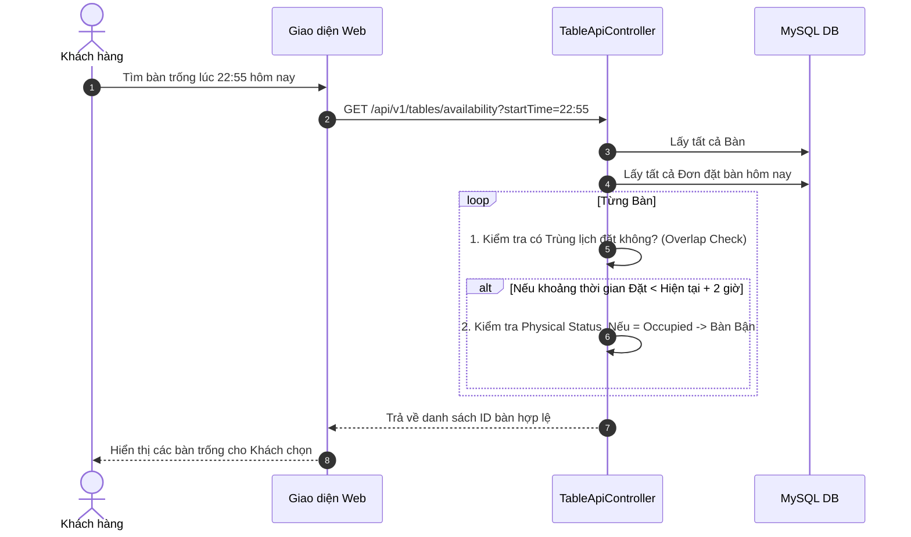

# Báo cáo Phân tích Luồng hoạt động UC15: Quản lý Bàn và Đặt Bàn Nhà Hàng (Table Management)

Tài liệu này giải thích chi tiết luồng xử lý của UC15 (Nghiệp vụ khách đặt bàn và quản lý trạng thái bàn) trong mã nguồn hiện tại của dự án Kawai Resort & Tour Hub, bao gồm các cập nhật mới nhất về việc **Kiểm tra Trùng lịch (Overlap Reservation)**, **Kiểm tra Trạng thái Vật lý Thực tế (Physical Status)** và các thay đổi giao diện trên POS.

---

## Danh sách các file được tạo mới hoặc chỉnh sửa

Trong quá trình giải quyết UC15, chúng ta đã can thiệp vào các tệp tin sau:

### Code Nghiệp vụ (Production Code)

1. **[MODIFY]** `com/kawai/controllers/api/TableApiController.java`: Cung cấp API `/api/v1/tables/availability` để tra cứu bàn trống và `/api/v1/tables/{id}/reservations` để lấy lịch trình của một bàn. Bổ sung logic chống trùng lịch và kiểm tra trạng thái vật lý thực tế của bàn trong khoảng thời gian cận giờ (< 2 tiếng). Sửa lỗi Time Wrap-around bằng `LocalDateTime`.
2. **[MODIFY]** `src/main/resources/data.sql`: Cập nhật dữ liệu test thực tế cho các bàn ở trạng thái `Occupied` và các bản ghi `TableReservation`.

### Giao diện (Frontend / Views)

3. **[MODIFY]** `src/main/resources/templates/f&bStaff/table-management.html`: Giao diện Quản lý bàn (Sơ đồ nhà hàng). Thêm Panel hiển thị chi tiết "Lịch trình hôm nay" của bàn khi click chọn. Loại bỏ các phần thừa của giao diện cũ.
4. **[MODIFY]** `src/main/resources/static/f&bStaff/js/table-management.js`: Bổ sung luồng gọi API lấy dữ liệu lịch trình của bàn và render động ra Side Panel trên giao diện sơ đồ bàn.
5. **[MODIFY]** `src/main/resources/templates/f&bStaff/create-food-order.html`: Màn hình Tạo đơn ăn tại bàn (Dine-In). Cập nhật danh sách chọn bàn (Dropdown) để phân loại rõ ràng Bàn Trống, Bàn Đã Đặt, và làm mờ (Disable) các Bàn Đang Bận (`Occupied`) do khách đang ngồi ăn thực tế.

---

## 1. Phía Backend: API Quản lý Bàn và Thuật toán Tính Khả dụng

Đây là cốt lõi của hệ thống chống Overbooking bàn nhà hàng.

### Bước 1.1: Chống trùng lịch (Overlap Check)

Khi có yêu cầu tìm bàn trống, Backend sẽ lấy tất cả lịch đặt của ngày hôm đó ra và so sánh khoảng thời gian (Start Time và End Time). Nếu khoảng thời gian mà khách hàng muốn đặt có sự giao thoa (Overlap) với bất kỳ một lịch đặt nào đã tồn tại, bàn đó sẽ bị loại khỏi danh sách trống.

### Bước 1.2: Thuật toán Kiểm tra Trạng thái Vật lý Cận giờ (Physical Status Check)

Một vấn đề trong thực tế: Bàn số 1 không có ai đặt trước vào lúc 22:55, nên thuật toán ở Bước 1.1 báo là bàn trống. Tuy nhiên, trên thực tế tại nhà hàng lúc 22:50, Bàn số 1 đang có khách ngồi ăn (trạng thái vật lý là `Occupied`). Do đó, nếu khách mới đặt bàn vào lúc 22:55, hệ thống phải chặn lại.

**Quy tắc (Business Rule):** Đối với các đơn đặt bàn trong cùng ngày hiện tại, nếu thời gian đặt cách thời điểm hiện tại dưới 2 tiếng (2 hours), hệ thống bắt buộc phải kiểm tra trạng thái vật lý của bàn. Nếu bàn đang `Occupied` hoặc `Cleaning`, lập tức báo bận.

### Bước 1.3: Vá lỗi Time Wrap-around Bug (Bug Kinh Điển)

**Vấn đề cũ:** Trong phiên bản trước, thuật toán dùng `LocalTime.now().plusHours(2)`. Nếu bây giờ là 22:50, cộng thêm 2 tiếng sẽ ra `00:50`. Hệ thống so sánh 22:55 với 00:50 thì theo chuẩn 24h, 22:55 > 00:50, dẫn đến kết quả sai (đáng lý ra phải là nhỏ hơn do 00:50 là của ngày hôm sau).
**Cập nhật mới:** Chuyển đổi toàn bộ logic sang dùng `LocalDateTime` để lấy cả ngày và giờ, đảm bảo phép so sánh thời gian vượt qua mốc nửa đêm (00:00) diễn ra chuẩn xác tuyệt đối.

---

## 2. Phía Frontend: Giao diện Quản lý (Table Management)

Trang Quản lý sơ đồ bàn cung cấp cái nhìn tổng quan cho Staff.

### Bước 2.1: Hiển thị Panel Lịch Trình (Side Panel)
Khi nhân viên click vào một bàn bất kỳ trên sơ đồ, một bảng điều khiển bên phải (Side Panel) sẽ hiện ra. Hệ thống sẽ gọi API `/api/v1/tables/{id}/reservations` bằng `fetch()` để lấy danh sách các đơn đặt bàn của bàn đó trong ngày hôm nay.
Điều này giúp nhân viên chủ động sắp xếp thời gian dọn dẹp hoặc mời khách nếu sắp tới giờ có người đặt.

### Bước 2.2: Trực quan hóa Bàn được chọn
Khi một bàn được chọn, giao diện sẽ kích hoạt lớp viền đậm `box-shadow` (`selected-table`) để làm nổi bật (Highlight) bàn đó, phân biệt rõ ràng với các bàn khác.

---

## 3. Phía Frontend: Giao diện Tạo Đơn (Create Food Order)

Trang Tạo Đơn (Dine-In) là nơi nhân viên bắt đầu phục vụ một nhóm khách mới đến.

### Tích hợp logic vật lý vào Dropdown Chọn Bàn
Khi sổ danh sách chọn bàn, các bàn được chia thành 3 nhóm rõ rệt:
1. **Bàn Sẵn Sàng (Trống / Đang dọn):** Những bàn mà khách có thể ngồi ngay lập tức.
2. **Bàn Đã Đặt (Reserved):** Những bàn đã có khách khác đặt trước trên hệ thống (Cần nhân viên kiểm tra kỹ giờ).
3. **Bàn Đang Bận:** Những bàn mà hệ thống nhận diện trạng thái vật lý đang là `Occupied`. Ở nhóm này, thẻ `<option>` sẽ bị thêm thuộc tính `disabled`, làm mờ đi và nhân viên không thể chọn nhầm để tạo đơn mới được nữa.

Điều này giải quyết triệt để lỗi vận hành "Tạo đơn đè lên bàn đang có khách".

---

## 4. Sơ đồ Data Flow (Luồng dữ liệu) Kiểm tra Khả dụng Bàn



---

## 5. Trích xuất và Giải thích Chi tiết Code (UC15) ở Từng File

Dưới đây là các đoạn mã nguồn (source code) quan trọng nhất liên quan trực tiếp đến luồng xử lý "Quản lý Bàn" của UC15, được trích xuất từ từng file và giải thích cặn kẽ ý nghĩa của từng dòng.

### 5.1. Tầng API - `TableApiController.java` (Logic Cận giờ và Chống trùng lịch)

```java
// File: src/main/java/com/kawai/controllers/api/TableApiController.java

1.  @GetMapping("/availability")
2.  public ResponseEntity<List<Long>> getAvailableTables(...) {
3.      // ...
4.      for (RestaurantTable table : allTables) {
5.          List<TableReservation> reservations = tableReservationRepository
6.                  .findByTable_IdAndReserveDateOrderByReserveTimeAsc(table.getId(), date);
7.          boolean isAvailable = true;
8.          
9.          // BƯỚC 1: KIỂM TRA TRÙNG LỊCH (OVERLAP CHECK)
10.         for (TableReservation res : reservations) {
11.             if ("Confirmed".equalsIgnoreCase(res.getStatus()) || "Pending".equalsIgnoreCase(res.getStatus())) {
12.                 LocalTime rStart = res.getReserveTime();
13.                 LocalTime rEnd = res.getEndTime() != null ? res.getEndTime() : rStart.plusHours(2);
14.                 
15.                 // So sánh thời gian giao thoa (Overlap logic)
16.                 if (rStart.isBefore(end) && rEnd.isAfter(start)) {
17.                     isAvailable = false;
18.                     break;
19.                 }
20.             }
21.         }
22.         
23.         // BƯỚC 2: KIỂM TRA TRẠNG THÁI VẬT LÝ CẬN GIỜ (PHYSICAL CHECK)
24.         if (isAvailable && date.equals(LocalDate.now())) {
25.             if ("Occupied".equalsIgnoreCase(table.getTableStatus()) || "Cleaning".equalsIgnoreCase(table.getTableStatus())) {
26.                 
27.                 // Fix Time wrap-around bug bằng cách dùng LocalDateTime kết hợp cả ngày và giờ
28.                 java.time.LocalDateTime startDateTime = java.time.LocalDateTime.of(date, start);
29.                 if (startDateTime.isBefore(java.time.LocalDateTime.now().plusHours(2))) {
30.                     isAvailable = false;
31.                 }
32.             }
33.         }
34. 
35.         if (isAvailable) {
36.             availableTableIds.add(table.getId());
37.         }
38.     }
39.     return ResponseEntity.ok(availableTableIds);
40. }
```

**Giải thích chi tiết:**
- **Dòng 5-6:** Lấy danh sách toàn bộ các lịch đặt bàn của Bàn hiện tại trong ngày hôm đó (sắp xếp theo thời gian sớm nhất).
- **Dòng 10-19:** Vòng lặp chống **Trùng Lịch (Overlap)**. Phép tính giao thoa kinh điển: Nếu Lịch cũ bắt đầu trước khi Lịch mới kết thúc `rStart < end` VÀ Lịch cũ kết thúc sau khi Lịch mới bắt đầu `rEnd > start`, thì 2 khoảng thời gian này giao nhau. Khi đó gán cờ `isAvailable = false` và thoát vòng lặp.
- **Dòng 24:** Nếu bước 1 thành công (Bàn vẫn trống) VÀ ngày khách đặt là hôm nay, tiến hành qua bước 2.
- **Dòng 28-30:** Khởi tạo `LocalDateTime` kết hợp cả ngày và giờ để xử lý triệt để lỗi Time wrap-around qua 00:00. So sánh `startDateTime` có nhỏ hơn `hiện tại + 2 tiếng` hay không. Nếu đúng là khách đang đặt gấp, kiểm tra trạng thái vật lý (`table.getTableStatus()`). Nếu bàn ngoài đời đang `Occupied` hoặc `Cleaning`, thì cờ `isAvailable` lập tức bị gán thành `false`, không cho khách đặt nữa.

### 5.2. Tầng API - `TableApiController.java` (Lấy dữ liệu cho Side Panel)

```java
// File: src/main/java/com/kawai/controllers/api/TableApiController.java

1.  @GetMapping("/{id}/reservations")
2.  public ResponseEntity<List<Map<String, Object>>> getTableReservations(
3.          @org.springframework.web.bind.annotation.PathVariable("id") Long tableId,
4.          @RequestParam(value = "date", required = false) String dateStr) {
5.      
6.      LocalDate date = (dateStr != null && !dateStr.isEmpty()) ? LocalDate.parse(dateStr) : LocalDate.now();
7.      List<TableReservation> reservations = tableReservationRepository
8.              .findByTable_IdAndReserveDateOrderByReserveTimeAsc(tableId, date);
9.      
10.     List<Map<String, Object>> result = new ArrayList<>();
11.     for (TableReservation res : reservations) {
12.         Map<String, Object> map = new HashMap<>();
13.         // ... map put các trường id, reserveDate, time, status, specialRequests ...
14.         if (res.getCustomer() != null) {
15.             map.put("customerName", res.getCustomer().getFullName());
16.         }
17.         result.add(map);
18.     }
19.     
20.     return ResponseEntity.ok(result);
21. }
```

**Giải thích chi tiết:**
- **Dòng 1-2:** Định nghĩa API lấy lịch trình riêng lẻ của 1 bàn, phục vụ tính năng click chuột hiển thị thông tin ở bên phải màn hình Sơ đồ nhà hàng.
- **Dòng 6-8:** Lấy dữ liệu đặt bàn theo ID của bàn. Mặc định là lấy ngày hôm nay (`LocalDate.now()`) nếu client không truyền tham số ngày lên.
- **Dòng 10-18:** Lặp và biến đổi Entity `TableReservation` thành một JSON dạng Map. Việc này giúp Backend giấu đi các trường nhạy cảm không cần thiết và linh hoạt hơn khi nối tên khách hàng từ bảng Customer sang.

### 5.3. Giao diện - `table-management.js` (Hiển thị Lịch trình động trên POS)

```javascript
// File: src/main/resources/static/f&bStaff/js/table-management.js

1.  document.querySelectorAll('.tm-table').forEach(table => {
2.    table.addEventListener('click', async function () {
3.      const tableId = parseInt(this.dataset.id);
4.      
5.      // ... code Highlight bàn đang chọn bằng class `selected-table`
6.      
7.      // Mở bảng điều khiển Side Panel và Load dữ liệu
8.      const scheduleList = document.getElementById('panel-schedule-list');
9.      scheduleList.innerHTML = `<div ...>Đang tải...</div>`;
10.     
11.     try {
12.       const response = await fetch(`/api/v1/tables/${tableId}/reservations`);
13.       const data = await response.json();
14.       
15.       if (!data || data.length === 0) {
16.         scheduleList.innerHTML = `<div>Không có lịch đặt nào hôm nay</div>`;
17.       } else {
18.         scheduleList.innerHTML = '';
19.         data.forEach(res => {
20.           const startTime = formatTime(res.reserveTime);
21.           const endTime = formatTime(res.endTime);
22.           
23.           const item = document.createElement('div');
24.           item.className = 'schedule-item';
25.           item.innerHTML = `
26.             <div class="schedule-item-time">${startTime} - ${endTime}</div>
27.             <div class="schedule-item-detail">
28.               <strong>${res.customerName}</strong> · ${res.partySize} khách
29.               ${res.specialRequests ? `<br><span>Ghi chú: ${res.specialRequests}</span>` : ''}
30.             </div>
31.           `;
32.           scheduleList.appendChild(item);
33.         });
34.       }
35.     } catch (err) {
36.       console.error(err);
37.       scheduleList.innerHTML = `<div>Lỗi tải dữ liệu</div>`;
38.     }
39.   });
40. });
```

**Giải thích chi tiết:**
- **Dòng 1-3:** Lắng nghe sự kiện `click` vào thẻ đại diện cho 1 Bàn trên màn hình Sơ đồ. Lấy ra ID của Bàn đó thông qua Data Attribute `data-id`.
- **Dòng 11-13:** Dùng `Fetch API` gọi lên tuyến đường backend đã khai báo ở mục 5.2. Chuyển đổi dữ liệu JSON trả về.
- **Dòng 19-33:** Vòng lặp duyệt qua tất cả các đặt bàn hôm nay. Sinh HTML động để đẩy vào Side Panel, hiển thị trực quan thông tin thời gian (đã format), Tên khách hàng, Số lượng khách, và cả Ghi chú (nếu có).

### 5.4. Giao diện Dropdown Chọn Bàn - `create-food-order.html` (Phân loại bàn)

```html
// File: src/main/resources/templates/f&bStaff/create-food-order.html

1.  <div class="form-group">
2.    <label class="form-label">Chọn Bàn / Khu vực</label>
3.    <select class="form-control">
4.      <option value="">-- Chọn Bàn --</option>
5.      
6.      <!-- Bàn Trống (Ready) -->
7.      <optgroup label="Bàn Sẵn Sàng (Trống / Đang dọn)">
8.        <option th:each="table : ${vacantTables}" 
9.                th:value="${table.id}" 
10.               th:text="'Bàn ' + ${#strings.replace(table.tableNumber, 'T', '')} + ' - Sức chứa: ' + ${table.capacity} + ' (' + ${tableAvailabilityText.get(table.id)} + ')'"></option>
11.     </optgroup>
12.     
13.     <!-- Bàn Đã Đặt Nhưng Khách Chưa Tới (Reserved) -->
14.     <optgroup label="Bàn Đã Đặt (Reserved)">
15.       <option th:each="table : ${reservedTables}" 
16.               th:value="${table.id}" 
17.               th:text="'Bàn ' + ${#strings.replace(table.tableNumber, 'T', '')} + ' - Sức chứa: ' + ${table.capacity} + ' (' + ${tableAvailabilityText.get(table.id)} + ')'"></option>
18.     </optgroup>
19.     
20.     <!-- Bàn Đang Có Khách Ngồi (Occupied) -->
21.     <optgroup label="Bàn Đang Bận">
22.       <option th:each="table : ${occupiedTables}" 
23.               th:value="${table.id}" 
24.               th:text="'Bàn ' + ${#strings.replace(table.tableNumber, 'T', '')} + ' - Đang phục vụ khách'" 
25.               disabled> <!-- CHIẾC CHÌA KHÓA NGĂN CHẶN LỖI -->
26.       </option>
27.     </optgroup>
28.     
29.   </select>
30. </div>
```

**Giải thích chi tiết:**
- **Dòng 8-18:** Thymeleaf lặp qua danh sách `vacantTables` và `reservedTables`. Sử dụng `#strings.replace` để định dạng tên bàn (Bỏ chữ 'T', ví dụ "T01" thành "Bàn 01"). Hiển thị thêm `capacity` và trạng thái phụ trợ từ `tableAvailabilityText` (vd: Sắp có khách lúc 19:00).
- **Dòng 22-26:** Vòng lặp lấy các bàn đang bận. Thẻ `<option>` thuộc nhóm này bị đính kèm thuộc tính cốt lõi là `disabled`. Thuộc tính này sẽ vô hiệu hóa lựa chọn, khiến tùy chọn bị làm mờ và nhân viên không thể bấm chọn. Qua đó, hệ thống ngăn chặn 100% rủi ro tạo nhầm đơn Dine-In đè lên một bàn đang có khách ngồi.

### 5.5. Cấu trúc chia đôi màn hình - `table-management.html` (Split-screen Layout)

```html
// File: src/main/resources/templates/f&bStaff/table-management.html

1.  <!-- Table Floor Plan & Side Panel Container -->
2.  <div class="tm-container">
3.  
4.    <!-- Sơ đồ tất cả các bàn (Bên trái) -->
5.    <div class="tm-floor-plan">
6.      <div class="tm-zone" style="padding-top: 10px;">
7.        <div class="tm-table-grid">
8.          <div class="tm-table" th:each="table : ${tables}"
9.               th:attr="data-id=${table.id}, data-table=${#strings.replace(table.tableNumber, 'T', '')}">
10.           <!-- Nội dung hiển thị bàn -->
11.         </div>
12.       </div>
13.     </div>
14.   </div><!-- / tm-floor-plan -->
15. 
16.   <!-- Bảng điều khiển Lịch trình (Side Panel - Bên phải) -->
17.   <aside class="tm-side-panel" id="tm-side-panel">
18.     <div class="side-panel-header">
19.       <h3 id="panel-table-name">Bàn --</h3>
20.       <div id="panel-table-cap">Sức chứa: --</div>
21.     </div>
22.     
23.     <div class="side-panel-schedule" style="flex:1;">
24.       <h4>Lịch trình hôm nay</h4>
25.       <!-- Khu vực sẽ được Javascript bơm dữ liệu vào -->
26.       <div id="panel-schedule-list" class="schedule-list" style="max-height: calc(100vh - 250px);">
27.         <div style="color:var(--text-muted);font-size:0.8rem;text-align:center;padding:20px 0;">Chọn bàn để xem lịch</div>
28.       </div>
29.     </div>
30.   </aside>
31. 
32. </div><!-- / tm-container -->
```

**Giải thích chi tiết:**
- **Dòng 2:** Lớp `tm-container` bao bọc cả 2 khu vực. Khi người dùng click vào một bàn, Javascript sẽ kích hoạt class CSS `split-active` cho vùng này, thu hẹp tỷ lệ của `tm-floor-plan` và mở rộng `tm-side-panel`.
- **Dòng 5:** `tm-floor-plan` là vùng chứa sơ đồ nhà hàng hiển thị tất cả các thẻ `tm-table`.
- **Dòng 17-30:** `tm-side-panel` là vùng bảng điều khiển bên phải. Bao gồm khu vực thông tin chung của bàn (Header) và khung cuộn `schedule-list`. Khung này chứa ID `panel-schedule-list` đóng vai trò là "mỏ neo" để Javascript gọi API lấy `TableReservation` nhúng HTML động vào.

### 5.6. Tầng Web Controller - `PosController.java` (Chuẩn bị dữ liệu cho Dropdown Chọn Bàn)

```java
// File: src/main/java/com/kawai/controllers/web/PosController.java

1.  @GetMapping("/create-food-order")
2.  public String createFoodOrder(Model model) {
3.      List<RestaurantTable> tables = restaurantTableRepository.findAll();
4.      
5.      // 1. Lọc bàn Trống / Đang dọn
6.      List<RestaurantTable> vacantTables = tables.stream()
7.              .filter(t -> "Vacant".equalsIgnoreCase(t.getTableStatus()) || "Cleaning".equalsIgnoreCase(t.getTableStatus()))
8.              .toList();
9.              
10.     // 2. Lọc bàn Đã Đặt
11.     List<RestaurantTable> reservedTables = tables.stream()
12.             .filter(t -> "Reserved".equalsIgnoreCase(t.getTableStatus()))
13.             .toList();
14.             
15.     // 3. Lọc bàn Đang Bận
16.     List<RestaurantTable> occupiedTables = tables.stream()
17.             .filter(t -> "Occupied".equalsIgnoreCase(t.getTableStatus()))
18.             .toList();
19. 
20.     // 4. Quét lịch đặt bàn hôm nay để tạo chuỗi văn bản phụ trợ
21.     Map<Long, String> tableAvailabilityText = new HashMap<>();
22.     LocalDate today = LocalDate.now();
23.     LocalTime now = LocalTime.now();
24. 
25.     for (RestaurantTable table : vacantTables) {
26.         List<TableReservation> reservations = tableReservationRepository
27.                 .findByTable_IdAndReserveDateOrderByReserveTimeAsc(table.getId(), today);
28.         String availability = "Trống cả ngày";
29.         for (TableReservation res : reservations) {
30.             if (("Confirmed".equalsIgnoreCase(res.getStatus()) || "Pending".equalsIgnoreCase(res.getStatus())) 
31.                     && res.getReserveTime().isAfter(now)) {
32.                 availability = "Trống đến " + res.getReserveTime().toString();
33.                 break;
34.             }
35.         }
36.         if ("Cleaning".equalsIgnoreCase(table.getTableStatus())) {
37.             availability = "Đang dọn - " + availability;
38.         }
39.         tableAvailabilityText.put(table.getId(), availability);
40.     }
41.     
42.     // ... lặp tương tự cho reservedTables
43.     
44.     model.addAttribute("vacantTables", vacantTables);
45.     model.addAttribute("reservedTables", reservedTables);
46.     model.addAttribute("occupiedTables", occupiedTables);
47.     model.addAttribute("tableAvailabilityText", tableAvailabilityText);
48. 
49.     return "f&bStaff/create-food-order";
50. }
```

**Giải thích chi tiết:**
- **Dòng 5-18:** Phân luồng dữ liệu thô từ Database thành 3 danh sách riêng biệt (`vacantTables`, `reservedTables`, `occupiedTables`) để đẩy xuống giao diện. Điều này giúp code HTML Thymeleaf ở Mục 5.4 sạch sẽ và không phải chứa logic phức tạp.
- **Dòng 25-39:** Backend chủ động duyệt qua tất cả các đơn đặt bàn trong ngày. Nếu bàn tuy đang "Trống" nhưng lại có người đặt vào buổi chiều (ví dụ 18:00), hệ thống sẽ tính toán và xuất ra chuỗi `Trống đến 18:00` thay vì `Trống cả ngày`. Chuỗi này được lưu vào Map `tableAvailabilityText` để nhân viên dễ dàng tư vấn cho khách hàng.

### 5.7. Tầng Web Controller - `PosController.java` (Chuẩn bị dữ liệu cho Sơ đồ Bàn)

```java
// File: src/main/java/com/kawai/controllers/web/PosController.java

1.  @GetMapping("/table-management")
2.  public String tableManagement(Model model) {
3.      List<RestaurantTable> tables = restaurantTableRepository.findAll();
4.      
5.      // Lấy các Đơn Hàng ăn tại bàn đang diễn ra
6.      List<FoodOrder> activeOrders = foodOrderRepository.findAll().stream()
7.              .filter(o -> ("Dine-In".equalsIgnoreCase(o.getOrderType()) || "Dine In".equalsIgnoreCase(o.getOrderType()) || "Table".equalsIgnoreCase(o.getOrderType()))
8.                      && ("Pending".equalsIgnoreCase(o.getOrderStatus()) || "Preparing".equalsIgnoreCase(o.getOrderStatus()) || "Served".equalsIgnoreCase(o.getOrderStatus())))
9.              .toList();
10. 
11.     // Map dữ liệu ID Bàn <-> ID Đơn hàng
12.     Map<Long, Long> tableActiveOrderMap = new HashMap<>();
13.     for (FoodOrder order : activeOrders) {
14.         if (order.getTable() != null) {
15.             tableActiveOrderMap.put(order.getTable().getId(), order.getId());
16.         }
17.     }
18.     
19.     model.addAttribute("tables", tables);
20.     model.addAttribute("tableActiveOrderMap", tableActiveOrderMap);
21.     return "f&bStaff/table-management";
22. }
```

**Giải thích chi tiết:**
- Tuyến đường này chịu trách nhiệm cấp dữ liệu cho màn hình `table-management.html` ở Mục 5.5.
- Để sơ đồ bàn biết được bàn nào đang có khách và mã đơn hàng của khách đó là gì, hệ thống dùng `filter` lọc ra tất cả các hóa đơn (FoodOrder) đang ở trạng thái Pending, Preparing, hoặc Served.
- Hàm trả về `tableActiveOrderMap` chứa bộ Key-Value là `[ID Bàn] -> [ID Đơn Hàng]`. Bộ Map này rất quan trọng để hệ thống biết chính xác Bàn số 2 đang ăn Đơn số mấy (từ đó điều hướng sang trang Chi tiết Đơn khi click).
